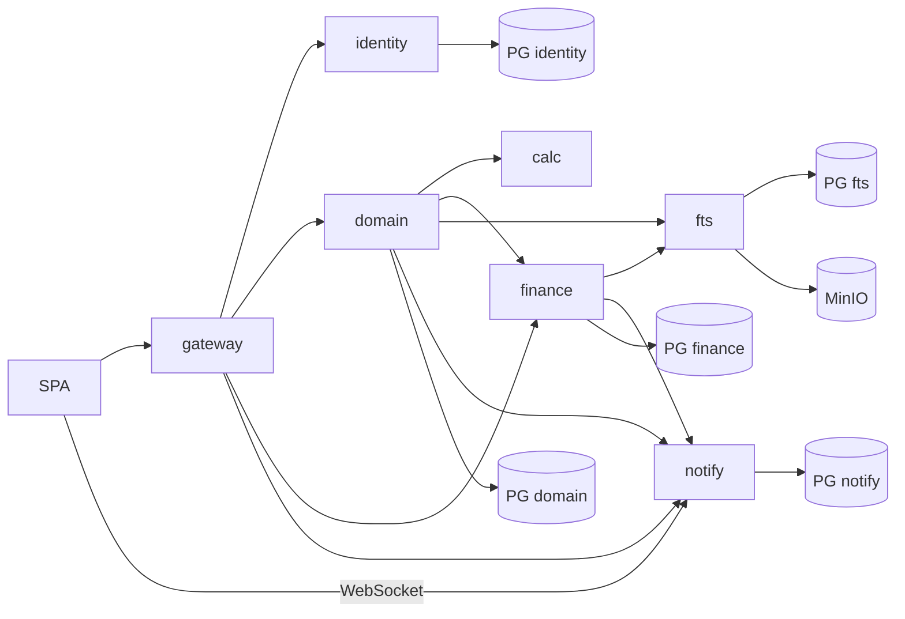

# Project Portfolio Optimizer — архитектура приложения

> Версия 2.0 · 2026-11-15 · Канон для реализации и пояснительной записки  
> Согласовано с: `02_DATABASE_Portfolio_Optimizer.md`  
> Краткая копия решений: `docs/architecture/ARCHITECTURE.md`  
> `docs/planning/PROJECT-BRIEF.md` — входной контекст (исторические фрагменты про core помечены устаревшими)

## 0. Назначение

Документ фиксирует границы системы, процессы, контракты, данные, алгоритмы и порядок реализации.  
Система **не** заменяет ERP: ведёт реестр инициатив, методики оценки, экспертные заключения, сценарии портфеля и решения. Финансы приходят импортом и фиксируются снимками.

### 0.1 Термины

| Термин | Значение |
|--------|----------|
| Проект | Зарегистрированная инициатива с атрибутами, оценками и финансовым профилем |
| Критерий / модель | Измерение привлекательности; версионируемый набор весов и направлений |
| Финансовый снимок | Неизменяемый набор потоков, использованный в расчётах |
| Сценарий | Кандидаты + бюджет + ограничения для отбора |
| Запуск (run) | Воспроизводимый расчёт 0-1 с зафиксированными входами |
| Согласование | Утверждение/отклонение выбранного запуска ЛПР |

### 0.2 Границы

**Входит:** реестр, справочники, оценки (SAW), импорт финансов/NPV, оптимизация состава, сравнение запусков, утверждение, отчёты, аудит, in-app/WS/email-уведомления.

**Не входит:** бухгалтерия, зарплата, закупки, календарь задач, исполнение работ.

### 0.3 Принятые решения (ARCH)

| ID | Решение |
|----|---------|
| ARCH-01 | **7** backend-процессов + SPA: gateway, identity, **domain**, finance, calc, fts, **notify**; без Kafka/K8s |
| ARCH-02 | ~~Modulith-core~~ и ~~дробление project/scoring/portfolio~~ **отменены**. Реестр + оценка + решение = один процесс `domain` (пакеты, не сервисы) |
| ARCH-03 | Finance — доменный сервис: parse + NPV **и** хранение импортов/снимков/потоков |
| ARCH-04 | Async job оптимизации — в **domain**; calc синхронный и stateless |
| ARCH-05 | Сервис = Spring Boot + `libs/` + OpenAPI; клиенты генерируются у потребителя |
| ARCH-06 | FTS — единственная обёртка MinIO; остальные работают с `fileId` |
| ARCH-07 | Spring Cloud Gateway — край: маршруты, CORS, rate-limit login, ранняя проверка JWT |
| ARCH-08 | Одна PostgreSQL, schema-per-service; кросс-схемные UUID **без FK** |
| ARCH-09 | **notify** — WebSocket на фронт + email (stub/SMTP); доставка не откатывает бизнес-транзакцию |
| ARCH-10 | **calc** ≠ scoring: scoring — данные в `domain`; calc — только формулы без БД |

---

## 1. Обзор

### 1.1 Почему так резали

Критерий процесса — **другая ответственность / канал I/O / граница сбоя**, а не «существительное из ТЗ».

| Процесс | Зачем отдельно |
|---------|----------------|
| identity | Выдача JWT, IAM; смена auth не трогает домен |
| domain | Один предметный контур: проект → оценка → сценарий → run → approve |
| finance | Владелец финансового факта + парсинг |
| calc | CPU-математика без состояния; общий клиент для SAW и 0-1 |
| fts | Единственный доступ к объектному хранилищу |
| notify | Другой канал: WS + email; сбой доставки ≠ откат approve |
| gateway | Край, без домена |

**Почему domain не дробим дальше:** проект и портфель — один сценарий; scoring (хранение критериев/оценок) неразрывно связан с run. Отдельные `project` / `scoring` / `portfolio` давали бы лишний HTTP и UUID-ссылки без выигрыша для КП.

**Почему calc не в domain:** чистые формулы тестируются оракулами без БД; один бинарь обслуживает и SAW, и рюкзак; падение БД domain не обязано ронять solver.

### 1.2 Контейнеры

```text
browser ──► nginx :80 (SPA; /api/** → gateway; /ws/** → notify)
                 │
                 ▼
          gateway :8090
           ├─ /api/v1/auth|users|admin/**    → identity :8080   PG(identity)
           ├─ /api/v1/reference|projects|
           │    criteria|scoring-models|
           │    assessments|scores|
           │    scenarios|runs|approvals|
           │    reports|audit               → domain   :8084   PG(domain)
           │         ├─► calc :8081
           │         ├─► finance, fts
           │         └─► notify (события)
           ├─ /api/v1/finance/**             → finance  :8082   PG(finance) ─► fts
           └─ /api/v1/notifications/**       → notify   :8087   PG(notify)
                    (WS: nginx → notify напрямую)

          calc :8081   stateless, без БД
          fts  :8083   MinIO + PG(fts)   только docker-сеть
```



### 1.3 Ответственность сервисов

| Сервис | Делает | Не делает |
|--------|--------|-----------|
| **frontend** | UI, подписка на WS | Бизнес-логику, формулы |
| **gateway** | Маршруты, CORS, JWT check, rate-limit login | Выдачу токенов, домен |
| **identity** | Users, roles (1:N via role_id), block, login/refresh/logout, **выдача JWT** | Проекты/портфель |
| **domain** | Справочники, проекты, связи, вложения; критерии/модели/оценки/баллы; сценарии, jobs, approve, отчёты, audit_log | Парсинг XLSX, байты файлов, SMTP/WS |
| **finance** | Импорт через FTS, ошибки, publish snapshot, cash_flows, NPV | Оптимизацию, пользователей |
| **calc** | SAW; бинарная 0-1 оптимизация | Хранение |
| **fts** | Upload/метаданные/soft-delete/presigned URL | Домен |
| **notify** | In-app записи, WebSocket push, email stub/SMTP | Бизнес-правила портфеля |

Безопасность: gateway — ранняя проверка; каждый сервис валидирует JWT через `common-security`. Межсервисные вызовы передают токен пользователя. Наружу — nginx.

### 1.4 Пакеты внутри domain

```text
com.portfolio.domain
  reference/    departments, budget_periods, strategic_goals
  project/      projects, links, goals, attachments → FtsClient
  scoring/      criteria, models, weights, assessments, scores → CalcClient.saw
  portfolio/    scenarios, runs (job), approvals, reports → CalcClient.binary, FinanceClient, FtsClient
  audit/        audit_log (локальный журнал критичных действий domain)
  shared/       Money/BigDecimal, клиенты, ошибки
```

Межпакетно — через application-сервисы пакета, без лезания в чужие репозитории. Modulith-verify **не** обязателен; границы — дисциплина пакетов + code review.

---

## 2. Стек

| Слой | Выбор | Заметка |
|------|-------|---------|
| Backend | Java 25, Spring Boot 4.1.x | Как в репозитории |
| API | OpenAPI contract-first | `contracts/openapi/*` |
| ORM / миграции | JPA + Flyway | schema-per-service |
| БД | PostgreSQL 17 (compose) | один инстанс; совместимо с 16+ |
| Файлы | MinIO через FTS | |
| Gateway | Spring Cloud Gateway Server WebMVC | servlet + common-security |
| Frontend | React + TypeScript | nginx |
| Уведомления | Spring WebSocket (STOMP или raw) + JavaMail stub | сервис notify |
| Тесты | JUnit, MockMvc, Testcontainers | |
| Деплой | Docker Compose | без K8s |

Деньги/веса/баллы — `BigDecimal` / строки в JSON. Ошибки — RFC 9457 Problem Details.

---

## 3. Конструктор сервиса

```text
libs/
  common-security   JWT validate-only, 401/403 Problem Details, method security
  common-web        BaseEntity, CRUD helpers, RSQL

contracts/openapi/
  identity-v1, domain-v1, finance-v1, calc-v1, fts-v1, notify-v1

services/<name>/
  <name>-api
  <name>-impl
```

1. Сначала контракт, потом код.  
2. Клиент к чужому сервису — generator **в потребителе**.  
3. Новая lib — только при втором реальном потребителе.  
4. Dockerfile на сервис; `infra/docker-compose.yml`.

---

## 4. API и маршруты gateway

| Префикс | Сервис | JWT |
|---------|--------|-----|
| `/api/v1/auth/**` | identity | нет (rate-limit на login) |
| `/api/v1/users/**` | identity | да |
| `/api/v1/admin/**` | identity | да (`ADMIN`) |
| `/api/v1/reference/**`, `/api/v1/projects/**` | domain | да |
| `/api/v1/criteria/**`, `/api/v1/scoring-models/**` | domain | да |
| `/api/v1/assessments/**`, `/api/v1/scores/**` | domain | да |
| `/api/v1/scenarios/**`, `/api/v1/runs/**`, `/api/v1/approvals/**`, `/api/v1/reports/**`, `/api/v1/audit/**` | domain | да |
| `/api/v1/finance/**` | finance | да |
| `/api/v1/notifications/**` | notify | да |
| `/api/v1/files/**` | — | 404 (внутренний FTS) |
| `/ws/**` | notify (через nginx) | JWT при handshake |

**Публичные контракты (уточнение):**

| Метод / путь | Назначение |
|--------------|------------|
| `GET/PUT /api/v1/admin/users/**` | Admin: список, смена `role_id`, block/unblock |
| `GET /api/v1/approvals` | Inbox ЛПР (pending / фильтр) |
| `POST /api/v1/scenarios/{id}/approvals` | Решение по конкретному run сценария → `domain.approvals` |

**Не на gateway (только docker-сеть):** `calc`, `fts`, `notify` `/internal/**`, `domain` `/internal/**`.

### Внутренние контракты

**domain → calc**

| POST | Назначение |
|------|------------|
| `/v1/scoring/saw` | веса + матрица → баллы + вклад; без silent zero |
| `/v1/optimization/binary` | баллы, стоимости, бюджет, mandatory/forbidden, связи → набор, OPTIMAL/INFEASIBLE |

**finance** — публичный `/api/v1/finance/imports|snapshots`; внутри себя читает файл из FTS и считает NPV.

**→ fts** — POST/GET/DELETE files, content, download-url; вызывают domain и finance.

**→ notify** — `POST /internal/v1/events` (из domain/finance **после** commit, fire-and-forget): тип события, userIds, payload.  
Публично: список/прочитано; WS push подписчикам.  
Auth internal: тот же user JWT **или** общий `INTERNAL_API_KEY` (заголовок); без ключа/JWT — 401.

**STALE (BR-10/23) — владелец только domain:**

| Триггер | Как |
|---------|-----|
| Смена весов / модели | В том же процессе domain: runs сценариев на этой модели → `STALE` + notify |
| Publish нового snapshot | Finance **не** трогает runs. Domain при GET scenario/runs и перед start run сверяет `scenarios.financial_snapshot_id` с актуальным published snapshot; при расхождении → `STALE` (lazy). Опционально W5: finance afterCommit → `POST domain/internal/v1/events/snapshot-published` для eager |

---

## 5. Сквозной сценарий

```text
1. Login → identity → JWT (+ refresh cookie Path=/api/v1/auth)
2. Импорт XLSX → finance → FTS(fileId) → parse → import_session/errors
   → publish → financial_snapshot + cash_flows → NPV
   → afterCommit → notify (IMPORT_PUBLISHED / IMPORT_FAILED)
3. Эксперты → domain.scoring → calc/saw → project_scores
4. Сценарий + POST /runs → 202 + optimization_runs(QUEUED)
   domain @Async: локальные scores/links + snapshot из finance
   → calc/binary → run_items + audit_log → afterCommit → notify (RUN_COMPLETED)
   (рестарт mid-job: run в QUEUED/RUNNING → FAILED при старте / ручной retry)
5. ЛПР: `POST /api/v1/scenarios/{id}/approvals` → `approvals` + отчёт в FTS → afterCommit → notify (SCENARIO_APPROVED) → WS/email
6. Смена весов → domain сразу STALE; смена снимка → domain STALE lazy (см. §4)
```

---

## 6. Данные (логика)

Одна PostgreSQL, схемы по сервисам. Детали полей — `02_DATABASE_Portfolio_Optimizer.md`.

| Схема | Владелец | Таблицы |
|-------|----------|---------|
| `identity` ✔ | identity | users, roles, refresh_sessions |
| `domain` | domain | departments, budget_periods, strategic_goals, projects, project_goals, project_links, project_attachments, criteria, scoring_models, model_weights, assessments, project_scores, scenarios, scenario_items, optimization_runs, run_items, approvals, reports, audit_log |
| `finance` | finance | import_sessions, import_errors, financial_snapshots, cash_flows |
| `notify` | notify | notifications, delivery_attempts |
| `fts` ✔ | fts | files |
| — | calc | нет |

Ссылки `fileId` / `userId` / `snapshotId` между схемами — без FK.

---

## 7. Роли

| Код | Предметные роли КП |
|-----|--------------------|
| `INITIATOR` | Инициатор, руководитель проекта |
| `EXPERT_ANALYST` | Эксперт, фин. аналитик, менеджер портфеля |
| `DECISION_MAKER` | ЛПР / член комитета |
| `ADMIN` | Системный администратор |

Роли — справочник `identity.roles`; у пользователя одна роль (`users.role_id`, связь 1:N). Коды совпадают с enum API. Таблица `permissions` / `user_roles` в v1 не вводятся: проверка через JWT и `@PreAuthorize`.

---

## 8. Алгоритмы (для ПЗ / DOC-437)

1. **NPV** — в finance из cash_flows (`BigDecimal`, явная ставка).  
2. **SAW** — в calc: нормализация min-max, веса Σ=1, вклад критерия; пропуск значения = ошибка.  
3. **0-1 отбор** — в calc (своя ДП / branch-and-bound, n≈30); domain делает постпроверку ограничений и пишет run.

Воспроизводимость: `optimization_runs.input_snapshot` (JSONB) + версии модели/алгоритма.

---

## 9. Notify подробно

| Канал | Поведение v1 |
|-------|----------------|
| In-app | Строка в `notifications`; REST list/mark-read |
| WebSocket | Push после insert; reconnect + догрузка missed |
| Email | Stub (лог) или SMTP; статус в `delivery_attempts` |

Провайдеры событий: domain, finance — только **afterCommit** (или эквивалент), HTTP к notify fire-and-forget.  
Сбой SMTP/WS **не** откатывает бизнес-транзакцию (FR-18).

Два уровня доставки:

1. **domain/finance → notify:** best-effort после commit; при необходимости усиления — outbox-таблица **у продюсера** (не в notify). В v1 outbox у продюсера не обязателен (YAGNI).
2. **notify → email/WS:** статусы в `delivery_attempts`; ретраи email внутри notify.

---

## 10. Качество и ошибки

- Ошибка calc/finance → явный Problem Details пользователю (не «пустой портфель»).  
- Идемпотентность: ключ на publish import и start run.  
- STALE при смене весов/снимка (BR-10/23).  
- Audit критичных действий пишется в `domain.audit_log`; уведомления — отдельно в notify.

---

## 11. Порядок реализации

| Wave | Содержание |
|------|------------|
| W1 | Канон-доки ✔; identity ✔ (в т.ч. `/admin/users`); gateway → domain/notify ✔; каркасы `domain`+`notify`+`calc` ✔; core/project/scoring/portfolio удалены |
| W2 | fts ✔; calc SAW+0-1; domain reference+projects |
| W3 | domain scoring → calc |
| W4 | finance import/snapshot/NPV ✔ (миграции + каркас API; полный parse/NPV — довести) |
| W5 | domain portfolio: job, approve (`/approvals`), STALE, audit |
| W6 | notify WS+email stub; UI; отчёты в FTS |

Откат по срокам: notify оставить polling-only в domain; calc/fts/finance/identity не сливать обратно в один JAR без нужды (REQ-INT ≥2 компонента уже закрыт).

---

## 12. Открытые вопросы

| ID | Статус |
|----|--------|
| DEC-MATH-02 решатель 0-1 | ✔ своя ДП в calc |
| DEC-MATH-01 TOPSIS | позже отдельным endpoint calc |
| Q-DOM-02/05 периоды/валюты | ✔ v1: один бюджет, одна валюта |
| BOOT-ADMIN | seed admin на пустой БД (сейчас Flyway-seed) |
| WS через gateway vs nginx | ✔ **принято:** nginx → notify для `/ws/**` |
| Email SMTP | stub до W6; контракт `delivery_attempts` сразу |
| STALE после publish | ✔ lazy в domain; eager internal — опционально W5 |

---

## 13. Критерий согласованности

Архитектура согласована, если: (1) у каждого API есть владелец-сервис; (2) у каждой таблицы — одна схема-владелец; (3) domain не дробятся на лишние процессы; (4) calc без БД; (5) файлы только через FTS; (6) notify не ломает бизнес-транзакции; (7) термины совпадают с БД и BPMN.
