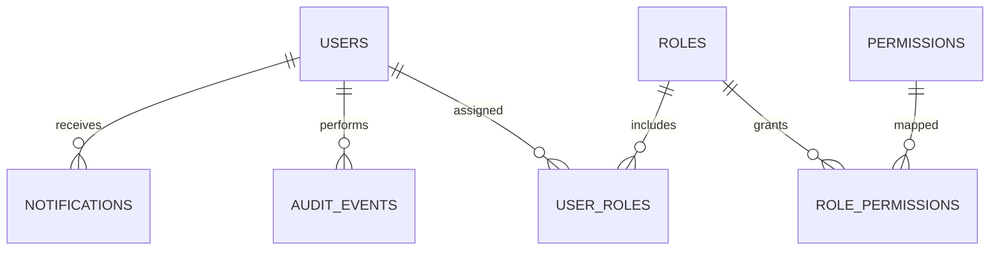
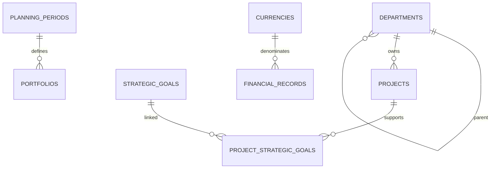
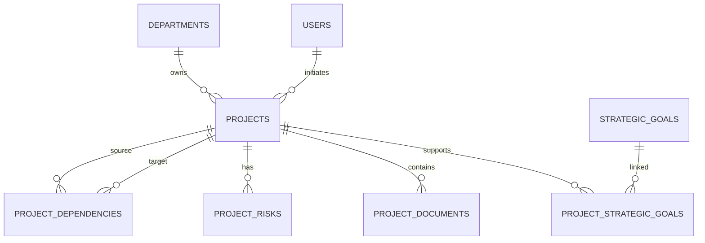
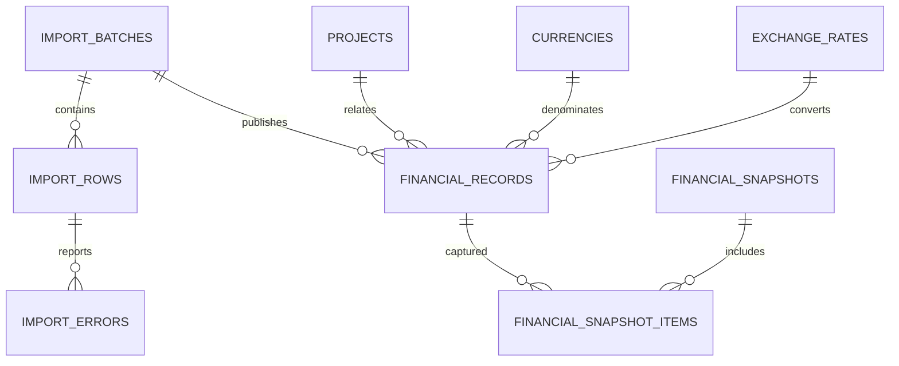
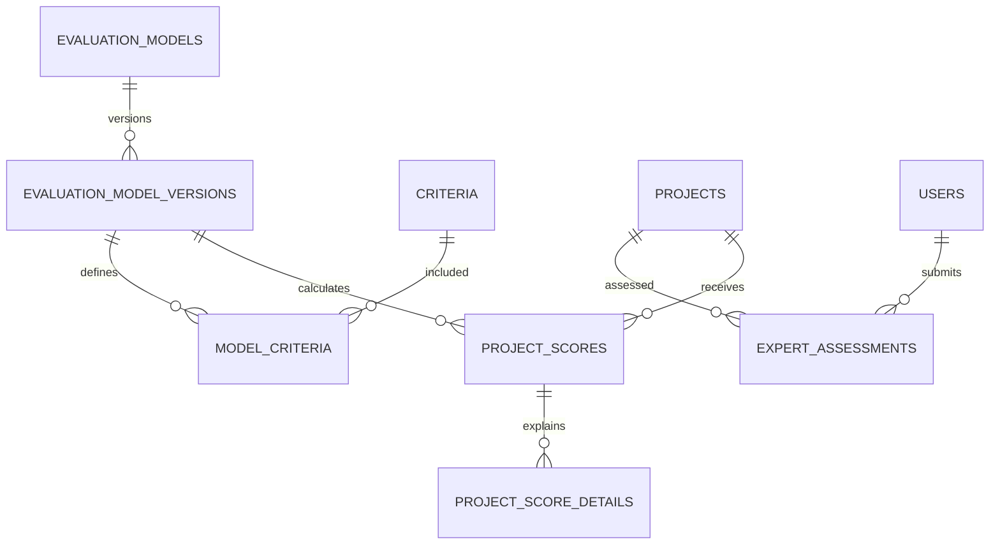
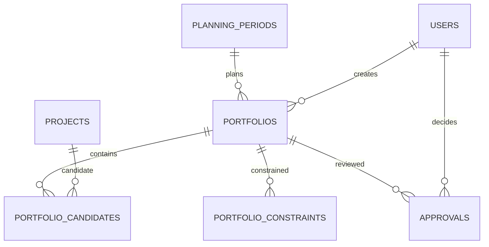
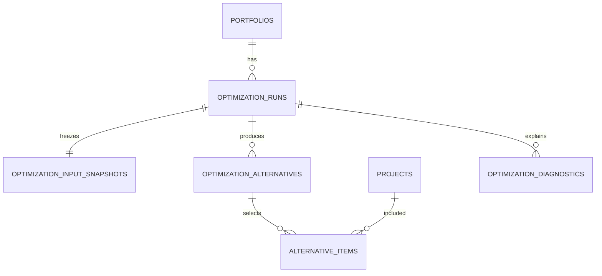

# Project Portfolio Optimizer — база данных, сущности и хранимые данные

> Версия 1.0 · PostgreSQL 16+ · Проектная схема данных для реализации  
> Согласованный документ: `01_ARCHITECTURE_Portfolio_Optimizer.md`

## 0. Принципы проектирования

База данных является транзакционным источником истины для реестра проектов, финансовых снимков, методик оценки, портфелей, запусков оптимизации и решений. Исходные файлы сохраняются отдельно в файловом хранилище; в БД хранятся метаданные, контрольные суммы и ссылки.

Для учебной реализации используется одна физическая БД PostgreSQL с логическими схемами. Это не означает, что схема является микросервисной базой с отдельным владельцем процесса: границы модулей обеспечиваются кодом и правами доступа.

### 0.1 Соглашения

- PK всех основных сущностей — `UUID`.
- Время — `TIMESTAMPTZ`, даты планирования — `DATE`.
- Денежные суммы — `NUMERIC(19,4)`; проценты/коэффициенты — `NUMERIC(12,6)`.
- Статусы — `VARCHAR` с `CHECK` либо PostgreSQL ENUM. В этом проекте используется `VARCHAR + CHECK`, чтобы миграции статусов были проще.
- Для изменяемых бизнес-сущностей используются `created_at`, `updated_at`, `version`.
- Для мягкого удаления применяется `archived_at`, а не физическое удаление финансовых и утверждённых данных.
- JSONB используется для параметров solver и технических диагностик, но не вместо нормализованных связей.
- Все FK между схемами физические, так как используется одна БД.
- Уникальные бизнес-коды имеют `UNIQUE`.
- Для финансовых фактов запрещено использовать `FLOAT/DOUBLE PRECISION`.

### 0.2 Логические схемы

| Схема | Назначение |
|---|---|
| `iam` | пользователи, роли и разрешения |
| `org` | подразделения, стратегические цели, периоды, валюты |
| `project` | проекты, зависимости, риски, документы |
| `finance` | импорт, ошибки, курсы, финансовые факты и снимки |
| `evaluation` | критерии, версии моделей, веса, экспертные оценки, баллы |
| `portfolio` | портфели, кандидаты, ограничения, согласования |
| `optimization` | запуски, снимки входов, альтернативы, выбранные проекты |
| `analytics` | KPI и сохранённые отчёты |
| `audit` | аудит действий |
| `notify` | уведомления и попытки доставки |

## 1. Перечисления и справочные значения

### 1.1 Статусы проекта

`DRAFT`, `SUBMITTED`, `UNDER_REVIEW`, `EVALUATED`, `APPROVED_FOR_PORTFOLIO`, `REJECTED`, `RETURNED_FOR_REVISION`, `ARCHIVED`.

### 1.2 Статусы импорта

`UPLOADED`, `PARSING`, `VALIDATING`, `READY_FOR_REVIEW`, `PUBLISHED`, `COMPLETED_WITH_ERRORS`, `REJECTED`, `FAILED`.

### 1.3 Статусы портфеля

`DRAFT`, `READY_FOR_OPTIMIZATION`, `OPTIMIZING`, `OPTIMIZED`, `IN_REVIEW`, `APPROVED`, `REJECTED`, `ARCHIVED`.

### 1.4 Статусы запуска

`QUEUED`, `RUNNING`, `OPTIMAL`, `FEASIBLE`, `INFEASIBLE`, `TIME_LIMIT`, `FAILED`, `CANCELLED`, `STALE`.

### 1.5 Направление критерия и типы

- `MAX` — большее значение предпочтительнее.
- `MIN` — меньшее значение предпочтительнее.
- Тип значения: `NUMBER`, `PERCENT`, `CURRENCY`, `INTEGER`, `RATING`.
- Нормализация: `MIN_MAX`, `RATIO`, `MANUAL_SCALE`.
- Тип ограничения: `TOTAL_BUDGET`, `PERIOD_BUDGET`, `MIN_PROJECTS`, `MAX_PROJECTS`, `MANDATORY`, `FORBIDDEN`, `DEPENDENCY`, `MUTUAL_EXCLUSION`, `DEPARTMENT_LIMIT`, `STRATEGIC_QUOTA`.

## 2. Схема `iam` — пользователи и доступ

### 2.1 ER-диаграмма



### 2.2 DDL

```sql
CREATE SCHEMA IF NOT EXISTS iam;

CREATE TABLE iam.users (
  id UUID PRIMARY KEY DEFAULT gen_random_uuid(),
  email VARCHAR(255) NOT NULL UNIQUE,
  password_hash VARCHAR(255) NOT NULL,
  full_name VARCHAR(200) NOT NULL,
  is_active BOOLEAN NOT NULL DEFAULT TRUE,
  last_login_at TIMESTAMPTZ,
  created_at TIMESTAMPTZ NOT NULL DEFAULT now(),
  updated_at TIMESTAMPTZ NOT NULL DEFAULT now(),
  version BIGINT NOT NULL DEFAULT 0
);

CREATE TABLE iam.roles (
  id UUID PRIMARY KEY DEFAULT gen_random_uuid(),
  code VARCHAR(60) NOT NULL UNIQUE,
  name VARCHAR(120) NOT NULL,
  description TEXT,
  created_at TIMESTAMPTZ NOT NULL DEFAULT now()
);

CREATE TABLE iam.permissions (
  id UUID PRIMARY KEY DEFAULT gen_random_uuid(),
  code VARCHAR(100) NOT NULL UNIQUE,
  description TEXT
);

CREATE TABLE iam.user_roles (
  user_id UUID NOT NULL REFERENCES iam.users(id) ON DELETE CASCADE,
  role_id UUID NOT NULL REFERENCES iam.roles(id) ON DELETE RESTRICT,
  assigned_at TIMESTAMPTZ NOT NULL DEFAULT now(),
  assigned_by UUID REFERENCES iam.users(id) ON DELETE SET NULL,
  PRIMARY KEY (user_id, role_id)
);

CREATE TABLE iam.role_permissions (
  role_id UUID NOT NULL REFERENCES iam.roles(id) ON DELETE CASCADE,
  permission_id UUID NOT NULL REFERENCES iam.permissions(id) ON DELETE CASCADE,
  PRIMARY KEY (role_id, permission_id)
);

CREATE INDEX idx_users_active ON iam.users(is_active);
CREATE INDEX idx_user_roles_role ON iam.user_roles(role_id);
```

### 2.3 Правила

- Email хранится в нормализованном виде в lowercase.
- Пароль хранится только как адаптивный хеш.
- Удаление пользователя, участвовавшего в согласовании или аудите, не допускается; используется блокировка `is_active=false`.
- Роль `SYSTEM_ADMIN` нельзя удалить, если она назначена активным пользователям.
- FK `assigned_by` допускает NULL, если назначение создано системной миграцией.

## 3. Схема `org` — организационная структура и планирование

### 3.1 ER-диаграмма



### 3.2 DDL

```sql
CREATE SCHEMA IF NOT EXISTS org;

CREATE TABLE org.departments (
  id UUID PRIMARY KEY DEFAULT gen_random_uuid(),
  code VARCHAR(40) NOT NULL UNIQUE,
  name VARCHAR(200) NOT NULL,
  parent_id UUID REFERENCES org.departments(id) ON DELETE RESTRICT,
  is_active BOOLEAN NOT NULL DEFAULT TRUE,
  created_at TIMESTAMPTZ NOT NULL DEFAULT now(),
  CHECK (parent_id IS NULL OR parent_id <> id)
);

CREATE TABLE org.strategic_goals (
  id UUID PRIMARY KEY DEFAULT gen_random_uuid(),
  code VARCHAR(50) NOT NULL UNIQUE,
  name VARCHAR(200) NOT NULL,
  description TEXT,
  priority INTEGER NOT NULL DEFAULT 1 CHECK (priority > 0),
  is_active BOOLEAN NOT NULL DEFAULT TRUE
);

CREATE TABLE org.planning_periods (
  id UUID PRIMARY KEY DEFAULT gen_random_uuid(),
  code VARCHAR(40) NOT NULL UNIQUE,
  name VARCHAR(120) NOT NULL,
  starts_on DATE NOT NULL,
  ends_on DATE NOT NULL,
  status VARCHAR(20) NOT NULL DEFAULT 'OPEN'
    CHECK (status IN ('DRAFT','OPEN','CLOSED')),
  CHECK (ends_on >= starts_on)
);

CREATE TABLE org.currencies (
  code CHAR(3) PRIMARY KEY,
  name VARCHAR(100) NOT NULL,
  minor_units SMALLINT NOT NULL DEFAULT 2 CHECK (minor_units BETWEEN 0 AND 4),
  is_active BOOLEAN NOT NULL DEFAULT TRUE
);
```

### 3.3 Содержание и ограничения

`departments` задаёт иерархию подразделений. Циклическая иерархия запрещается сервисной проверкой при изменении `parent_id`. `strategic_goals` содержит цели предприятия, к которым могут относиться проекты. `planning_periods` определяет горизонт портфельного планирования. Валюта хранится ISO-кодом.

## 4. Схема `project` — реестр проектов

### 4.1 ER-диаграмма



### 4.2 DDL

```sql
CREATE SCHEMA IF NOT EXISTS project;

CREATE TABLE project.projects (
  id UUID PRIMARY KEY DEFAULT gen_random_uuid(),
  project_code VARCHAR(50) NOT NULL UNIQUE,
  name VARCHAR(250) NOT NULL,
  description TEXT,
  business_justification TEXT NOT NULL,
  initiator_id UUID NOT NULL REFERENCES iam.users(id) ON DELETE RESTRICT,
  department_id UUID NOT NULL REFERENCES org.departments(id) ON DELETE RESTRICT,
  manager_id UUID REFERENCES iam.users(id) ON DELETE SET NULL,
  status VARCHAR(40) NOT NULL DEFAULT 'DRAFT'
    CHECK (status IN ('DRAFT','SUBMITTED','UNDER_REVIEW','EVALUATED',
      'APPROVED_FOR_PORTFOLIO','REJECTED','RETURNED_FOR_REVISION','ARCHIVED')),
  planned_start DATE,
  planned_finish DATE,
  requested_budget NUMERIC(19,4) NOT NULL CHECK (requested_budget >= 0),
  budget_currency CHAR(3) NOT NULL REFERENCES org.currencies(code),
  expected_benefit NUMERIC(19,4),
  risk_category VARCHAR(20) CHECK (risk_category IN ('LOW','MEDIUM','HIGH','CRITICAL')),
  submitted_at TIMESTAMPTZ,
  archived_at TIMESTAMPTZ,
  created_at TIMESTAMPTZ NOT NULL DEFAULT now(),
  updated_at TIMESTAMPTZ NOT NULL DEFAULT now(),
  version BIGINT NOT NULL DEFAULT 0,
  CHECK (planned_finish IS NULL OR planned_start IS NULL OR planned_finish >= planned_start)
);

CREATE TABLE project.project_strategic_goals (
  project_id UUID NOT NULL REFERENCES project.projects(id) ON DELETE CASCADE,
  strategic_goal_id UUID NOT NULL REFERENCES org.strategic_goals(id) ON DELETE RESTRICT,
  contribution_level SMALLINT NOT NULL DEFAULT 1 CHECK (contribution_level BETWEEN 1 AND 5),
  PRIMARY KEY (project_id, strategic_goal_id)
);

CREATE TABLE project.project_dependencies (
  id UUID PRIMARY KEY DEFAULT gen_random_uuid(),
  project_id UUID NOT NULL REFERENCES project.projects(id) ON DELETE CASCADE,
  related_project_id UUID NOT NULL REFERENCES project.projects(id) ON DELETE RESTRICT,
  relation_type VARCHAR(30) NOT NULL
    CHECK (relation_type IN ('REQUIRES','MUTUALLY_EXCLUSIVE')),
  created_at TIMESTAMPTZ NOT NULL DEFAULT now(),
  CHECK (project_id <> related_project_id),
  UNIQUE (project_id, related_project_id, relation_type)
);

CREATE TABLE project.project_risks (
  id UUID PRIMARY KEY DEFAULT gen_random_uuid(),
  project_id UUID NOT NULL REFERENCES project.projects(id) ON DELETE CASCADE,
  title VARCHAR(200) NOT NULL,
  description TEXT,
  probability NUMERIC(6,5) NOT NULL CHECK (probability BETWEEN 0 AND 1),
  impact NUMERIC(6,5) NOT NULL CHECK (impact BETWEEN 0 AND 1),
  mitigation TEXT,
  status VARCHAR(20) NOT NULL DEFAULT 'OPEN'
    CHECK (status IN ('OPEN','MITIGATING','ACCEPTED','CLOSED')),
  created_at TIMESTAMPTZ NOT NULL DEFAULT now()
);

CREATE TABLE project.project_documents (
  id UUID PRIMARY KEY DEFAULT gen_random_uuid(),
  project_id UUID NOT NULL REFERENCES project.projects(id) ON DELETE CASCADE,
  file_name VARCHAR(255) NOT NULL,
  storage_key VARCHAR(500) NOT NULL,
  mime_type VARCHAR(120) NOT NULL,
  file_size BIGINT NOT NULL CHECK (file_size > 0),
  sha256 CHAR(64) NOT NULL,
  uploaded_by UUID NOT NULL REFERENCES iam.users(id) ON DELETE RESTRICT,
  uploaded_at TIMESTAMPTZ NOT NULL DEFAULT now()
);

CREATE INDEX idx_projects_status ON project.projects(status);
CREATE INDEX idx_projects_department ON project.projects(department_id);
CREATE INDEX idx_projects_period_dates ON project.projects(planned_start, planned_finish);
CREATE INDEX idx_project_dependencies_related ON project.project_dependencies(related_project_id);
CREATE INDEX idx_project_risks_project ON project.project_risks(project_id);
```

### 4.3 Назначение полей и бизнес-правила

- `project_code` — человекочитаемый код, неизменяемый после создания.
- `initiator_id` — автор инициативы; `manager_id` — ответственный руководитель.
- `requested_budget` и `budget_currency` — запрос на финансирование, не факт затрат.
- `expected_benefit` — заявленная выгода; её тип и метод расчёта должны быть определены методикой предприятия.
- `project_strategic_goals` позволяет связать проект с несколькими целями.
- `project_dependencies` хранит направленное отношение `REQUIRES` и симметричное по смыслу `MUTUALLY_EXCLUSIVE`. Для исключающей пары сервис должен нормализовать порядок UUID, чтобы не допустить дублей `(A,B)` и `(B,A)`.
- Циклы `REQUIRES` запрещаются сервисной проверкой графа до фиксации транзакции.
- Удаление проекта с финансовыми фактами/историей не выполняется; проект архивируется.

## 5. Схема `finance` — финансовая интеграция

### 5.1 ER-диаграмма



### 5.2 DDL

```sql
CREATE SCHEMA IF NOT EXISTS finance;

CREATE TABLE finance.import_batches (
  id UUID PRIMARY KEY DEFAULT gen_random_uuid(),
  source_system VARCHAR(100) NOT NULL,
  original_file_name VARCHAR(255) NOT NULL,
  storage_key VARCHAR(500) NOT NULL,
  file_sha256 CHAR(64) NOT NULL,
  status VARCHAR(30) NOT NULL DEFAULT 'UPLOADED'
    CHECK (status IN ('UPLOADED','PARSING','VALIDATING','READY_FOR_REVIEW',
      'PUBLISHED','COMPLETED_WITH_ERRORS','REJECTED','FAILED')),
  total_rows INTEGER NOT NULL DEFAULT 0 CHECK (total_rows >= 0),
  valid_rows INTEGER NOT NULL DEFAULT 0 CHECK (valid_rows >= 0),
  invalid_rows INTEGER NOT NULL DEFAULT 0 CHECK (invalid_rows >= 0),
  imported_by UUID NOT NULL REFERENCES iam.users(id) ON DELETE RESTRICT,
  published_by UUID REFERENCES iam.users(id) ON DELETE RESTRICT,
  uploaded_at TIMESTAMPTZ NOT NULL DEFAULT now(),
  published_at TIMESTAMPTZ,
  CHECK (valid_rows + invalid_rows <= total_rows)
);

CREATE TABLE finance.import_rows (
  id UUID PRIMARY KEY DEFAULT gen_random_uuid(),
  batch_id UUID NOT NULL REFERENCES finance.import_batches(id) ON DELETE CASCADE,
  row_number INTEGER NOT NULL CHECK (row_number > 0),
  raw_data JSONB NOT NULL,
  normalized_data JSONB,
  validation_status VARCHAR(20) NOT NULL DEFAULT 'PENDING'
    CHECK (validation_status IN ('PENDING','VALID','INVALID','WARNING')),
  created_at TIMESTAMPTZ NOT NULL DEFAULT now(),
  UNIQUE (batch_id, row_number)
);

CREATE TABLE finance.import_errors (
  id UUID PRIMARY KEY DEFAULT gen_random_uuid(),
  import_row_id UUID NOT NULL REFERENCES finance.import_rows(id) ON DELETE CASCADE,
  field_name VARCHAR(100),
  error_code VARCHAR(80) NOT NULL,
  message TEXT NOT NULL,
  severity VARCHAR(10) NOT NULL CHECK (severity IN ('ERROR','WARNING'))
);

CREATE TABLE finance.exchange_rates (
  id UUID PRIMARY KEY DEFAULT gen_random_uuid(),
  base_currency CHAR(3) NOT NULL REFERENCES org.currencies(code),
  quote_currency CHAR(3) NOT NULL REFERENCES org.currencies(code),
  rate_date DATE NOT NULL,
  rate NUMERIC(19,8) NOT NULL CHECK (rate > 0),
  source VARCHAR(100) NOT NULL,
  created_at TIMESTAMPTZ NOT NULL DEFAULT now(),
  UNIQUE (base_currency, quote_currency, rate_date, source),
  CHECK (base_currency <> quote_currency)
);

CREATE TABLE finance.financial_records (
  id UUID PRIMARY KEY DEFAULT gen_random_uuid(),
  project_id UUID NOT NULL REFERENCES project.projects(id) ON DELETE RESTRICT,
  import_batch_id UUID REFERENCES finance.import_batches(id) ON DELETE RESTRICT,
  source_system VARCHAR(100) NOT NULL,
  external_record_id VARCHAR(150),
  metric_code VARCHAR(60) NOT NULL,
  period_start DATE NOT NULL,
  period_end DATE NOT NULL,
  amount NUMERIC(19,4) NOT NULL,
  currency_code CHAR(3) NOT NULL REFERENCES org.currencies(code),
  exchange_rate_id UUID REFERENCES finance.exchange_rates(id) ON DELETE RESTRICT,
  amount_base NUMERIC(19,4),
  base_currency CHAR(3) REFERENCES org.currencies(code),
  effective_at TIMESTAMPTZ NOT NULL,
  record_version INTEGER NOT NULL DEFAULT 1 CHECK (record_version > 0),
  is_current BOOLEAN NOT NULL DEFAULT TRUE,
  created_at TIMESTAMPTZ NOT NULL DEFAULT now(),
  CHECK (period_end >= period_start),
  CHECK ((amount_base IS NULL AND base_currency IS NULL) OR
         (amount_base IS NOT NULL AND base_currency IS NOT NULL))
);

CREATE UNIQUE INDEX uq_finance_external_record
  ON finance.financial_records(source_system, external_record_id)
  WHERE external_record_id IS NOT NULL AND is_current = TRUE;
CREATE INDEX idx_finance_project_period
  ON finance.financial_records(project_id, period_start, period_end);
CREATE INDEX idx_finance_metric_period
  ON finance.financial_records(metric_code, period_start);

CREATE TABLE finance.financial_snapshots (
  id UUID PRIMARY KEY DEFAULT gen_random_uuid(),
  snapshot_code VARCHAR(80) NOT NULL UNIQUE,
  base_currency CHAR(3) NOT NULL REFERENCES org.currencies(code),
  as_of_date DATE NOT NULL,
  created_by UUID NOT NULL REFERENCES iam.users(id) ON DELETE RESTRICT,
  created_at TIMESTAMPTZ NOT NULL DEFAULT now(),
  description TEXT
);

CREATE TABLE finance.financial_snapshot_items (
  snapshot_id UUID NOT NULL REFERENCES finance.financial_snapshots(id) ON DELETE CASCADE,
  financial_record_id UUID NOT NULL REFERENCES finance.financial_records(id) ON DELETE RESTRICT,
  amount_base NUMERIC(19,4) NOT NULL,
  exchange_rate NUMERIC(19,8),
  PRIMARY KEY (snapshot_id, financial_record_id)
);
```

### 5.3 Правила импорта и финансовой целостности

- Оригинальный файл не изменяется после загрузки.
- `raw_data` хранит исходное представление строки; `normalized_data` — результат сопоставления.
- Ошибки не хранятся только в одном JSON-массиве: отдельная таблица позволяет фильтровать и считать ошибки по полям.
- `financial_records` содержит опубликованные факты. Черновые строки остаются в `import_rows`.
- Для одной текущей записи источника действует уникальность по external ID. При исправлении создаётся новая версия, предыдущая получает `is_current=false`.
- Если курс не найден, строка не может получить `amount_base`; её нельзя использовать в запуске, требующем базовую валюту.
- При одинаковой валюте исходной и базовой курс равен 1; запись курса может не создаваться.
- `metric_code` — код типа факта, например `CAPEX`, `OPEX`, `REVENUE`, `SAVINGS`, `CASH_FLOW`. Полный справочник кодов должен быть зафиксирован в миграциях.

## 6. Схема `evaluation` — критерии и оценивание

### 6.1 ER-диаграмма



### 6.2 DDL

```sql
CREATE SCHEMA IF NOT EXISTS evaluation;

CREATE TABLE evaluation.criteria (
  id UUID PRIMARY KEY DEFAULT gen_random_uuid(),
  code VARCHAR(60) NOT NULL UNIQUE,
  name VARCHAR(160) NOT NULL,
  description TEXT,
  value_type VARCHAR(20) NOT NULL
    CHECK (value_type IN ('NUMBER','PERCENT','CURRENCY','INTEGER','RATING')),
  unit VARCHAR(40),
  direction VARCHAR(3) NOT NULL CHECK (direction IN ('MAX','MIN')),
  normalization_method VARCHAR(20) NOT NULL
    CHECK (normalization_method IN ('MIN_MAX','RATIO','MANUAL_SCALE')),
  is_mandatory BOOLEAN NOT NULL DEFAULT TRUE,
  min_allowed NUMERIC(19,6),
  max_allowed NUMERIC(19,6),
  is_active BOOLEAN NOT NULL DEFAULT TRUE,
  CHECK (min_allowed IS NULL OR max_allowed IS NULL OR max_allowed >= min_allowed)
);

CREATE TABLE evaluation.evaluation_models (
  id UUID PRIMARY KEY DEFAULT gen_random_uuid(),
  code VARCHAR(60) NOT NULL UNIQUE,
  name VARCHAR(180) NOT NULL,
  description TEXT,
  created_by UUID NOT NULL REFERENCES iam.users(id) ON DELETE RESTRICT,
  created_at TIMESTAMPTZ NOT NULL DEFAULT now()
);

CREATE TABLE evaluation.evaluation_model_versions (
  id UUID PRIMARY KEY DEFAULT gen_random_uuid(),
  model_id UUID NOT NULL REFERENCES evaluation.evaluation_models(id) ON DELETE RESTRICT,
  version_number INTEGER NOT NULL CHECK (version_number > 0),
  status VARCHAR(20) NOT NULL DEFAULT 'DRAFT'
    CHECK (status IN ('DRAFT','ACTIVE','RETIRED')),
  missing_value_policy VARCHAR(30) NOT NULL
    CHECK (missing_value_policy IN ('REJECT_PROJECT','NEUTRAL_VALUE')),
  normalization_scope VARCHAR(30) NOT NULL DEFAULT 'CANDIDATE_SET'
    CHECK (normalization_scope IN ('CANDIDATE_SET','FIXED_BOUNDS')),
  created_by UUID NOT NULL REFERENCES iam.users(id) ON DELETE RESTRICT,
  created_at TIMESTAMPTZ NOT NULL DEFAULT now(),
  activated_at TIMESTAMPTZ,
  UNIQUE (model_id, version_number)
);

CREATE TABLE evaluation.model_criteria (
  model_version_id UUID NOT NULL REFERENCES evaluation.evaluation_model_versions(id) ON DELETE CASCADE,
  criterion_id UUID NOT NULL REFERENCES evaluation.criteria(id) ON DELETE RESTRICT,
  weight NUMERIC(12,8) NOT NULL CHECK (weight >= 0),
  sort_order INTEGER NOT NULL DEFAULT 0,
  fixed_min NUMERIC(19,6),
  fixed_max NUMERIC(19,6),
  PRIMARY KEY (model_version_id, criterion_id),
  CHECK (fixed_min IS NULL OR fixed_max IS NULL OR fixed_max > fixed_min)
);

CREATE TABLE evaluation.expert_assessments (
  id UUID PRIMARY KEY DEFAULT gen_random_uuid(),
  project_id UUID NOT NULL REFERENCES project.projects(id) ON DELETE RESTRICT,
  criterion_id UUID NOT NULL REFERENCES evaluation.criteria(id) ON DELETE RESTRICT,
  expert_id UUID NOT NULL REFERENCES iam.users(id) ON DELETE RESTRICT,
  value_numeric NUMERIC(19,6),
  value_text VARCHAR(500),
  comment TEXT,
  status VARCHAR(20) NOT NULL DEFAULT 'DRAFT'
    CHECK (status IN ('DRAFT','SUBMITTED','ACCEPTED','REJECTED')),
  submitted_at TIMESTAMPTZ,
  created_at TIMESTAMPTZ NOT NULL DEFAULT now(),
  updated_at TIMESTAMPTZ NOT NULL DEFAULT now(),
  CHECK (value_numeric IS NOT NULL OR value_text IS NOT NULL)
);

CREATE TABLE evaluation.project_scores (
  id UUID PRIMARY KEY DEFAULT gen_random_uuid(),
  project_id UUID NOT NULL REFERENCES project.projects(id) ON DELETE RESTRICT,
  model_version_id UUID NOT NULL REFERENCES evaluation.evaluation_model_versions(id) ON DELETE RESTRICT,
  project_data_version BIGINT NOT NULL,
  score NUMERIC(14,10) NOT NULL CHECK (score BETWEEN 0 AND 1),
  calculated_at TIMESTAMPTZ NOT NULL DEFAULT now(),
  input_fingerprint CHAR(64) NOT NULL,
  is_current BOOLEAN NOT NULL DEFAULT TRUE,
  UNIQUE (project_id, model_version_id, input_fingerprint)
);

CREATE TABLE evaluation.project_score_details (
  score_id UUID NOT NULL REFERENCES evaluation.project_scores(id) ON DELETE CASCADE,
  criterion_id UUID NOT NULL REFERENCES evaluation.criteria(id) ON DELETE RESTRICT,
  source_value NUMERIC(19,6) NOT NULL,
  normalized_value NUMERIC(14,10) NOT NULL CHECK (normalized_value BETWEEN 0 AND 1),
  applied_weight NUMERIC(12,8) NOT NULL CHECK (applied_weight >= 0),
  weighted_value NUMERIC(14,10) NOT NULL,
  PRIMARY KEY (score_id, criterion_id)
);

CREATE INDEX idx_assessments_project ON evaluation.expert_assessments(project_id, status);
CREATE INDEX idx_scores_project_current ON evaluation.project_scores(project_id, is_current);
```

### 6.3 Правила расчёта

Сумма весов проверяется сервисом при активации версии модели: `abs(sum(weights) - 1) <= 0.000001`. CHECK на уровне одной строки не может обеспечить агрегатное ограничение по нескольким строкам.

Одна оценка проекта по критерию может быть агрегирована из нескольких экспертных оценок. Метод агрегации (среднее, медиана, согласование) должен быть зафиксирован как бизнес-правило. Нельзя незаметно смешивать значения разных типов.

`input_fingerprint` — SHA-256 от канонического набора значений проекта, версии модели и правил нормализации. Он позволяет определить, был ли рассчитан такой набор ранее.

## 7. Схема `portfolio` — портфели и согласования

### 7.1 ER-диаграмма



### 7.2 DDL

```sql
CREATE SCHEMA IF NOT EXISTS portfolio;

CREATE TABLE portfolio.portfolios (
  id UUID PRIMARY KEY DEFAULT gen_random_uuid(),
  portfolio_code VARCHAR(60) NOT NULL UNIQUE,
  name VARCHAR(200) NOT NULL,
  planning_period_id UUID NOT NULL REFERENCES org.planning_periods(id) ON DELETE RESTRICT,
  base_currency CHAR(3) NOT NULL REFERENCES org.currencies(code),
  status VARCHAR(30) NOT NULL DEFAULT 'DRAFT'
    CHECK (status IN ('DRAFT','READY_FOR_OPTIMIZATION','OPTIMIZING',
      'OPTIMIZED','IN_REVIEW','APPROVED','REJECTED','ARCHIVED')),
  created_by UUID NOT NULL REFERENCES iam.users(id) ON DELETE RESTRICT,
  created_at TIMESTAMPTZ NOT NULL DEFAULT now(),
  updated_at TIMESTAMPTZ NOT NULL DEFAULT now(),
  version BIGINT NOT NULL DEFAULT 0,
  archived_at TIMESTAMPTZ
);

CREATE TABLE portfolio.portfolio_candidates (
  portfolio_id UUID NOT NULL REFERENCES portfolio.portfolios(id) ON DELETE CASCADE,
  project_id UUID NOT NULL REFERENCES project.projects(id) ON DELETE RESTRICT,
  candidate_status VARCHAR(20) NOT NULL DEFAULT 'ACTIVE'
    CHECK (candidate_status IN ('ACTIVE','EXCLUDED','ON_HOLD')),
  added_by UUID NOT NULL REFERENCES iam.users(id) ON DELETE RESTRICT,
  added_at TIMESTAMPTZ NOT NULL DEFAULT now(),
  PRIMARY KEY (portfolio_id, project_id)
);

CREATE TABLE portfolio.portfolio_constraints (
  id UUID PRIMARY KEY DEFAULT gen_random_uuid(),
  portfolio_id UUID NOT NULL REFERENCES portfolio.portfolios(id) ON DELETE CASCADE,
  constraint_type VARCHAR(30) NOT NULL
    CHECK (constraint_type IN ('TOTAL_BUDGET','PERIOD_BUDGET','MIN_PROJECTS',
      'MAX_PROJECTS','MANDATORY','FORBIDDEN','DEPENDENCY','MUTUAL_EXCLUSION',
      'DEPARTMENT_LIMIT','STRATEGIC_QUOTA')),
  project_id UUID REFERENCES project.projects(id) ON DELETE RESTRICT,
  related_project_id UUID REFERENCES project.projects(id) ON DELETE RESTRICT,
  department_id UUID REFERENCES org.departments(id) ON DELETE RESTRICT,
  strategic_goal_id UUID REFERENCES org.strategic_goals(id) ON DELETE RESTRICT,
  period_start DATE,
  period_end DATE,
  amount NUMERIC(19,4),
  integer_value INTEGER,
  ratio NUMERIC(12,8),
  currency_code CHAR(3) REFERENCES org.currencies(code),
  parameters JSONB NOT NULL DEFAULT '{}'::jsonb,
  created_at TIMESTAMPTZ NOT NULL DEFAULT now(),
  CHECK (amount IS NULL OR amount >= 0),
  CHECK (integer_value IS NULL OR integer_value >= 0),
  CHECK (ratio IS NULL OR ratio BETWEEN 0 AND 1),
  CHECK (period_end IS NULL OR period_start IS NULL OR period_end >= period_start)
);

CREATE TABLE portfolio.approvals (
  id UUID PRIMARY KEY DEFAULT gen_random_uuid(),
  portfolio_id UUID NOT NULL REFERENCES portfolio.portfolios(id) ON DELETE RESTRICT,
  stage_number SMALLINT NOT NULL CHECK (stage_number > 0),
  approver_id UUID NOT NULL REFERENCES iam.users(id) ON DELETE RESTRICT,
  decision VARCHAR(20) NOT NULL DEFAULT 'PENDING'
    CHECK (decision IN ('PENDING','APPROVED','REJECTED','RETURNED')),
  comment TEXT,
  assigned_at TIMESTAMPTZ NOT NULL DEFAULT now(),
  decided_at TIMESTAMPTZ,
  UNIQUE (portfolio_id, stage_number, approver_id)
);

CREATE INDEX idx_portfolios_period_status ON portfolio.portfolios(planning_period_id, status);
CREATE INDEX idx_candidates_project ON portfolio.portfolio_candidates(project_id);
CREATE INDEX idx_constraints_portfolio ON portfolio.portfolio_constraints(portfolio_id, constraint_type);
CREATE INDEX idx_approvals_pending ON portfolio.approvals(approver_id, decision);
```

### 7.3 Семантика ограничений

Таблица `portfolio_constraints` является типизированным контейнером. Смысл полей зависит от `constraint_type`; application-слой обязан валидировать требуемые поля до сохранения. Примеры:
- `TOTAL_BUDGET`: `amount` + `currency_code`;
- `PERIOD_BUDGET`: `amount`, валюта, `period_start`, `period_end`;
- `MIN_PROJECTS`/`MAX_PROJECTS`: `integer_value`;
- `MANDATORY`/`FORBIDDEN`: `project_id`;
- `DEPENDENCY`/`MUTUAL_EXCLUSION`: `project_id`, `related_project_id`;
- `DEPARTMENT_LIMIT`: `department_id`, `amount` либо `integer_value`;
- `STRATEGIC_QUOTA`: `strategic_goal_id`, `ratio`.

Ограничения, которые ссылаются на проект, должны ссылаться на кандидата текущего портфеля. Это агрегатное правило проверяется сервисом перед запуском. Комбинация `MANDATORY + FORBIDDEN` для одного проекта недопустима.

## 8. Схема `optimization` — расчёты и альтернативы

### 8.1 ER-диаграмма



### 8.2 DDL

```sql
CREATE SCHEMA IF NOT EXISTS optimization;

CREATE TABLE optimization.optimization_runs (
  id UUID PRIMARY KEY DEFAULT gen_random_uuid(),
  portfolio_id UUID NOT NULL REFERENCES portfolio.portfolios(id) ON DELETE RESTRICT,
  portfolio_version INTEGER NOT NULL CHECK (portfolio_version > 0),
  evaluation_model_version_id UUID NOT NULL
    REFERENCES evaluation.evaluation_model_versions(id) ON DELETE RESTRICT,
  financial_snapshot_id UUID NOT NULL REFERENCES finance.financial_snapshots(id) ON DELETE RESTRICT,
  status VARCHAR(20) NOT NULL DEFAULT 'QUEUED'
    CHECK (status IN ('QUEUED','RUNNING','OPTIMAL','FEASIBLE','INFEASIBLE','TIME_LIMIT','FAILED','CANCELLED','STALE')),
  solver_status VARCHAR(30),
  algorithm_code VARCHAR(60) NOT NULL,
  algorithm_version VARCHAR(40) NOT NULL,
  parameters JSONB NOT NULL DEFAULT '{}'::jsonb,
  requested_by UUID NOT NULL REFERENCES iam.users(id) ON DELETE RESTRICT,
  queued_at TIMESTAMPTZ NOT NULL DEFAULT now(),
  started_at TIMESTAMPTZ,
  finished_at TIMESTAMPTZ,
  objective_value NUMERIC(19,8),
  execution_seconds NUMERIC(12,4) CHECK (execution_seconds IS NULL OR execution_seconds >= 0),
  error_code VARCHAR(80),
  error_message TEXT
);

CREATE TABLE optimization.optimization_input_snapshots (
  run_id UUID PRIMARY KEY REFERENCES optimization.optimization_runs(id) ON DELETE CASCADE,
  snapshot_json JSONB NOT NULL,
  snapshot_sha256 CHAR(64) NOT NULL,
  created_at TIMESTAMPTZ NOT NULL DEFAULT now()
);

CREATE TABLE optimization.optimization_alternatives (
  id UUID PRIMARY KEY DEFAULT gen_random_uuid(),
  run_id UUID NOT NULL REFERENCES optimization.optimization_runs(id) ON DELETE CASCADE,
  alternative_number INTEGER NOT NULL CHECK (alternative_number > 0),
  objective_value NUMERIC(19,8) NOT NULL,
  total_budget NUMERIC(19,4) NOT NULL CHECK (total_budget >= 0),
  base_currency CHAR(3) NOT NULL REFERENCES org.currencies(code),
  is_recommended BOOLEAN NOT NULL DEFAULT FALSE,
  created_at TIMESTAMPTZ NOT NULL DEFAULT now(),
  UNIQUE (run_id, alternative_number)
);

CREATE TABLE optimization.alternative_items (
  alternative_id UUID NOT NULL REFERENCES optimization.optimization_alternatives(id) ON DELETE CASCADE,
  project_id UUID NOT NULL REFERENCES project.projects(id) ON DELETE RESTRICT,
  project_score NUMERIC(14,10) NOT NULL,
  allocated_budget NUMERIC(19,4) NOT NULL CHECK (allocated_budget >= 0),
  selection_reason TEXT,
  PRIMARY KEY (alternative_id, project_id)
);

CREATE TABLE optimization.optimization_diagnostics (
  id UUID PRIMARY KEY DEFAULT gen_random_uuid(),
  run_id UUID NOT NULL REFERENCES optimization.optimization_runs(id) ON DELETE CASCADE,
  severity VARCHAR(10) NOT NULL CHECK (severity IN ('INFO','WARNING','ERROR')),
  diagnostic_code VARCHAR(80) NOT NULL,
  message TEXT NOT NULL,
  related_constraint_id UUID REFERENCES portfolio.portfolio_constraints(id) ON DELETE SET NULL,
  related_project_id UUID REFERENCES project.projects(id) ON DELETE SET NULL,
  details JSONB NOT NULL DEFAULT '{}'::jsonb,
  created_at TIMESTAMPTZ NOT NULL DEFAULT now()
);

CREATE INDEX idx_optimization_runs_portfolio ON optimization.optimization_runs(portfolio_id, queued_at DESC);
CREATE INDEX idx_optimization_runs_status ON optimization.optimization_runs(status);
CREATE INDEX idx_alternatives_run ON optimization.optimization_alternatives(run_id);
CREATE INDEX idx_diagnostics_run ON optimization.optimization_diagnostics(run_id, severity);
```

### 8.3 Требования к снимку

` snapshot_json` должен включать:
- ID портфеля и его version;
- период и базовую валюту;
- полный список активных кандидатов;
- финансовые потребности каждого проекта по периодам;
- применённые курсы;
- оценки и детализацию по критериям;
- версию оценочной модели;
- все ограничения;
- параметры solver и алгоритм.

Снимок — не произвольный лог, а каноническое представление входа. Его SHA-256 вычисляется по сериализованному каноническому JSON. Повторный запуск всегда создаёт новую запись, даже если входы совпадают; fingerprint позволяет обнаружить повторяемость.

### 8.4 Правила результата

- Альтернативы принадлежат одному запуску.
- В одном запуске не более одной альтернативы `is_recommended=true`.
- Выбранные проекты должны входить в набор кандидатов снимка.
- `total_budget` должен совпадать с суммой `allocated_budget` элементов.
- Сумма оценок/весов не должна повторно пересчитываться по текущим значениям: используется сохранённый снимок.
- При `INFEASIBLE` альтернативы отсутствуют, но диагностика сохраняется.
- При `FAILED` хранится техническая причина, не содержащая секретов.

## 9. Схема `analytics` — показатели и отчёты

### 9.1 DDL

```sql
CREATE SCHEMA IF NOT EXISTS analytics;

CREATE TABLE analytics.portfolio_kpis (
  id UUID PRIMARY KEY DEFAULT gen_random_uuid(),
  portfolio_id UUID NOT NULL REFERENCES portfolio.portfolios(id) ON DELETE RESTRICT,
  optimization_run_id UUID REFERENCES optimization.optimization_runs(id) ON DELETE RESTRICT,
  kpi_code VARCHAR(60) NOT NULL,
  kpi_value NUMERIC(19,6) NOT NULL,
  unit VARCHAR(40),
  calculated_at TIMESTAMPTZ NOT NULL DEFAULT now()
);

CREATE TABLE analytics.report_snapshots (
  id UUID PRIMARY KEY DEFAULT gen_random_uuid(),
  portfolio_id UUID NOT NULL REFERENCES portfolio.portfolios(id) ON DELETE RESTRICT,
  optimization_run_id UUID REFERENCES optimization.optimization_runs(id) ON DELETE RESTRICT,
  report_type VARCHAR(60) NOT NULL,
  report_parameters JSONB NOT NULL DEFAULT '{}'::jsonb,
  report_data JSONB NOT NULL,
  generated_by UUID NOT NULL REFERENCES iam.users(id) ON DELETE RESTRICT,
  generated_at TIMESTAMPTZ NOT NULL DEFAULT now()
);

CREATE INDEX idx_kpis_portfolio ON analytics.portfolio_kpis(portfolio_id, calculated_at DESC);
CREATE INDEX idx_reports_portfolio ON analytics.report_snapshots(portfolio_id, generated_at DESC);
```

### 9.2 Назначение

`portfolio_kpis` хранит рассчитанные агрегаты: общий бюджет, число проектов, доля бюджета по подразделению, средний балл, доля стратегического направления. `report_snapshots` хранит зафиксированный результат формирования отчёта. JSONB оправдан, поскольку состав колонок разных отчётов может отличаться; первичные бизнес-данные остаются нормализованными.

## 10. Схема `audit` — аудит

### 10.1 DDL

```sql
CREATE SCHEMA IF NOT EXISTS audit;

CREATE TABLE audit.audit_events (
  id UUID PRIMARY KEY DEFAULT gen_random_uuid(),
  actor_user_id UUID REFERENCES iam.users(id) ON DELETE SET NULL,
  action_code VARCHAR(100) NOT NULL,
  entity_type VARCHAR(80) NOT NULL,
  entity_id UUID,
  occurred_at TIMESTAMPTZ NOT NULL DEFAULT now(),
  request_id VARCHAR(100),
  ip_address INET,
  before_data JSONB,
  after_data JSONB,
  outcome VARCHAR(20) NOT NULL CHECK (outcome IN ('SUCCESS','DENIED','FAILED'))
);

CREATE INDEX idx_audit_entity ON audit.audit_events(entity_type, entity_id, occurred_at DESC);
CREATE INDEX idx_audit_actor ON audit.audit_events(actor_user_id, occurred_at DESC);
```

Аудит является append-only для прикладной роли. Изменение и удаление событий запрещаются правами PostgreSQL. В `before_data`/`after_data` не помещаются пароли, токены и содержимое загруженных файлов.

## 11. Схема `notify` — уведомления

### 11.1 DDL

```sql
CREATE SCHEMA IF NOT EXISTS notify;

CREATE TABLE notify.notifications (
  id UUID PRIMARY KEY DEFAULT gen_random_uuid(),
  recipient_id UUID NOT NULL REFERENCES iam.users(id) ON DELETE RESTRICT,
  notification_type VARCHAR(80) NOT NULL,
  title VARCHAR(200) NOT NULL,
  body TEXT NOT NULL,
  related_entity_type VARCHAR(80),
  related_entity_id UUID,
  status VARCHAR(20) NOT NULL DEFAULT 'PENDING'
    CHECK (status IN ('PENDING','SENT','FAILED','READ')),
  created_at TIMESTAMPTZ NOT NULL DEFAULT now(),
  read_at TIMESTAMPTZ
);

CREATE TABLE notify.notification_attempts (
  id UUID PRIMARY KEY DEFAULT gen_random_uuid(),
  notification_id UUID NOT NULL REFERENCES notify.notifications(id) ON DELETE CASCADE,
  channel VARCHAR(20) NOT NULL CHECK (channel IN ('IN_APP','EMAIL')),
  attempt_number SMALLINT NOT NULL CHECK (attempt_number > 0),
  status VARCHAR(20) NOT NULL CHECK (status IN ('SENT','FAILED')),
  attempted_at TIMESTAMPTZ NOT NULL DEFAULT now(),
  error_message TEXT,
  UNIQUE (notification_id, channel, attempt_number)
);

CREATE INDEX idx_notifications_recipient ON notify.notifications(recipient_id, status, created_at DESC);
```

## 12. Межтабличная целостность и бизнес-ограничения

Некоторые правила нельзя выразить простым `CHECK`, так как они требуют агрегирования или проверки графа. Они должны выполняться application-сервисом в транзакции и покрываться тестами.

| Правило | Реализация |
|---|---|
| Сумма весов модели = 1 | проверка перед активацией версии |
| Циклов в зависимостях нет | обход графа перед сохранением связи |
| Проект-ограничение входит в кандидаты | проверка при сохранении ограничений и перед запуском |
| Mandatory и Forbidden не конфликтуют | валидатор портфеля |
| Все обязательные критерии заполнены | preflight оптимизации |
| Входной снимок неизменяем | отсутствие update API и права БД |
| Альтернатива соблюдает бюджет | независимый валидатор после solver |
| Утверждённый портфель неизменяем | state machine + optimistic locking |
| Курс соответствует дате | правило выбора курса и сохранение его ID |
| Импорт публикуется один раз | блокировка пакета + транзакция + статус |

## 13. Ключевые SQL-запросы

### 13.1 Реестр проектов с подразделением

```sql
SELECT p.id, p.project_code, p.name, p.status,
       d.name AS department_name, p.requested_budget, p.budget_currency
FROM project.projects p
JOIN org.departments d ON d.id = p.department_id
WHERE p.archived_at IS NULL
  AND (:status IS NULL OR p.status = :status)
  AND (:department_id IS NULL OR p.department_id = :department_id)
ORDER BY p.created_at DESC
LIMIT :limit OFFSET :offset;
```

### 13.2 Ошибки финансового пакета

```sql
SELECT r.row_number, e.field_name, e.error_code, e.message, e.severity
FROM finance.import_rows r
JOIN finance.import_errors e ON e.import_row_id = r.id
WHERE r.batch_id = :batch_id
ORDER BY r.row_number, e.severity DESC;
```

### 13.3 Сумма весов версии модели

```sql
SELECT mv.id, SUM(mc.weight) AS weight_sum
FROM evaluation.evaluation_model_versions mv
JOIN evaluation.model_criteria mc ON mc.model_version_id = mv.id
WHERE mv.id = :model_version_id
GROUP BY mv.id
HAVING ABS(SUM(mc.weight) - 1.0) > 0.000001;
```

Пустой результат означает, что агрегатная проверка пройдена (при условии, что модель содержит хотя бы один критерий; наличие критериев проверяется отдельно).

### 13.4 Проекты-кандидаты портфеля

```sql
SELECT p.id, p.project_code, p.name, p.requested_budget, p.budget_currency,
       s.score
FROM portfolio.portfolio_candidates pc
JOIN project.projects p ON p.id = pc.project_id
LEFT JOIN evaluation.project_scores s
  ON s.project_id = p.id AND s.is_current = TRUE
WHERE pc.portfolio_id = :portfolio_id
  AND pc.candidate_status = 'ACTIVE'
ORDER BY s.score DESC NULLS LAST, p.project_code;
```

### 13.5 Состав рекомендованной альтернативы

```sql
SELECT a.alternative_number, a.objective_value, a.total_budget,
       p.project_code, p.name, ai.project_score, ai.allocated_budget,
       ai.selection_reason
FROM optimization.optimization_alternatives a
JOIN optimization.alternative_items ai ON ai.alternative_id = a.id
JOIN project.projects p ON p.id = ai.project_id
WHERE a.run_id = :run_id
  AND a.is_recommended = TRUE
ORDER BY p.project_code;
```

### 13.6 История запусков портфеля

```sql
SELECT id, status, algorithm_code, algorithm_version,
       objective_value, queued_at, started_at, finished_at,
       error_code
FROM optimization.optimization_runs
WHERE portfolio_id = :portfolio_id
ORDER BY queued_at DESC;
```

### 13.7 Ожидающие согласования пользователя

```sql
SELECT a.id, a.portfolio_id, p.portfolio_code, p.name,
       a.stage_number, a.assigned_at
FROM portfolio.approvals a
JOIN portfolio.portfolios p ON p.id = a.portfolio_id
WHERE a.approver_id = :user_id
  AND a.decision = 'PENDING'
  AND p.status = 'IN_REVIEW'
ORDER BY a.assigned_at;
```

## 14. Индексы и производительность

Индексы создаются под реальные фильтры и соединения. Обязательные индексы перечислены рядом с DDL. Дополнительно:
- B-tree по статусам и датам для реестров;
- составные индексы по `portfolio_id + status`;
- частичные индексы только для текущих финансовых записей;
- GIN для JSONB — только если появятся частые фильтры по ключам;
- полнотекстовый индекс по названию/описанию проектов — отдельное улучшение, не обязательное для первой версии.

Не следует индексировать каждое поле: это увеличивает стоимость вставки и обновления. План запросов проверяется через `EXPLAIN (ANALYZE, BUFFERS)` на реалистичном объёме.

## 15. Миграции Liquibase

Рекомендуемый порядок:
1. `001-create-schemas.xml`
2. `002-iam-tables.xml`
3. `003-org-tables.xml`
4. `004-project-tables.xml`
5. `005-finance-tables.xml`
6. `006-evaluation-tables.xml`
7. `007-portfolio-tables.xml`
8. `008-optimization-tables.xml`
9. `009-analytics-audit-notify.xml`
10. `010-reference-data.xml`
11. `011-indexes-and-constraints.xml`

Каждый changeset должен быть атомарным и иметь уникальный ID. Изменения опубликованных схем не редактируются задним числом: создаётся новый changeset.

## 16. Начальные справочные данные

Минимальный seed:
- роли `SYSTEM_ADMIN`, `PORTFOLIO_MANAGER`, `PROJECT_MANAGER`, `FINANCIAL_ANALYST`, `EXPERT`, `COMMITTEE_MEMBER`, `VIEWER`;
- разрешения для проектов, финансов, моделей, портфелей, оптимизации, согласования, отчётов;
- валюты, используемые в демонстрационном сценарии;
- статусы и типы финансовых метрик;
- несколько подразделений и стратегических целей для тестового набора.

Seed не должен содержать реальные персональные данные или реальные финансовые показатели предприятия.

## 17. Решения и ограничения, которые нужно уточнить

1. Источник и формат финансовых данных (ERP, CSV, XLSX, API).
2. Перечень финансовых метрик и правила трактовки CAPEX/OPEX/выручки/экономии.
3. Валюта портфеля и источник курсов.
4. Горизонт планирования и бюджетная периодизация.
5. Состав критериев, шкалы и метод агрегации экспертных оценок.
6. Методика расчёта NPV/ROI и ставка дисконтирования.
7. Маршрут согласования и кворум комитета.
8. Необходимость разграничения доступа по подразделениям.

Без этих решений нельзя корректно зафиксировать конкретные отраслевые значения и правила финансовой модели. Представленная схема даёт реализуемую основу, но перечисленные параметры должны быть подтверждены владельцем процесса.


---

## 18. Полный каталог таблиц и атрибутов

Ниже приведён каталог, автоматически сверенный с именами столбцов в нормативных блоках DDL разделов 2–11. В отличие от концептуального перечня, это именно фактические имена полей из SQL, включая типы и nullable. PK/FK, CHECK, UNIQUE и ON DELETE правила остаются определёнными непосредственно в DDL.

### `iam.users`

| Поле | Тип | NULL | Назначение |
|---|---|---:|---|
| `id` | `UUID PRIMARY KEY` | нет | Уникальный идентификатор записи (PK). |
| `email` | `VARCHAR(255)` | нет | Электронная почта пользователя; уникальна. |
| `password_hash` | `VARCHAR(255)` | нет | Адаптивный хеш пароля; исходный пароль не хранится. |
| `full_name` | `VARCHAR(200)` | нет | Отображаемое имя пользователя. |
| `is_active` | `BOOLEAN` | нет | Признак активности записи. |
| `last_login_at` | `TIMESTAMPTZ` | да | Время последнего успешного входа. |
| `created_at` | `TIMESTAMPTZ` | нет | Время создания записи. |
| `updated_at` | `TIMESTAMPTZ` | нет | Время последнего изменения записи. |
| `version` | `BIGINT` | нет | Версия записи для оптимистической блокировки. |

### `iam.roles`

| Поле | Тип | NULL | Назначение |
|---|---|---:|---|
| `id` | `UUID PRIMARY KEY` | нет | Уникальный идентификатор записи (PK). |
| `code` | `VARCHAR(60)` | нет | Уникальный бизнес-код справочной записи. |
| `name` | `VARCHAR(120)` | нет | Наименование записи. |
| `description` | `TEXT` | да | Подробное описание. |
| `created_at` | `TIMESTAMPTZ` | нет | Время создания записи. |

### `iam.permissions`

| Поле | Тип | NULL | Назначение |
|---|---|---:|---|
| `id` | `UUID PRIMARY KEY` | нет | Уникальный идентификатор записи (PK). |
| `code` | `VARCHAR(100)` | нет | Уникальный бизнес-код справочной записи. |
| `description` | `TEXT` | да | Подробное описание. |

### `iam.user_roles`

| Поле | Тип | NULL | Назначение |
|---|---|---:|---|
| `user_id` | `UUID` | нет | Назначение определяется контекстом таблицы и бизнес-правилами раздела. |
| `role_id` | `UUID` | нет | Назначение определяется контекстом таблицы и бизнес-правилами раздела. |
| `assigned_at` | `TIMESTAMPTZ` | нет | Время назначения согласования. |
| `assigned_by` | `UUID` | да | Назначение определяется контекстом таблицы и бизнес-правилами раздела. |

### `iam.role_permissions`

| Поле | Тип | NULL | Назначение |
|---|---|---:|---|
| `role_id` | `UUID` | нет | Назначение определяется контекстом таблицы и бизнес-правилами раздела. |
| `permission_id` | `UUID` | нет | Назначение определяется контекстом таблицы и бизнес-правилами раздела. |

### `org.departments`

| Поле | Тип | NULL | Назначение |
|---|---|---:|---|
| `id` | `UUID PRIMARY KEY` | нет | Уникальный идентификатор записи (PK). |
| `code` | `VARCHAR(40)` | нет | Уникальный бизнес-код справочной записи. |
| `name` | `VARCHAR(200)` | нет | Наименование записи. |
| `parent_id` | `UUID` | да | Ссылка на родительскую запись той же иерархии. |
| `is_active` | `BOOLEAN` | нет | Признак активности записи. |
| `created_at` | `TIMESTAMPTZ` | нет | Время создания записи. |

### `org.strategic_goals`

| Поле | Тип | NULL | Назначение |
|---|---|---:|---|
| `id` | `UUID PRIMARY KEY` | нет | Уникальный идентификатор записи (PK). |
| `code` | `VARCHAR(50)` | нет | Уникальный бизнес-код справочной записи. |
| `name` | `VARCHAR(200)` | нет | Наименование записи. |
| `description` | `TEXT` | да | Подробное описание. |
| `priority` | `INTEGER` | нет | Приоритет/порядок важности. |
| `is_active` | `BOOLEAN` | нет | Признак активности записи. |

### `org.planning_periods`

| Поле | Тип | NULL | Назначение |
|---|---|---:|---|
| `id` | `UUID PRIMARY KEY` | нет | Уникальный идентификатор записи (PK). |
| `code` | `VARCHAR(40)` | нет | Уникальный бизнес-код справочной записи. |
| `name` | `VARCHAR(120)` | нет | Наименование записи. |
| `starts_on` | `DATE` | нет | Дата начала периода. |
| `ends_on` | `DATE` | нет | Дата окончания периода. |
| `status` | `VARCHAR(20)` | нет | Текущее состояние жизненного цикла. |

### `org.currencies`

| Поле | Тип | NULL | Назначение |
|---|---|---:|---|
| `code` | `CHAR(3) PRIMARY KEY` | нет | Уникальный бизнес-код справочной записи. |
| `name` | `VARCHAR(100)` | нет | Наименование записи. |
| `minor_units` | `SMALLINT` | нет | Число десятичных разрядов валюты. |
| `is_active` | `BOOLEAN` | нет | Признак активности записи. |

### `project.projects`

| Поле | Тип | NULL | Назначение |
|---|---|---:|---|
| `id` | `UUID PRIMARY KEY` | нет | Уникальный идентификатор записи (PK). |
| `project_code` | `VARCHAR(50)` | нет | Назначение определяется контекстом таблицы и бизнес-правилами раздела. |
| `name` | `VARCHAR(250)` | нет | Наименование записи. |
| `description` | `TEXT` | да | Подробное описание. |
| `business_justification` | `TEXT` | нет | Назначение определяется контекстом таблицы и бизнес-правилами раздела. |
| `initiator_id` | `UUID` | нет | Идентификатор инициатора проекта. |
| `department_id` | `UUID` | нет | Ссылка на подразделение-владелец. |
| `manager_id` | `UUID` | да | Идентификатор ответственного руководителя. |
| `status` | `VARCHAR(40)` | нет | Текущее состояние жизненного цикла. |
| `planned_start` | `DATE` | да | Назначение определяется контекстом таблицы и бизнес-правилами раздела. |
| `planned_finish` | `DATE` | да | Назначение определяется контекстом таблицы и бизнес-правилами раздела. |
| `requested_budget` | `NUMERIC(19,4)` | нет | Назначение определяется контекстом таблицы и бизнес-правилами раздела. |
| `budget_currency` | `CHAR(3)` | нет | Назначение определяется контекстом таблицы и бизнес-правилами раздела. |
| `expected_benefit` | `NUMERIC(19,4)` | да | Назначение определяется контекстом таблицы и бизнес-правилами раздела. |
| `risk_category` | `VARCHAR(20) CHECK (risk_category IN ('LOW','MEDIUM','HIGH','CRITICAL'))` | да | Назначение определяется контекстом таблицы и бизнес-правилами раздела. |
| `submitted_at` | `TIMESTAMPTZ` | да | Время отправки оценки. |
| `archived_at` | `TIMESTAMPTZ` | да | Время архивирования. |
| `created_at` | `TIMESTAMPTZ` | нет | Время создания записи. |
| `updated_at` | `TIMESTAMPTZ` | нет | Время последнего изменения записи. |
| `version` | `BIGINT` | нет | Версия записи для оптимистической блокировки. |

### `project.project_strategic_goals`

| Поле | Тип | NULL | Назначение |
|---|---|---:|---|
| `project_id` | `UUID` | нет | Ссылка на проект, если ограничение проектное. |
| `strategic_goal_id` | `UUID` | нет | Цель для стратегической квоты. |
| `contribution_level` | `SMALLINT` | нет | Оценка вклада проекта в достижение цели. |

### `project.project_dependencies`

| Поле | Тип | NULL | Назначение |
|---|---|---:|---|
| `id` | `UUID PRIMARY KEY` | нет | Уникальный идентификатор записи (PK). |
| `project_id` | `UUID` | нет | Ссылка на проект, если ограничение проектное. |
| `related_project_id` | `UUID` | нет | Ссылка на проект, связанный с диагностикой. |
| `relation_type` | `VARCHAR(30)` | нет | Тип зависимости между проектами. |
| `created_at` | `TIMESTAMPTZ` | нет | Время создания записи. |

### `project.project_risks`

| Поле | Тип | NULL | Назначение |
|---|---|---:|---|
| `id` | `UUID PRIMARY KEY` | нет | Уникальный идентификатор записи (PK). |
| `project_id` | `UUID` | нет | Ссылка на проект, если ограничение проектное. |
| `title` | `VARCHAR(200)` | нет | Краткий заголовок. |
| `description` | `TEXT` | да | Подробное описание. |
| `probability` | `NUMERIC(6,5)` | нет | Вероятность наступления риска в диапазоне 0..1. |
| `impact` | `NUMERIC(6,5)` | нет | Оценка влияния риска в диапазоне 0..1. |
| `mitigation` | `TEXT` | да | Меры снижения или обработки риска. |
| `status` | `VARCHAR(20)` | нет | Текущее состояние жизненного цикла. |
| `created_at` | `TIMESTAMPTZ` | нет | Время создания записи. |

### `project.project_documents`

| Поле | Тип | NULL | Назначение |
|---|---|---:|---|
| `id` | `UUID PRIMARY KEY` | нет | Уникальный идентификатор записи (PK). |
| `project_id` | `UUID` | нет | Ссылка на проект, если ограничение проектное. |
| `file_name` | `VARCHAR(255)` | нет | Имя загруженного файла. |
| `storage_key` | `VARCHAR(500)` | нет | Ключ объекта в файловом хранилище. |
| `mime_type` | `VARCHAR(120)` | нет | MIME-тип файла. |
| `file_size` | `BIGINT` | нет | Размер файла в байтах. |
| `sha256` | `CHAR(64)` | нет | Контрольная сумма содержимого файла. |
| `uploaded_by` | `UUID` | нет | Идентификатор пользователя, загрузившего файл. |
| `uploaded_at` | `TIMESTAMPTZ` | нет | Время загрузки пакета. |

### `finance.import_batches`

| Поле | Тип | NULL | Назначение |
|---|---|---:|---|
| `id` | `UUID PRIMARY KEY` | нет | Уникальный идентификатор записи (PK). |
| `source_system` | `VARCHAR(100)` | нет | Идентификатор внешней системы-источника. |
| `original_file_name` | `VARCHAR(255)` | нет | Имя исходного файла. |
| `storage_key` | `VARCHAR(500)` | нет | Ключ объекта в файловом хранилище. |
| `file_sha256` | `CHAR(64)` | нет | SHA-256 исходного файла. |
| `status` | `VARCHAR(30)` | нет | Текущее состояние жизненного цикла. |
| `total_rows` | `INTEGER` | нет | Общее количество строк пакета. |
| `valid_rows` | `INTEGER` | нет | Количество валидных строк. |
| `invalid_rows` | `INTEGER` | нет | Количество строк с ошибками. |
| `imported_by` | `UUID` | нет | Пользователь, создавший пакет импорта. |
| `published_by` | `UUID` | да | Пользователь, подтвердивший публикацию. |
| `uploaded_at` | `TIMESTAMPTZ` | нет | Время загрузки пакета. |
| `published_at` | `TIMESTAMPTZ` | да | Время публикации финансовых данных. |

### `finance.import_rows`

| Поле | Тип | NULL | Назначение |
|---|---|---:|---|
| `id` | `UUID PRIMARY KEY` | нет | Уникальный идентификатор записи (PK). |
| `batch_id` | `UUID` | нет | Ссылка на пакет импорта. |
| `row_number` | `INTEGER` | нет | Номер строки в исходном файле. |
| `raw_data` | `JSONB` | нет | Исходные значения строки до нормализации (JSONB). |
| `normalized_data` | `JSONB` | да | Сопоставленные и нормализованные значения (JSONB). |
| `validation_status` | `VARCHAR(20)` | нет | Результат проверки строки. |
| `created_at` | `TIMESTAMPTZ` | нет | Время создания записи. |

### `finance.import_errors`

| Поле | Тип | NULL | Назначение |
|---|---|---:|---|
| `id` | `UUID PRIMARY KEY` | нет | Уникальный идентификатор записи (PK). |
| `import_row_id` | `UUID` | нет | Ссылка на строку импорта. |
| `field_name` | `VARCHAR(100)` | да | Поле, к которому относится ошибка. |
| `error_code` | `VARCHAR(80)` | нет | Код технической/предметной ошибки запуска. |
| `message` | `TEXT` | нет | Пояснение ошибки для пользователя. |
| `severity` | `VARCHAR(10)` | нет | Уровень ошибки или предупреждения. |

### `finance.exchange_rates`

| Поле | Тип | NULL | Назначение |
|---|---|---:|---|
| `id` | `UUID PRIMARY KEY` | нет | Уникальный идентификатор записи (PK). |
| `base_currency` | `CHAR(3)` | нет | Базовая валюта портфеля. |
| `quote_currency` | `CHAR(3)` | нет | Котируемая валюта курса. |
| `rate_date` | `DATE` | нет | Дата действия валютного курса. |
| `rate` | `NUMERIC(19,8)` | нет | Коэффициент пересчёта валют. |
| `source` | `VARCHAR(100)` | нет | Источник курса валюты. |
| `created_at` | `TIMESTAMPTZ` | нет | Время создания записи. |

### `finance.financial_records`

| Поле | Тип | NULL | Назначение |
|---|---|---:|---|
| `id` | `UUID PRIMARY KEY` | нет | Уникальный идентификатор записи (PK). |
| `project_id` | `UUID` | нет | Ссылка на проект, если ограничение проектное. |
| `import_batch_id` | `UUID` | да | Назначение определяется контекстом таблицы и бизнес-правилами раздела. |
| `source_system` | `VARCHAR(100)` | нет | Идентификатор внешней системы-источника. |
| `external_record_id` | `VARCHAR(150)` | да | Идентификатор записи во внешней системе. |
| `metric_code` | `VARCHAR(60)` | нет | Код финансового показателя. |
| `period_start` | `DATE` | нет | Начало периода действия ограничения. |
| `period_end` | `DATE` | нет | Окончание периода действия ограничения. |
| `amount` | `NUMERIC(19,4)` | нет | Денежный параметр ограничения. |
| `currency_code` | `CHAR(3)` | нет | Валюта денежного параметра. |
| `exchange_rate_id` | `UUID` | да | Ссылка на использованный курс. |
| `amount_base` | `NUMERIC(19,4)` | да | Сумма после пересчёта в базовую валюту. |
| `base_currency` | `CHAR(3)` | да | Базовая валюта портфеля. |
| `effective_at` | `TIMESTAMPTZ` | нет | Дата/время, на которое действует финансовая запись. |
| `record_version` | `INTEGER` | нет | Версия записи при корректировке источника. |
| `is_current` | `BOOLEAN` | нет | Признак актуального результата. |
| `created_at` | `TIMESTAMPTZ` | нет | Время создания записи. |

### `finance.financial_snapshots`

| Поле | Тип | NULL | Назначение |
|---|---|---:|---|
| `id` | `UUID PRIMARY KEY` | нет | Уникальный идентификатор записи (PK). |
| `snapshot_code` | `VARCHAR(80)` | нет | Уникальный код снимка. |
| `base_currency` | `CHAR(3)` | нет | Базовая валюта портфеля. |
| `as_of_date` | `DATE` | нет | Дата состояния финансовых данных. |
| `created_by` | `UUID` | нет | Пользователь, создавший запись. |
| `created_at` | `TIMESTAMPTZ` | нет | Время создания записи. |
| `description` | `TEXT` | да | Подробное описание. |

### `finance.financial_snapshot_items`

| Поле | Тип | NULL | Назначение |
|---|---|---:|---|
| `snapshot_id` | `UUID` | нет | Назначение определяется контекстом таблицы и бизнес-правилами раздела. |
| `financial_record_id` | `UUID` | нет | Ссылка на опубликованный финансовый факт. |
| `amount_base` | `NUMERIC(19,4)` | нет | Сумма после пересчёта в базовую валюту. |
| `exchange_rate` | `NUMERIC(19,8)` | да | Зафиксированный курс пересчёта в снимке. |

### `evaluation.criteria`

| Поле | Тип | NULL | Назначение |
|---|---|---:|---|
| `id` | `UUID PRIMARY KEY` | нет | Уникальный идентификатор записи (PK). |
| `code` | `VARCHAR(60)` | нет | Уникальный бизнес-код справочной записи. |
| `name` | `VARCHAR(160)` | нет | Наименование записи. |
| `description` | `TEXT` | да | Подробное описание. |
| `value_type` | `VARCHAR(20)` | нет | Тип значения критерия. |
| `unit` | `VARCHAR(40)` | да | Единица измерения значения/KPI. |
| `direction` | `VARCHAR(3)` | нет | Направление предпочтения критерия. |
| `normalization_method` | `VARCHAR(20)` | нет | Метод нормализации значения критерия. |
| `is_mandatory` | `BOOLEAN` | нет | Признак обязательности критерия. |
| `min_allowed` | `NUMERIC(19,6)` | да | Нижняя допустимая граница значения. |
| `max_allowed` | `NUMERIC(19,6)` | да | Верхняя допустимая граница значения. |
| `is_active` | `BOOLEAN` | нет | Признак активности записи. |

### `evaluation.evaluation_models`

| Поле | Тип | NULL | Назначение |
|---|---|---:|---|
| `id` | `UUID PRIMARY KEY` | нет | Уникальный идентификатор записи (PK). |
| `code` | `VARCHAR(60)` | нет | Уникальный бизнес-код справочной записи. |
| `name` | `VARCHAR(180)` | нет | Наименование записи. |
| `description` | `TEXT` | да | Подробное описание. |
| `created_by` | `UUID` | нет | Пользователь, создавший запись. |
| `created_at` | `TIMESTAMPTZ` | нет | Время создания записи. |

### `evaluation.evaluation_model_versions`

| Поле | Тип | NULL | Назначение |
|---|---|---:|---|
| `id` | `UUID PRIMARY KEY` | нет | Уникальный идентификатор записи (PK). |
| `model_id` | `UUID` | нет | Ссылка на оценочную модель. |
| `version_number` | `INTEGER` | нет | Порядковый номер версии модели. |
| `status` | `VARCHAR(20)` | нет | Текущее состояние жизненного цикла. |
| `missing_value_policy` | `VARCHAR(30)` | нет | Политика обработки отсутствующих значений. |
| `normalization_scope` | `VARCHAR(30)` | нет | Область определения параметров нормализации. |
| `created_by` | `UUID` | нет | Пользователь, создавший запись. |
| `created_at` | `TIMESTAMPTZ` | нет | Время создания записи. |
| `activated_at` | `TIMESTAMPTZ` | да | Время активации версии модели. |

### `evaluation.model_criteria`

| Поле | Тип | NULL | Назначение |
|---|---|---:|---|
| `model_version_id` | `UUID` | нет | Ссылка на версию оценочной модели. |
| `criterion_id` | `UUID` | нет | Ссылка на критерий. |
| `weight` | `NUMERIC(12,8)` | нет | Вес критерия в интегральной оценке. |
| `sort_order` | `INTEGER` | нет | Порядок отображения критерия. |
| `fixed_min` | `NUMERIC(19,6)` | да | Зафиксированная нижняя граница нормализации. |
| `fixed_max` | `NUMERIC(19,6)` | да | Зафиксированная верхняя граница нормализации. |

### `evaluation.expert_assessments`

| Поле | Тип | NULL | Назначение |
|---|---|---:|---|
| `id` | `UUID PRIMARY KEY` | нет | Уникальный идентификатор записи (PK). |
| `project_id` | `UUID` | нет | Ссылка на проект, если ограничение проектное. |
| `criterion_id` | `UUID` | нет | Ссылка на критерий. |
| `expert_id` | `UUID` | нет | Идентификатор эксперта, выставившего оценку. |
| `value_numeric` | `NUMERIC(19,6)` | да | Числовое значение экспертной оценки. |
| `value_text` | `VARCHAR(500)` | да | Текстовое значение экспертной оценки. |
| `comment` | `TEXT` | да | Комментарий или обоснование. |
| `status` | `VARCHAR(20)` | нет | Текущее состояние жизненного цикла. |
| `submitted_at` | `TIMESTAMPTZ` | да | Время отправки оценки. |
| `created_at` | `TIMESTAMPTZ` | нет | Время создания записи. |
| `updated_at` | `TIMESTAMPTZ` | нет | Время последнего изменения записи. |

### `evaluation.project_scores`

| Поле | Тип | NULL | Назначение |
|---|---|---:|---|
| `id` | `UUID PRIMARY KEY` | нет | Уникальный идентификатор записи (PK). |
| `project_id` | `UUID` | нет | Ссылка на проект, если ограничение проектное. |
| `model_version_id` | `UUID` | нет | Ссылка на версию оценочной модели. |
| `project_data_version` | `BIGINT` | нет | Назначение определяется контекстом таблицы и бизнес-правилами раздела. |
| `score` | `NUMERIC(14,10)` | нет | Итоговый нормированный балл проекта. |
| `calculated_at` | `TIMESTAMPTZ` | нет | Время расчёта результата. |
| `input_fingerprint` | `CHAR(64)` | нет | Хеш набора входных данных расчёта. |
| `is_current` | `BOOLEAN` | нет | Признак актуального результата. |

### `evaluation.project_score_details`

| Поле | Тип | NULL | Назначение |
|---|---|---:|---|
| `score_id` | `UUID` | нет | Ссылка на итоговый балл проекта. |
| `criterion_id` | `UUID` | нет | Ссылка на критерий. |
| `source_value` | `NUMERIC(19,6)` | нет | Исходное значение критерия. |
| `normalized_value` | `NUMERIC(14,10)` | нет | Нормализованное значение критерия. |
| `applied_weight` | `NUMERIC(12,8)` | нет | Применённый вес критерия. |
| `weighted_value` | `NUMERIC(14,10)` | нет | Взвешенный вклад критерия в итоговый балл. |

### `portfolio.portfolios`

| Поле | Тип | NULL | Назначение |
|---|---|---:|---|
| `id` | `UUID PRIMARY KEY` | нет | Уникальный идентификатор записи (PK). |
| `portfolio_code` | `VARCHAR(60)` | нет | Уникальный код портфеля. |
| `name` | `VARCHAR(200)` | нет | Наименование записи. |
| `planning_period_id` | `UUID` | нет | Ссылка на плановый период. |
| `base_currency` | `CHAR(3)` | нет | Базовая валюта портфеля. |
| `status` | `VARCHAR(30)` | нет | Текущее состояние жизненного цикла. |
| `created_by` | `UUID` | нет | Пользователь, создавший запись. |
| `created_at` | `TIMESTAMPTZ` | нет | Время создания записи. |
| `updated_at` | `TIMESTAMPTZ` | нет | Время последнего изменения записи. |
| `version` | `BIGINT` | нет | Версия записи для оптимистической блокировки. |
| `archived_at` | `TIMESTAMPTZ` | да | Время архивирования. |

### `portfolio.portfolio_candidates`

| Поле | Тип | NULL | Назначение |
|---|---|---:|---|
| `portfolio_id` | `UUID` | нет | Ссылка на портфель. |
| `project_id` | `UUID` | нет | Ссылка на проект, если ограничение проектное. |
| `candidate_status` | `VARCHAR(20)` | нет | Состояние проекта в списке кандидатов. |
| `added_by` | `UUID` | нет | Пользователь, добавивший кандидата. |
| `added_at` | `TIMESTAMPTZ` | нет | Время добавления кандидата. |

### `portfolio.portfolio_constraints`

| Поле | Тип | NULL | Назначение |
|---|---|---:|---|
| `id` | `UUID PRIMARY KEY` | нет | Уникальный идентификатор записи (PK). |
| `portfolio_id` | `UUID` | нет | Ссылка на портфель. |
| `constraint_type` | `VARCHAR(30)` | нет | Тип ограничения портфеля. |
| `project_id` | `UUID` | да | Ссылка на проект, если ограничение проектное. |
| `related_project_id` | `UUID` | да | Ссылка на проект, связанный с диагностикой. |
| `department_id` | `UUID` | да | Ссылка на подразделение-владелец. |
| `strategic_goal_id` | `UUID` | да | Цель для стратегической квоты. |
| `period_start` | `DATE` | да | Начало периода действия ограничения. |
| `period_end` | `DATE` | да | Окончание периода действия ограничения. |
| `amount` | `NUMERIC(19,4)` | да | Денежный параметр ограничения. |
| `integer_value` | `INTEGER` | да | Целочисленный параметр ограничения. |
| `ratio` | `NUMERIC(12,8)` | да | Доля/коэффициент ограничения. |
| `currency_code` | `CHAR(3)` | да | Валюта денежного параметра. |
| `parameters` | `JSONB` | нет | Параметры solver и запуска (JSONB). |
| `created_at` | `TIMESTAMPTZ` | нет | Время создания записи. |

### `portfolio.approvals`

| Поле | Тип | NULL | Назначение |
|---|---|---:|---|
| `id` | `UUID PRIMARY KEY` | нет | Уникальный идентификатор записи (PK). |
| `portfolio_id` | `UUID` | нет | Ссылка на портфель. |
| `stage_number` | `SMALLINT` | нет | Порядковый номер этапа согласования. |
| `approver_id` | `UUID` | нет | Пользователь, назначенный согласующим. |
| `decision` | `VARCHAR(20)` | нет | Решение по согласованию. |
| `comment` | `TEXT` | да | Комментарий или обоснование. |
| `assigned_at` | `TIMESTAMPTZ` | нет | Время назначения согласования. |
| `decided_at` | `TIMESTAMPTZ` | да | Время принятия решения. |

### `optimization.optimization_runs`

| Поле | Тип | NULL | Назначение |
|---|---|---:|---|
| `id` | `UUID PRIMARY KEY` | нет | Уникальный идентификатор записи (PK). |
| `portfolio_id` | `UUID` | нет | Ссылка на портфель. |
| `portfolio_version` | `INTEGER` | нет | Назначение определяется контекстом таблицы и бизнес-правилами раздела. |
| `evaluation_model_version_id` | `UUID` | нет | Ссылка на версию оценочной модели, использованную запуском. |
| `financial_snapshot_id` | `UUID` | нет | Ссылка на финансовый снимок входных данных. |
| `status` | `VARCHAR(20)` | нет | Текущее состояние жизненного цикла. |
| `solver_status` | `VARCHAR(30)` | да | Назначение определяется контекстом таблицы и бизнес-правилами раздела. |
| `algorithm_code` | `VARCHAR(60)` | нет | Код алгоритма оптимизации. |
| `algorithm_version` | `VARCHAR(40)` | нет | Версия реализации алгоритма. |
| `parameters` | `JSONB` | нет | Параметры solver и запуска (JSONB). |
| `requested_by` | `UUID` | нет | Пользователь, инициировавший запуск. |
| `queued_at` | `TIMESTAMPTZ` | нет | Время постановки запуска в очередь. |
| `started_at` | `TIMESTAMPTZ` | да | Время начала вычисления. |
| `finished_at` | `TIMESTAMPTZ` | да | Время завершения вычисления. |
| `objective_value` | `NUMERIC(19,8)` | да | Значение целевой функции. |
| `execution_seconds` | `NUMERIC(12,4) CHECK (execution_seconds IS` | да | Длительность выполнения в секундах. |
| `error_code` | `VARCHAR(80)` | да | Код технической/предметной ошибки запуска. |
| `error_message` | `TEXT` | да | Описание ошибки доставки. |

### `optimization.optimization_input_snapshots`

| Поле | Тип | NULL | Назначение |
|---|---|---:|---|
| `run_id` | `UUID PRIMARY KEY` | нет | Ссылка на запуск оптимизации. |
| `snapshot_json` | `JSONB` | нет | Полный снимок входных данных для воспроизводимости (JSONB). |
| `snapshot_sha256` | `CHAR(64)` | нет | Хеш снимка входных данных. |
| `created_at` | `TIMESTAMPTZ` | нет | Время создания записи. |

### `optimization.optimization_alternatives`

| Поле | Тип | NULL | Назначение |
|---|---|---:|---|
| `id` | `UUID PRIMARY KEY` | нет | Уникальный идентификатор записи (PK). |
| `run_id` | `UUID` | нет | Ссылка на запуск оптимизации. |
| `alternative_number` | `INTEGER` | нет | Порядковый номер альтернативы в запуске. |
| `objective_value` | `NUMERIC(19,8)` | нет | Значение целевой функции. |
| `total_budget` | `NUMERIC(19,4)` | нет | Суммарный бюджет выбранной альтернативы. |
| `base_currency` | `CHAR(3)` | нет | Базовая валюта портфеля. |
| `is_recommended` | `BOOLEAN` | нет | Признак рекомендованной альтернативы. |
| `created_at` | `TIMESTAMPTZ` | нет | Время создания записи. |

### `optimization.alternative_items`

| Поле | Тип | NULL | Назначение |
|---|---|---:|---|
| `alternative_id` | `UUID` | нет | Ссылка на альтернативу портфеля. |
| `project_id` | `UUID` | нет | Ссылка на проект, если ограничение проектное. |
| `project_score` | `NUMERIC(14,10)` | нет | Балл проекта, использованный в альтернативе. |
| `allocated_budget` | `NUMERIC(19,4)` | нет | Бюджет выбранного проекта в альтернативе. |
| `selection_reason` | `TEXT` | да | Объяснение включения проекта. |

### `optimization.optimization_diagnostics`

| Поле | Тип | NULL | Назначение |
|---|---|---:|---|
| `id` | `UUID PRIMARY KEY` | нет | Уникальный идентификатор записи (PK). |
| `run_id` | `UUID` | нет | Ссылка на запуск оптимизации. |
| `severity` | `VARCHAR(10)` | нет | Уровень ошибки или предупреждения. |
| `diagnostic_code` | `VARCHAR(80)` | нет | Назначение определяется контекстом таблицы и бизнес-правилами раздела. |
| `message` | `TEXT` | нет | Пояснение ошибки для пользователя. |
| `related_constraint_id` | `UUID` | да | Ссылка на ограничение, связанное с диагностикой. |
| `related_project_id` | `UUID` | да | Ссылка на проект, связанный с диагностикой. |
| `details` | `JSONB` | нет | Структурированные детали диагностики (JSONB). |
| `created_at` | `TIMESTAMPTZ` | нет | Время создания записи. |

### `analytics.portfolio_kpis`

| Поле | Тип | NULL | Назначение |
|---|---|---:|---|
| `id` | `UUID PRIMARY KEY` | нет | Уникальный идентификатор записи (PK). |
| `portfolio_id` | `UUID` | нет | Ссылка на портфель. |
| `optimization_run_id` | `UUID` | да | Ссылка на запуск оптимизации. |
| `kpi_code` | `VARCHAR(60)` | нет | Код аналитического показателя. |
| `kpi_value` | `NUMERIC(19,6)` | нет | Значение KPI. |
| `unit` | `VARCHAR(40)` | да | Единица измерения значения/KPI. |
| `calculated_at` | `TIMESTAMPTZ` | нет | Время расчёта результата. |

### `analytics.report_snapshots`

| Поле | Тип | NULL | Назначение |
|---|---|---:|---|
| `id` | `UUID PRIMARY KEY` | нет | Уникальный идентификатор записи (PK). |
| `portfolio_id` | `UUID` | нет | Ссылка на портфель. |
| `optimization_run_id` | `UUID` | да | Ссылка на запуск оптимизации. |
| `report_type` | `VARCHAR(60)` | нет | Тип формируемого отчёта. |
| `report_parameters` | `JSONB` | нет | Параметры формирования отчёта (JSONB). |
| `report_data` | `JSONB` | нет | Снимок данных отчёта (JSONB). |
| `generated_by` | `UUID` | нет | Пользователь, сформировавший отчёт. |
| `generated_at` | `TIMESTAMPTZ` | нет | Время формирования отчёта. |

### `audit.audit_events`

| Поле | Тип | NULL | Назначение |
|---|---|---:|---|
| `id` | `UUID PRIMARY KEY` | нет | Уникальный идентификатор записи (PK). |
| `actor_user_id` | `UUID` | да | Пользователь, выполнивший действие. |
| `action_code` | `VARCHAR(100)` | нет | Код действия в журнале аудита. |
| `entity_type` | `VARCHAR(80)` | нет | Тип объекта, над которым выполнено действие. |
| `entity_id` | `UUID` | да | Идентификатор объекта действия. |
| `occurred_at` | `TIMESTAMPTZ` | нет | Время события аудита. |
| `request_id` | `VARCHAR(100)` | да | Идентификатор HTTP-запроса/корреляции. |
| `ip_address` | `INET` | да | IP-адрес источника запроса. |
| `before_data` | `JSONB` | да | Состояние значимых полей до операции (JSONB). |
| `after_data` | `JSONB` | да | Состояние значимых полей после операции (JSONB). |
| `outcome` | `VARCHAR(20)` | нет | Результат операции. |

### `notify.notifications`

| Поле | Тип | NULL | Назначение |
|---|---|---:|---|
| `id` | `UUID PRIMARY KEY` | нет | Уникальный идентификатор записи (PK). |
| `recipient_id` | `UUID` | нет | Получатель уведомления. |
| `notification_type` | `VARCHAR(80)` | нет | Тип бизнес-уведомления. |
| `title` | `VARCHAR(200)` | нет | Краткий заголовок. |
| `body` | `TEXT` | нет | Текст уведомления. |
| `related_entity_type` | `VARCHAR(80)` | да | Тип связанного объекта. |
| `related_entity_id` | `UUID` | да | Идентификатор связанного объекта. |
| `status` | `VARCHAR(20)` | нет | Текущее состояние жизненного цикла. |
| `created_at` | `TIMESTAMPTZ` | нет | Время создания записи. |
| `read_at` | `TIMESTAMPTZ` | да | Время прочтения уведомления. |

### `notify.notification_attempts`

| Поле | Тип | NULL | Назначение |
|---|---|---:|---|
| `id` | `UUID PRIMARY KEY` | нет | Уникальный идентификатор записи (PK). |
| `notification_id` | `UUID` | нет | Ссылка на уведомление. |
| `channel` | `VARCHAR(20)` | нет | Канал доставки. |
| `attempt_number` | `SMALLINT` | нет | Номер попытки доставки. |
| `status` | `VARCHAR(20)` | нет | Текущее состояние жизненного цикла. |
| `attempted_at` | `TIMESTAMPTZ` | нет | Время попытки доставки. |
| `error_message` | `TEXT` | да | Описание ошибки доставки. |

## 19. Матрица связей и владения данными

| Родитель | Дочерняя сущность | Кардинальность | Правило удаления |
|---|---|---|---|
| `iam.users` | `iam.user_roles` | 1:N | RESTRICT/CASCADE только для технической связи; пользователя обычно деактивируют |
| `iam.roles` | `iam.user_roles` | 1:N | RESTRICT при назначениях |
| `iam.roles` | `iam.role_permissions` | 1:N | CASCADE при удалении роли |
| `org.departments` | `project.projects` | 1:N | RESTRICT при наличии проектов |
| `org.planning_periods` | `project.projects` | 1:N | RESTRICT |
| `project.projects` | `project.project_dependencies` | 1:N | CASCADE для исходящих связей при физическом удалении проекта; бизнес-операция удаления запрещена при истории |
| `project.projects` | `project.project_risks` | 1:N | CASCADE только при физическом удалении черновика |
| `finance.import_batches` | `finance.import_rows` | 1:N | CASCADE только для непубликованного пакета |
| `finance.import_rows` | `finance.import_errors` | 1:N | CASCADE |
| `finance.financial_snapshots` | `finance.financial_snapshot_items` | 1:N | RESTRICT после использования запуском |
| `evaluation.evaluation_models` | `evaluation.evaluation_model_versions` | 1:N | RESTRICT после активации |
| `evaluation.evaluation_model_versions` | `evaluation.model_criteria` | 1:N | RESTRICT после расчётов |
| `evaluation.project_scores` | `evaluation.project_score_details` | 1:N | CASCADE только при удалении неиспользованного чернового результата |
| `portfolio.portfolios` | `portfolio.portfolio_candidates` | 1:N | RESTRICT после запуска/согласования |
| `portfolio.portfolios` | `portfolio.portfolio_constraints` | 1:N | RESTRICT после запуска; изменение создаёт новую версию |
| `portfolio.portfolios` | `portfolio.approvals` | 1:N | RESTRICT |
| `optimization.optimization_runs` | `optimization.optimization_input_snapshots` | 1:N | RESTRICT |
| `optimization.optimization_runs` | `optimization.optimization_alternatives` | 1:N | RESTRICT |
| `optimization.optimization_alternatives` | `optimization.alternative_items` | 1:N | CASCADE только вместе с неиспользованной альтернативой |
| `optimization.optimization_runs` | `optimization.optimization_diagnostics` | 1:N | CASCADE только для тестового/непубликуемого запуска |
| `notify.notifications` | `notify.notification_attempts` | 1:N | CASCADE |

## 20. Индексы, ограничения и транзакционные правила

### 20.1 Обязательные индексы

- `iam.users(login)` и `iam.users(email)` — уникальные индексы по нормализованным значениям.
- `project.projects(status, planning_period_id)` — фильтрация реестра по статусу и периоду.
- `project.projects(department_id, status)` — рабочая выборка подразделения.
- `finance.import_rows(batch_id, validation_status)` — протокол пакета.
- `finance.financial_records(project_id, metric_code, period_start, period_end)` — выбор финансов по проекту.
- `evaluation.expert_assessments(project_id, model_version_id, status)` — проверка полноты экспертных оценок.
- `evaluation.project_scores(project_id, is_current)` — актуальный балл.
- `portfolio.portfolio_candidates(portfolio_id, project_id)` — уникальный кандидат.
- `optimization.optimization_runs(portfolio_id, created_at DESC)` — история запусков.
- `optimization.optimization_diagnostics(run_id, severity)` — просмотр диагностики.
- `audit.audit_events(entity_type, entity_id, occurred_at DESC)` — история сущности.
- `notify.notifications(recipient_id, status, created_at DESC)` — inbox пользователя.

### 20.2 Транзакционные границы

1. Создание проекта + начальная запись аудита — одна транзакция.
2. Публикация финансового пакета + записи финансовых фактов + отметка строк + аудит — одна транзакция либо контролируемая пакетная публикация с журналом прогресса; частичное состояние не должно считаться `PUBLISHED`.
3. Активация версии оценочной модели + проверка суммы весов — одна транзакция.
4. Сохранение результата оценки + деталей по критериям — одна транзакция.
5. Создание запуска + snapshot входов — одна транзакция до передачи вычисления исполнителю.
6. Сохранение альтернативы + элементов альтернативы + диагностики — одна транзакция на альтернативу/результат.
7. Решение по согласованию + обновление статуса портфеля + аудит — одна транзакция.

### 20.3 Оптимистическая блокировка

Для изменяемых агрегатов `projects`, `portfolios`, `evaluation_models` применяется поле версии (`data_version`/`version`). Запрос изменения должен содержать ожидаемую версию. Если версия в БД изменилась, сервер возвращает `409 VERSION_CONFLICT`; клиент перечитывает объект и повторно подтверждает изменение. Это предотвращает потерю обновлений при параллельной работе.

## 21. Словарь данных и допустимые значения

Значения ниже приведены по CHECK-ограничениям в DDL. Дополнительные переходы статусов проверяются прикладным сервисом и не могут быть обеспечены одним CHECK.

| Таблица/поле | Допустимые значения по DDL | Комментарий |
|---|---|---|
| `org.planning_periods.status` | `DRAFT`, `OPEN`, `CLOSED` | период планирования |
| `project.projects.status` | `DRAFT`, `SUBMITTED`, `UNDER_REVIEW`, `EVALUATED`, `APPROVED_FOR_PORTFOLIO`, `REJECTED`, `RETURNED_FOR_REVISION`, `ARCHIVED` | жизненный цикл проекта |
| `project.projects.risk_category` | `LOW`, `MEDIUM`, `HIGH`, `CRITICAL` | категория риска |
| `project.project_dependencies.relation_type` | `REQUIRES`, `MUTUALLY_EXCLUSIVE` | тип отношения между проектами |
| `project.project_risks.status` | `OPEN`, `MITIGATING`, `ACCEPTED`, `CLOSED` | состояние отдельного риска |
| `finance.import_batches.status` | `UPLOADED`, `PARSING`, `VALIDATING`, `READY_FOR_REVIEW`, `PUBLISHED`, `COMPLETED_WITH_ERRORS`, `REJECTED`, `FAILED` | статус пакета импорта |
| `finance.import_rows.validation_status` | `PENDING`, `VALID`, `INVALID`, `WARNING` | результат проверки строки |
| `finance.import_errors.severity` | `ERROR`, `WARNING` | критичность замечания |
| `evaluation.criteria.value_type` | `NUMBER`, `PERCENT`, `CURRENCY`, `INTEGER`, `RATING` | тип исходного значения |
| `evaluation.criteria.direction` | `MAX`, `MIN` | максимизация или минимизация |
| `evaluation.criteria.normalization_method` | `MIN_MAX`, `RATIO`, `MANUAL_SCALE` | нормализация |
| `evaluation.evaluation_model_versions.status` | `DRAFT`, `ACTIVE`, `RETIRED` | статус версии модели |
| `evaluation.evaluation_model_versions.missing_value_policy` | `REJECT_PROJECT`, `NEUTRAL_VALUE` | политика пропуска |
| `evaluation.evaluation_model_versions.normalization_scope` | `CANDIDATE_SET`, `FIXED_BOUNDS` | источник границ нормализации |
| `evaluation.expert_assessments.status` | `DRAFT`, `SUBMITTED`, `ACCEPTED`, `REJECTED` | статус экспертной оценки |
| `portfolio.portfolios.status` | `DRAFT`, `READY_FOR_OPTIMIZATION`, `OPTIMIZING`, `OPTIMIZED`, `IN_REVIEW`, `APPROVED`, `REJECTED`, `ARCHIVED` | статус портфеля |
| `portfolio.portfolio_candidates.candidate_status` | `ACTIVE`, `EXCLUDED`, `ON_HOLD` | состояние кандидата |
| `portfolio.portfolio_constraints.constraint_type` | `TOTAL_BUDGET`, `PERIOD_BUDGET`, `MIN_PROJECTS`, `MAX_PROJECTS`, `MANDATORY`, `FORBIDDEN`, `DEPENDENCY`, `MUTUAL_EXCLUSION`, `DEPARTMENT_LIMIT`, `STRATEGIC_QUOTA` | тип ограничения |
| `portfolio.approvals.decision` | `PENDING`, `APPROVED`, `REJECTED`, `RETURNED` | решение на этапе согласования |
| `optimization.optimization_runs.status` | `QUEUED`, `RUNNING`, `OPTIMAL`, `FEASIBLE`, `INFEASIBLE`, `TIME_LIMIT`, `FAILED`, `CANCELLED`, `STALE` | статус запуска; `FEASIBLE` не означает доказанный оптимум |
| `optimization.optimization_diagnostics.severity` | `INFO`, `WARNING`, `ERROR` | уровень диагностики |
| `audit.audit_events.outcome` | `SUCCESS`, `DENIED`, `FAILED` | результат аудируемой операции |
| `notify.notifications.status` | `PENDING`, `SENT`, `FAILED`, `READ` | состояние уведомления |
| `notify.notification_attempts.channel` | `IN_APP`, `EMAIL` | канал доставки |
| `notify.notification_attempts.status` | `SENT`, `FAILED` | результат отдельной попытки |

## 22. План Liquibase и порядок создания

1. `001-create-schemas` — `iam`, `org`, `project`, `finance`, `evaluation`, `portfolio`, `optimization`, `analytics`, `audit`, `notify`.
2. `002-iam` — пользователи, роли, разрешения и связи.
3. `003-org` — валюты, подразделения, цели, периоды.
4. `004-project` — проекты и дочерние сущности.
5. `005-finance` — импорт, курсы, финансовые записи и снимки.
6. `006-evaluation` — критерии, модели, оценки и баллы.
7. `007-portfolio` — портфели, кандидаты, ограничения и согласования.
8. `008-optimization` — запуски, снимки, альтернативы и диагностика.
9. `009-analytics-audit-notify` — KPI, отчёты, аудит, уведомления.
10. `010-indexes-and-checks` — дополнительные индексы, CHECK, частичные уникальные индексы.
11. `011-reference-data` — системные роли, permissions, базовые валюты и демонстрационные справочники.

Liquibase changeset должен иметь стабильный `id`, `author`, быть атомарным и не редактироваться после применения в общей среде. Исправление уже применённой миграции выполняется новым changeset. Для каждой миграции тестируется чистая установка и обновление с предыдущей версии.

## 23. Проверочные SQL-сценарии

### 23.1 Поиск проектов, не готовых к оптимизации

```sql
SELECT p.id, p.code, p.name, p.status,
       CASE WHEN ps.id IS NULL THEN 'NO_CURRENT_SCORE' END AS score_issue,
       CASE WHEN p.requested_budget IS NULL THEN 'NO_BUDGET' END AS budget_issue
FROM project.projects p
LEFT JOIN evaluation.project_scores ps
  ON ps.project_id = p.id AND ps.is_current = TRUE
WHERE p.status IN ('SUBMITTED', 'UNDER_REVIEW', 'EVALUATED')
  AND (ps.id IS NULL OR p.requested_budget IS NULL);
```

### 23.2 Сводка ошибок финансового пакета

```sql
SELECT e.error_code, e.field_name, COUNT(*) AS error_count
FROM finance.import_errors e
WHERE e.batch_id = :batch_id
GROUP BY e.error_code, e.field_name
ORDER BY error_count DESC, e.error_code;
```

### 23.3 Проверка суммы весов версии модели

```sql
SELECT model_version_id, SUM(weight) AS total_weight,
       COUNT(*) AS criteria_count
FROM evaluation.model_criteria
WHERE model_version_id = :version_id
GROUP BY model_version_id
HAVING ABS(SUM(weight) - 1.0) > 0.000001;
```

### 23.4 Проверка бюджета альтернативы

```sql
SELECT a.id, a.total_budget, SUM(ai.budget_amount) AS calculated_budget
FROM optimization.optimization_alternatives a
JOIN optimization.alternative_items ai ON ai.alternative_id = a.id
WHERE a.id = :alternative_id
GROUP BY a.id, a.total_budget
HAVING ABS(a.total_budget - SUM(ai.budget_amount)) > 0.01;
```

### 23.5 История решений по версии портфеля

```sql
SELECT ap.id, ap.approver_id, ap.decision, ap.comment,
       ap.requested_at, ap.decided_at
FROM portfolio.approvals ap
WHERE ap.portfolio_id = :portfolio_id
  AND ap.portfolio_version = :portfolio_version
ORDER BY ap.requested_at, ap.decided_at;
```

## 24. Решения, которые необходимо зафиксировать до реализации

1. Какой ERP используется и существует ли API/формат выгрузки; до подтверждения интеграция с ERP реализуется адаптером CSV/XLSX.
2. Какие именно финансовые показатели нужны: CAPEX, OPEX, денежные потоки, NPV, экономия, выручка, срок окупаемости. Нельзя смешивать показатели разных размерностей в одну сумму.
3. Как определяется стоимость проекта для каждого бюджетного периода: годовая потребность или полный бюджет проекта.
4. Кто имеет право утверждать портфель и требуется ли последовательное/параллельное согласование.
5. Требуется ли поддержка нескольких валют в одном портфеле; в текущей модели расчёт выполняется в одной базовой валюте.
6. Как агрегируются оценки нескольких экспертов: среднее, медиана, согласованный экспертный вес или решение ответственного эксперта.
7. Какая библиотека solver будет применяться; до проверки лицензии и совместимости интерфейс `SolverAdapter` не связывается с конкретной библиотекой.
8. Нужно ли хранить версии файлов-источников и как долго сохраняются финансовые данные.

## 25. Условия готовности схемы к реализации

Схема считается готовой к переносу в Liquibase после проверки: все таблицы создаются на чистой PostgreSQL; все FK ссылаются на существующие таблицы; уникальные и CHECK-ограничения соответствуют бизнес-правилам; индексы покрывают основные запросы; тесты подтверждают атомарность публикации финансов и фиксации результата оптимизации; исторический запуск можно воспроизвести по сохранённому snapshot; удаление родительской записи не разрушает утверждённые портфели и аудит.
