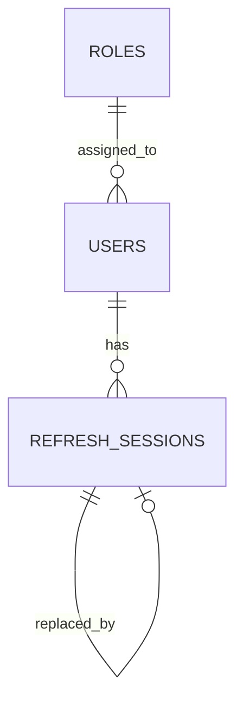
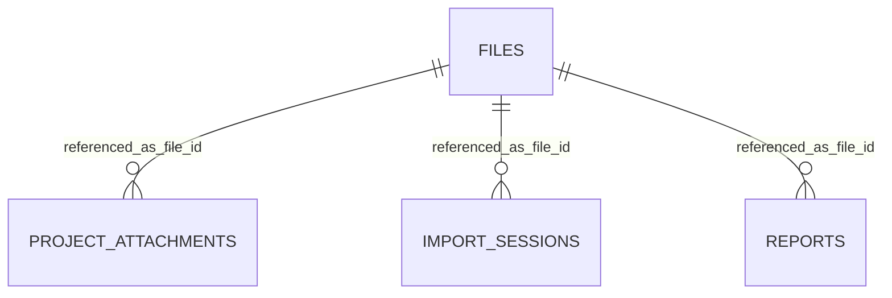
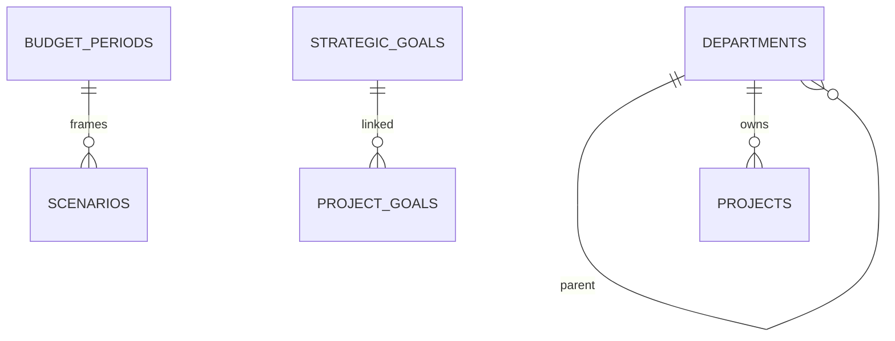
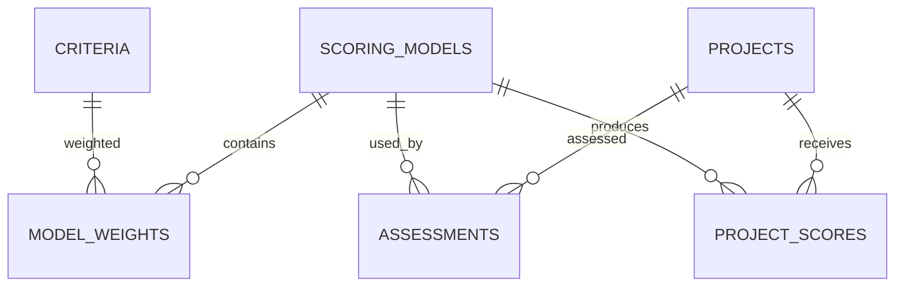
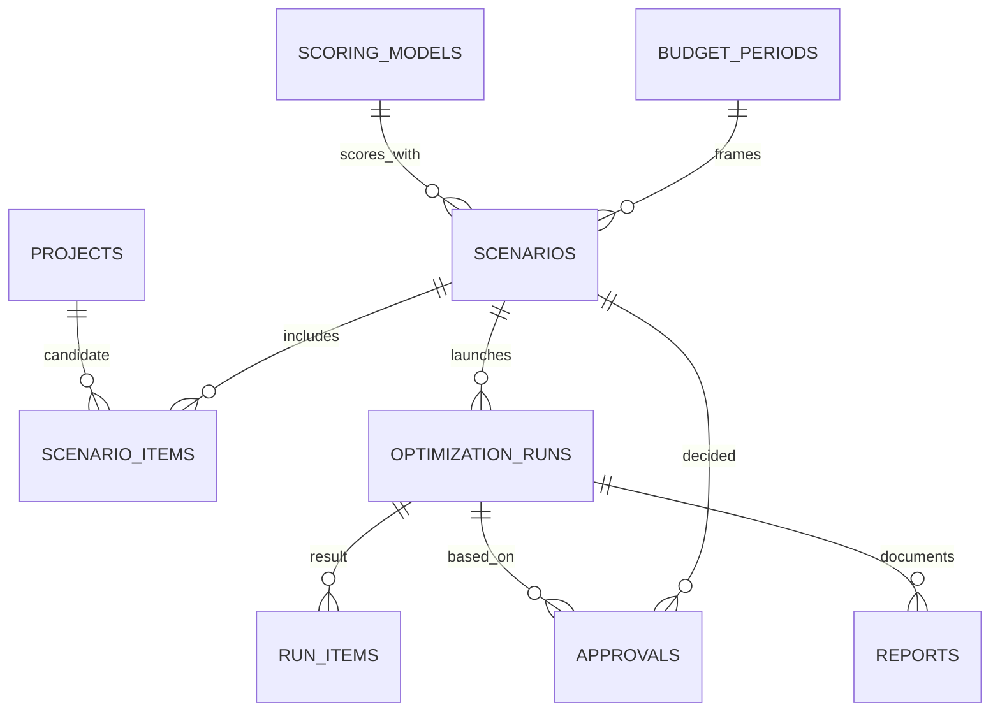
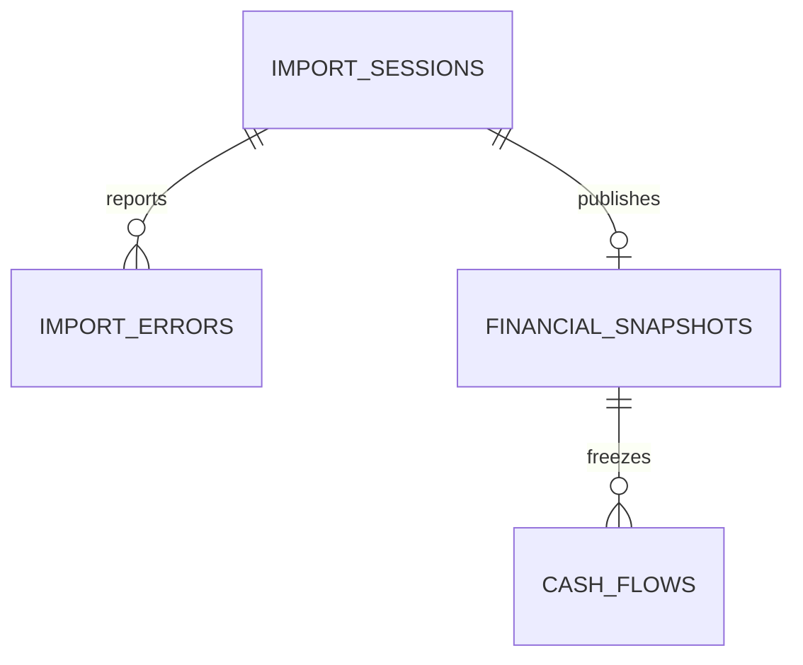
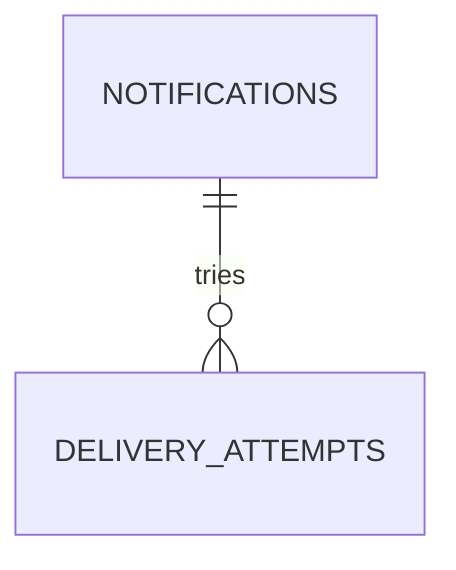

# Project Portfolio Optimizer — база данных, сущности и хранимые данные

> Версия 5.1 · PostgreSQL 16+ (compose: 17) · Проектная схема данных для реализации  
> Согласованный документ: `01_ARCHITECTURE_Portfolio_Optimizer.md`  
> Краткая копия архитектурных решений: `docs/architecture/ARCHITECTURE.md`  
> Flyway: schema-per-service в `services/*/…/db/migration/`

## 0. Принципы проектирования

База данных является транзакционным источником истины для реестра проектов, методик оценки, экспертных заключений, финансовых снимков, сценариев портфеля, запусков оптимизации и решений. Исходные файлы (импорты, вложения, отчёты) сохраняются в объектном хранилище MinIO; в БД хранятся метаданные, контрольные суммы и логические ссылки `file_id`.

Для реализации используется **один физический экземпляр PostgreSQL** с логическим разделением по схемам владельцев-сервисов (**schema-per-service**, ARCH-08). Это не означает отдельные инстансы БД на сервис: границы модулей обеспечиваются кодом сервисов, правами ролей PostgreSQL и отсутствием кросс-схемных FK.

Сервис **calc** не имеет схемы и таблиц: он stateless и получает все входы по HTTP (ARCH-10).

### 0.1 Соглашения

- PK всех основных сущностей — `UUID` (генерация на стороне приложения или `gen_random_uuid()`).
- Время — `TIMESTAMPTZ`; календарные границы бюджетных периодов — `DATE`.
- Денежные суммы — `NUMERIC(19,4)`; проценты, веса, ставки дисконтирования — `NUMERIC(12,6)` или уже; баллы — `NUMERIC(14,10)`.
- Статусы — `VARCHAR` с `CHECK` (не PostgreSQL ENUM), чтобы миграции статусов были проще.
- Для изменяемых бизнес-сущностей используются `created_at`, `updated_at`, при необходимости `version` (optimistic locking).
- Для мягкого удаления финансовых/утверждённых контуров применяется архивация статусом или `archived_at` / `deleted_at`, а не физическое удаление фактов.
- JSONB используется для `input_snapshot` запуска, вкладов критериев и технических payload аудита/уведомлений, но **не** вместо нормализованных связей кандидатов, потоков и оценок.
- **Кросс-схемные ссылки — UUID без FK** (ARCH-08). Целостность между `identity`, `domain`, `finance`, `fts`, `notify` проверяется application-сервисом.
- Внутри схемы владельца FK физические и обязательны.
- Уникальные бизнес-коды имеют `UNIQUE`.
- Для финансовых фактов запрещено использовать `FLOAT` / `DOUBLE PRECISION`.
- Роли нормализованы в справочник `identity.roles`; у пользователя одна роль через `users.role_id` (**1:N**: одна роль — много пользователей). Коды совпадают с enum API. Таблица `permissions` в v1 не вводится — проверка через `@PreAuthorize` / JWT.

### 0.2 Логические схемы (владельцы)

| Схема | Сервис-владелец | Назначение |
|---|---|---|
| `identity` | identity :8080 | пользователи, справочник ролей, refresh-сессии |
| `fts` | fts :8083 | метаданные файлов; байты в MinIO |
| `domain` | domain :8084 | справочники, проекты, scoring, сценарии, runs, approve, audit |
| `finance` | finance :8082 | импорт, ошибки, снимки, денежные потоки |
| `notify` | notify :8087 | in-app уведомления и попытки доставки |
| — | calc :8081 | **нет БД** |

### 0.3 Соответствие пакетам `domain`

Внутри одной схемы `domain` таблицы сгруппированы по пакетам приложения (не отдельные процессы):

| Пакет | Таблицы |
|---|---|
| `reference/` | `departments`, `budget_periods`, `strategic_goals` |
| `project/` | `projects`, `project_goals`, `project_links`, `project_attachments` |
| `scoring/` | `criteria`, `scoring_models`, `model_weights`, `assessments`, `project_scores` |
| `portfolio/` | `scenarios`, `scenario_items`, `optimization_runs`, `run_items`, `approvals`, `reports` |
| `audit/` | `audit_log` |

### 0.4 Статус реализации миграций

| Схема | Статус Flyway |
|---|---|
| `identity` | ✔ `V1__users_and_refresh_sessions.sql`, `V2__seed_admin_user.sql`, `V3__roles_fk_on_users.sql` |
| `fts` | ✔ `V1__create_files.sql`, `V2__add_owner_id.sql` |
| `finance` | ✔ схема + `V2__import_and_snapshots.sql` |
| `domain` | каркас схемы; целевой DDL зафиксирован в этом документе (волны W2–W5) |
| `notify` | каркас схемы; целевой DDL зафиксирован в этом документе (W6) |

Пометка ✔ в разделах ниже означает «уже в миграциях репозитория»; остальной DDL — канон для последующих миграций и обязан совпадать с OpenAPI/`01_ARCHITECTURE`.

---

## 1. Перечисления и справочные значения

### 1.1 Роли пользователей (`identity.roles.code`)

`INITIATOR`, `EXPERT_ANALYST`, `DECISION_MAKER`, `ADMIN`.

Коды в справочнике `identity.roles`; пользователь ссылается на одну роль (`users.role_id`). Таблица `permissions` в v1 не вводится.

### 1.2 Статусы проекта

`DRAFT`, `SUBMITTED`, `UNDER_REVIEW`, `EVALUATED`, `APPROVED_FOR_PORTFOLIO`, `REJECTED`, `RETURNED_FOR_REVISION`, `ARCHIVED`.

### 1.3 Статусы импорта финансов

`UPLOADED`, `PARSING`, `VALIDATING`, `READY_FOR_REVIEW`, `PUBLISHED`, `COMPLETED_WITH_ERRORS`, `REJECTED`, `FAILED`.

### 1.4 Статусы сценария портфеля

`DRAFT`, `READY_FOR_OPTIMIZATION`, `OPTIMIZING`, `OPTIMIZED`, `IN_REVIEW`, `APPROVED`, `REJECTED`, `ARCHIVED`.

### 1.5 Статусы запуска оптимизации

`QUEUED`, `RUNNING`, `OPTIMAL`, `FEASIBLE`, `INFEASIBLE`, `TIME_LIMIT`, `FAILED`, `CANCELLED`, `STALE`.

`STALE` выставляется **только domain** при устаревании входов (смена весов/модели; lazy-сверка финансового снимка) — см. ARCH §4.

### 1.6 Статусы модели оценки

`DRAFT`, `ACTIVE`, `RETIRED`.

### 1.7 Направление критерия, источники и нормализация

- Направление: `MAX` — большее предпочтительнее; `MIN` — меньшее предпочтительнее.
- Источник значения: `MANUAL` (эксперт), `COMPUTED` (например NPV из finance, сохраняется как значение критерия после расчёта).
- Тип значения: `NUMBER`, `PERCENT`, `CURRENCY`, `INTEGER`, `RATING`.
- Нормализация (в calc SAW): `MIN_MAX` (v1); расширение `RATIO` / `MANUAL_SCALE` допускается без ломки схемы.
- Метод модели v1: `SAW`.
- Флаг кандидата в сценарии: `CANDIDATE`, `MANDATORY`, `FORBIDDEN`.
- Тип связи проектов: `DEPENDENCY`, `MUTUAL_EXCLUSION`.
- Канал уведомления: `IN_APP`, `EMAIL`, `WS`.
- Статус попытки доставки: `PENDING`, `SENT`, `FAILED`.
- Решение согласования: `PENDING`, `APPROVED`, `REJECTED`, `RETURNED`.
- Бакеты FTS: `IMPORTS`, `REPORTS`, `ATTACHMENTS` (логические имена; физические bucket MinIO — `fts-imports` и т.д.).

### 1.8 Бюджетный период

Статус периода: `DRAFT`, `OPEN`, `CLOSED`.

В v1 портфельный сценарий оперирует **одним суммарным бюджетом** и **одной валютой** (DEC Q-DOM-02/05); периодизация cash_flows хранится как `period_index`, без мультивалютных курсов в первой версии.

---

## 2. Схема `identity` — пользователи, роли и сессии ✔

### 2.1 ER-диаграмма



Связь **1:N**: одна роль → много пользователей (`users.role_id` → `roles.id`). У пользователя ровно одна роль.  
Логические (без FK) исходящие ссылки: `users.id` → `owner_id` / `uploaded_by` / `actor_id` / `recipient` в других схемах.

### 2.2 DDL (канон после V1–V3)

```sql
CREATE SCHEMA IF NOT EXISTS identity;

CREATE TABLE identity.roles (
  id          UUID         PRIMARY KEY,
  code        VARCHAR(32)  NOT NULL,
  name        VARCHAR(120) NOT NULL,
  description TEXT,
  created_at  TIMESTAMPTZ  NOT NULL DEFAULT now(),
  CONSTRAINT uk_roles_code UNIQUE (code),
  CONSTRAINT ck_roles_code CHECK (code IN (
    'INITIATOR', 'EXPERT_ANALYST', 'DECISION_MAKER', 'ADMIN'
  ))
);

CREATE TABLE identity.users (
  id            UUID         PRIMARY KEY,
  email         VARCHAR(320) NOT NULL,
  display_name  VARCHAR(120) NOT NULL,
  password_hash VARCHAR(255) NOT NULL,
  role_id       UUID         NOT NULL REFERENCES identity.roles (id) ON DELETE RESTRICT,
  blocked       BOOLEAN      NOT NULL DEFAULT FALSE,
  created_at    TIMESTAMPTZ  NOT NULL,
  updated_at    TIMESTAMPTZ  NOT NULL,
  CONSTRAINT uk_users_email UNIQUE (email)
);

CREATE TABLE identity.refresh_sessions (
  id             UUID        PRIMARY KEY,
  user_id        UUID        NOT NULL,
  token_hash     CHAR(64)    NOT NULL,
  expires_at     TIMESTAMPTZ NOT NULL,
  revoked_at     TIMESTAMPTZ,
  created_at     TIMESTAMPTZ NOT NULL,
  replaced_by_id UUID,
  CONSTRAINT uk_refresh_sessions_token_hash UNIQUE (token_hash),
  CONSTRAINT fk_refresh_sessions_user
    FOREIGN KEY (user_id) REFERENCES identity.users (id) ON DELETE CASCADE,
  CONSTRAINT fk_refresh_sessions_replaced_by
    FOREIGN KEY (replaced_by_id) REFERENCES identity.refresh_sessions (id)
);

CREATE INDEX idx_users_role_id ON identity.users (role_id);
CREATE INDEX idx_refresh_sessions_user_id ON identity.refresh_sessions (user_id);
CREATE INDEX idx_refresh_sessions_expires_at ON identity.refresh_sessions (expires_at);
```

> История: V1 — `users.role` VARCHAR; V2 — seed admin; **V3** — справочник `roles`, колонка `role_id`, drop `role`. Канон — состояние после V3.

### 2.3 Правила

- Email в lowercase; уникальность — бизнес-ключ входа.
- Пароль только как адаптивный хеш (bcrypt).
- Refresh в БД — только `token_hash`; ротация через `replaced_by_id`.
- Блокировка — `blocked=true`; физическое удаление с историей не выполняется.
- У пользователя ровно одна роль (`role_id NOT NULL`); регистрация → `INITIATOR`.
- Админ (gateway → identity): `GET /api/v1/admin/users`, `PUT /api/v1/admin/users/{id}/role`, `PUT /api/v1/admin/users/{id}/blocked`.
- Нельзя снять `ADMIN` / заблокировать последнего активного администратора.
- JWT claim `role` = `roles.code` → authority `ROLE_{code}` → `@PreAuthorize("hasRole('ADMIN')")`.
- Таблица `permissions` / `user_roles` **не** вводятся: для КП достаточно одной роли на пользователя.
- Identity не хранит проекты, сценарии и финансы.

### 2.4 Почему 1:N, а не M:N

Для порога КП (≥3 роли) и текущих сценариев пользователю достаточно **одной** роли. Справочник `roles` даёт нормализацию и FK; связующая `user_roles` усложняла бы API/JWT без выигрыша. M:N имеет смысл только если одному человеку реально нужны несколько ролей одновременно.

---

## 3. Схема `fts` — метаданные файлов ✔

### 3.1 ER-диаграмма



Связи к `domain` / `finance` — логические UUID, **без FK**.

### 3.2 DDL (канон с учётом V1+V2)

```sql
CREATE SCHEMA IF NOT EXISTS fts;

CREATE TABLE fts.files (
  id            UUID         PRIMARY KEY,
  created_at    TIMESTAMPTZ  NOT NULL,
  updated_at    TIMESTAMPTZ  NOT NULL,
  created_by    VARCHAR(255),
  updated_by    VARCHAR(255),
  version       BIGINT,
  bucket        VARCHAR(32)  NOT NULL,
  object_key    VARCHAR(64)  NOT NULL,
  original_name VARCHAR(255) NOT NULL,
  content_type  VARCHAR(255) NOT NULL,
  size_bytes    BIGINT       NOT NULL CHECK (size_bytes >= 0),
  sha256        VARCHAR(64)  NOT NULL,
  owner_id      UUID         NOT NULL,
  deleted_at    TIMESTAMPTZ,
  CONSTRAINT uk_files_object_key UNIQUE (object_key),
  CONSTRAINT ck_files_bucket CHECK (bucket IN ('IMPORTS', 'REPORTS', 'ATTACHMENTS')
    OR bucket LIKE 'fts-%')
);

CREATE INDEX ix_files_owner_id ON fts.files (owner_id);
CREATE INDEX ix_files_deleted_at ON fts.files (deleted_at);
```

> В миграции V1 таблица создана в search_path схемы `fts` как `files`; физическое имя в каталоге — `fts.files`. `owner_id` добавлен в V2. CHECK на bucket может оставаться на уровне приложения (маппинг enum → имя MinIO).

### 3.3 Правила

- Байты объекта неизменяемы: новая версия файла = новый `id` и новый object key.
- Soft-delete: `deleted_at IS NOT NULL` → API отвечает 404; объект в MinIO может удаляться фоном.
- `sha256` считается при upload; потребители (finance publish, report) могут дублировать хеш для сверки неизменности входа.
- `owner_id` — UUID пользователя identity **без FK**; удаление/блокировка пользователя не каскадирует файлы.
- FTS не знает доменных сущностей: ACL на чтение/удаление — владелец или `ADMIN`, плюс доверенные сервисы с JWT пользователя.
- Gateway **не** маршрутизирует `/api/files/**` наружу; браузер работает через domain/finance.

### 3.4 Обоснование отдельной схемы

Файловый контур имеет другой канал I/O (MinIO), другие лимиты размера/типов и иной lifecycle. Вынос в `fts` исключает утечку credentials MinIO в domain/finance и даёт единую точку soft-delete и presigned URL.

---

## 4. Схема `domain` — справочники (`reference`)

### 4.1 ER-диаграмма



### 4.2 DDL

```sql
CREATE SCHEMA IF NOT EXISTS domain;

CREATE TABLE domain.departments (
  id          UUID PRIMARY KEY,
  code        VARCHAR(40)  NOT NULL UNIQUE,
  name        VARCHAR(200) NOT NULL,
  parent_id   UUID REFERENCES domain.departments(id) ON DELETE RESTRICT,
  is_active   BOOLEAN      NOT NULL DEFAULT TRUE,
  created_at  TIMESTAMPTZ  NOT NULL DEFAULT now(),
  updated_at  TIMESTAMPTZ  NOT NULL DEFAULT now(),
  CHECK (parent_id IS NULL OR parent_id <> id)
);

CREATE TABLE domain.budget_periods (
  id          UUID PRIMARY KEY,
  code        VARCHAR(40)  NOT NULL UNIQUE,
  name        VARCHAR(120) NOT NULL,
  starts_on   DATE         NOT NULL,
  ends_on     DATE         NOT NULL,
  status      VARCHAR(20)  NOT NULL DEFAULT 'OPEN'
    CHECK (status IN ('DRAFT', 'OPEN', 'CLOSED')),
  created_at  TIMESTAMPTZ  NOT NULL DEFAULT now(),
  updated_at  TIMESTAMPTZ  NOT NULL DEFAULT now(),
  CHECK (ends_on >= starts_on)
);

CREATE TABLE domain.strategic_goals (
  id          UUID PRIMARY KEY,
  code        VARCHAR(50)  NOT NULL UNIQUE,
  name        VARCHAR(200) NOT NULL,
  description TEXT,
  priority    INTEGER      NOT NULL DEFAULT 1 CHECK (priority > 0),
  is_active   BOOLEAN      NOT NULL DEFAULT TRUE,
  created_at  TIMESTAMPTZ  NOT NULL DEFAULT now(),
  updated_at  TIMESTAMPTZ  NOT NULL DEFAULT now()
);

CREATE INDEX idx_departments_parent ON domain.departments(parent_id);
CREATE INDEX idx_budget_periods_status ON domain.budget_periods(status);
CREATE INDEX idx_strategic_goals_active ON domain.strategic_goals(is_active);
```

### 4.3 Содержание и ограничения

- `departments` задаёт иерархию подразделений. Циклическая иерархия запрещается сервисной проверкой при изменении `parent_id` (обход предков до корня).
- `budget_periods` определяет горизонт портфельного планирования; сценарий ссылается на один период.
- `strategic_goals` — цели предприятия, к которым проекты привязываются через `project_goals`.
- Валюты как отдельный справочник в v1 **не** вводятся: денежные поля подразумевают единую валюту сценария/снимка (см. §1.8). При появлении мультивалютности добавляется `org`-подобная таблица или расширение finance — отдельной миграцией.

---

## 5. Схема `domain` — реестр проектов (`project`)

### 5.1 ER-диаграмма

```mermaid
erDiagram
  DEPARTMENTS ||--o{ PROJECTS : owns
  PROJECTS ||--o{ PROJECT_GOALS : has
  STRATEGIC_GOALS ||--o{ PROJECT_GOALS : linked
  PROJECTS ||--o{ PROJECT_LINKS : from
  PROJECTS ||--o{ PROJECT_LINKS : to
  PROJECTS ||--o{ PROJECT_ATTACHMENTS : has
  PROJECTS ||--o{ ASSESSMENTS : scored
  PROJECTS ||--o{ PROJECT_SCORES : ranked
  PROJECTS ||--o{ SCENARIO_ITEMS : candidate
```

### 5.2 DDL

```sql
CREATE TABLE domain.projects (
  id                 UUID PRIMARY KEY,
  code               VARCHAR(50)  NOT NULL UNIQUE,
  title              VARCHAR(250) NOT NULL,
  description        TEXT,
  business_case      TEXT,
  status             VARCHAR(40)  NOT NULL DEFAULT 'DRAFT'
    CHECK (status IN (
      'DRAFT', 'SUBMITTED', 'UNDER_REVIEW', 'EVALUATED',
      'APPROVED_FOR_PORTFOLIO', 'REJECTED', 'RETURNED_FOR_REVISION', 'ARCHIVED'
    )),
  department_id      UUID         NOT NULL REFERENCES domain.departments(id) ON DELETE RESTRICT,
  owner_id           UUID         NOT NULL,  -- identity.users.id, без FK
  manager_id         UUID,                   -- identity.users.id, без FK
  planned_start      DATE,
  planned_finish     DATE,
  requested_budget   NUMERIC(19,4) NOT NULL CHECK (requested_budget >= 0),
  expected_benefit   NUMERIC(19,4),
  risk_category      VARCHAR(20)
    CHECK (risk_category IS NULL OR risk_category IN ('LOW', 'MEDIUM', 'HIGH', 'CRITICAL')),
  submitted_at       TIMESTAMPTZ,
  archived_at        TIMESTAMPTZ,
  created_at         TIMESTAMPTZ  NOT NULL DEFAULT now(),
  updated_at         TIMESTAMPTZ  NOT NULL DEFAULT now(),
  version            BIGINT       NOT NULL DEFAULT 0,
  CHECK (planned_finish IS NULL OR planned_start IS NULL OR planned_finish >= planned_start)
);

CREATE TABLE domain.project_goals (
  project_id           UUID NOT NULL REFERENCES domain.projects(id) ON DELETE CASCADE,
  strategic_goal_id    UUID NOT NULL REFERENCES domain.strategic_goals(id) ON DELETE RESTRICT,
  contribution_level   SMALLINT NOT NULL DEFAULT 1 CHECK (contribution_level BETWEEN 1 AND 5),
  PRIMARY KEY (project_id, strategic_goal_id)
);

CREATE TABLE domain.project_links (
  id                   UUID PRIMARY KEY,
  from_project_id      UUID NOT NULL REFERENCES domain.projects(id) ON DELETE CASCADE,
  to_project_id        UUID NOT NULL REFERENCES domain.projects(id) ON DELETE RESTRICT,
  link_type            VARCHAR(30) NOT NULL
    CHECK (link_type IN ('DEPENDENCY', 'MUTUAL_EXCLUSION')),
  created_at           TIMESTAMPTZ NOT NULL DEFAULT now(),
  CHECK (from_project_id <> to_project_id),
  UNIQUE (from_project_id, to_project_id, link_type)
);

CREATE TABLE domain.project_attachments (
  id           UUID PRIMARY KEY,
  project_id   UUID NOT NULL REFERENCES domain.projects(id) ON DELETE CASCADE,
  file_id      UUID NOT NULL,              -- fts.files.id, без FK
  sha256       VARCHAR(64) NOT NULL,
  caption      VARCHAR(200),
  uploaded_by  UUID NOT NULL,              -- identity.users.id, без FK
  uploaded_at  TIMESTAMPTZ NOT NULL DEFAULT now(),
  UNIQUE (project_id, file_id)
);

CREATE INDEX idx_projects_status ON domain.projects(status);
CREATE INDEX idx_projects_department ON domain.projects(department_id);
CREATE INDEX idx_projects_owner ON domain.projects(owner_id);
CREATE INDEX idx_projects_dates ON domain.projects(planned_start, planned_finish);
CREATE INDEX idx_project_links_to ON domain.project_links(to_project_id);
CREATE INDEX idx_project_attachments_file ON domain.project_attachments(file_id);
```

### 5.3 Назначение полей и бизнес-правила

- `code` — человекочитаемый код проекта, неизменяемый после создания.
- `owner_id` — инициатор (автор карточки); `manager_id` — ответственный руководитель (опционально).
- `requested_budget` — запрос на финансирование из карточки, **не** факт затрат из finance.
- `expected_benefit` — заявленная выгода; интерпретация задаётся методикой предприятия / критериями.
- `project_goals` связывает проект с несколькими стратегическими целями и уровнем вклада 1..5.
- `project_links`:
  - `DEPENDENCY` — направленное «from требует to» (в solver: нельзя взять from без to);
  - `MUTUAL_EXCLUSION` — взаимоисключение; сервис нормализует порядок UUID при записи, чтобы не допустить дублей `(A,B)` и `(B,A)`.
- Циклы `DEPENDENCY` запрещаются проверкой графа до фиксации транзакции.
- Удаление проекта с историей оценок/runs не выполняется: статус `ARCHIVED` + `archived_at`.
- `project_attachments.file_id` указывает на FTS; при soft-delete файла вложение остаётся, но скачивание недоступно — UI показывает ошибку целостности.

### 5.4 Почему нет отдельной таблицы рисков

В монолитном учебном образце есть `project_risks`. В Optimizer риск v1 представлен категорией на карточке и/или критерием модели (`RATING` / `NUMBER`). Отдельная сущность рисков не требуется для FR реестра и оптимизации; при появлении требования добавляется таблица без ломки PK проектов.

---

## 6. Схема `domain` — критерии и оценивание (`scoring`)

### 6.1 ER-диаграмма



### 6.2 DDL

```sql
CREATE TABLE domain.criteria (
  id                     UUID PRIMARY KEY,
  code                   VARCHAR(60)  NOT NULL UNIQUE,
  name                   VARCHAR(160) NOT NULL,
  description            TEXT,
  value_type             VARCHAR(20)  NOT NULL
    CHECK (value_type IN ('NUMBER', 'PERCENT', 'CURRENCY', 'INTEGER', 'RATING')),
  unit                   VARCHAR(40),
  direction              VARCHAR(3)   NOT NULL CHECK (direction IN ('MAX', 'MIN')),
  source                 VARCHAR(20)  NOT NULL DEFAULT 'MANUAL'
    CHECK (source IN ('MANUAL', 'COMPUTED')),
  normalization_method   VARCHAR(20)  NOT NULL DEFAULT 'MIN_MAX'
    CHECK (normalization_method IN ('MIN_MAX', 'RATIO', 'MANUAL_SCALE')),
  is_mandatory           BOOLEAN      NOT NULL DEFAULT TRUE,
  min_allowed            NUMERIC(19,6),
  max_allowed            NUMERIC(19,6),
  is_active              BOOLEAN      NOT NULL DEFAULT TRUE,
  created_at             TIMESTAMPTZ  NOT NULL DEFAULT now(),
  updated_at             TIMESTAMPTZ  NOT NULL DEFAULT now(),
  CHECK (min_allowed IS NULL OR max_allowed IS NULL OR max_allowed >= min_allowed)
);

CREATE TABLE domain.scoring_models (
  id               UUID PRIMARY KEY,
  code             VARCHAR(60)  NOT NULL,
  name             VARCHAR(180) NOT NULL,
  description      TEXT,
  version_no       INTEGER      NOT NULL CHECK (version_no > 0),
  status           VARCHAR(20)  NOT NULL DEFAULT 'DRAFT'
    CHECK (status IN ('DRAFT', 'ACTIVE', 'RETIRED')),
  method           VARCHAR(20)  NOT NULL DEFAULT 'SAW'
    CHECK (method IN ('SAW')),
  missing_policy   VARCHAR(30)  NOT NULL DEFAULT 'REJECT_PROJECT'
    CHECK (missing_policy IN ('REJECT_PROJECT', 'NEUTRAL_VALUE')),
  created_by       UUID         NOT NULL,  -- identity.users.id
  created_at       TIMESTAMPTZ  NOT NULL DEFAULT now(),
  updated_at       TIMESTAMPTZ  NOT NULL DEFAULT now(),
  activated_at     TIMESTAMPTZ,
  UNIQUE (code, version_no)
);

CREATE TABLE domain.model_weights (
  model_id       UUID NOT NULL REFERENCES domain.scoring_models(id) ON DELETE CASCADE,
  criterion_id   UUID NOT NULL REFERENCES domain.criteria(id) ON DELETE RESTRICT,
  weight         NUMERIC(12,8) NOT NULL CHECK (weight >= 0),
  sort_order     INTEGER NOT NULL DEFAULT 0,
  fixed_min      NUMERIC(19,6),
  fixed_max      NUMERIC(19,6),
  PRIMARY KEY (model_id, criterion_id),
  CHECK (fixed_min IS NULL OR fixed_max IS NULL OR fixed_max > fixed_min)
);

CREATE TABLE domain.assessments (
  id             UUID PRIMARY KEY,
  project_id     UUID NOT NULL REFERENCES domain.projects(id) ON DELETE RESTRICT,
  model_id       UUID NOT NULL REFERENCES domain.scoring_models(id) ON DELETE RESTRICT,
  criterion_id   UUID NOT NULL REFERENCES domain.criteria(id) ON DELETE RESTRICT,
  expert_id      UUID NOT NULL,  -- identity.users.id
  raw_value      NUMERIC(19,6) NOT NULL,
  comment        TEXT,
  status         VARCHAR(20) NOT NULL DEFAULT 'DRAFT'
    CHECK (status IN ('DRAFT', 'SUBMITTED', 'ACCEPTED', 'REJECTED')),
  submitted_at   TIMESTAMPTZ,
  created_at     TIMESTAMPTZ NOT NULL DEFAULT now(),
  updated_at     TIMESTAMPTZ NOT NULL DEFAULT now(),
  UNIQUE (project_id, model_id, criterion_id, expert_id)
);

CREATE TABLE domain.project_scores (
  id                        UUID PRIMARY KEY,
  project_id                UUID NOT NULL REFERENCES domain.projects(id) ON DELETE RESTRICT,
  model_id                  UUID NOT NULL REFERENCES domain.scoring_models(id) ON DELETE RESTRICT,
  total_score               NUMERIC(14,10) NOT NULL CHECK (total_score >= 0),
  criterion_contributions   JSONB NOT NULL DEFAULT '{}'::jsonb,
  input_fingerprint         CHAR(64) NOT NULL,
  calculated_at             TIMESTAMPTZ NOT NULL DEFAULT now(),
  is_current                BOOLEAN NOT NULL DEFAULT TRUE,
  UNIQUE (project_id, model_id, input_fingerprint)
);

CREATE INDEX idx_assessments_project ON domain.assessments(project_id, status);
CREATE INDEX idx_assessments_model ON domain.assessments(model_id, criterion_id);
CREATE INDEX idx_scores_project_current ON domain.project_scores(project_id, is_current);
CREATE INDEX idx_scores_model ON domain.project_scores(model_id);
CREATE INDEX idx_scoring_models_status ON domain.scoring_models(status);
```

### 6.3 Правила расчёта

Сумма весов проверяется сервисом при активации модели: `abs(sum(weights) - 1) <= 0.000001`. Однострочный `CHECK` не может обеспечить агрегат по нескольким строкам `model_weights`.

Расчёт SAW выполняется в **calc** (`POST /v1/scoring/saw`): нормализация min-max, веса, вклад критерия; отсутствие обязательного значения — ошибка (без silent zero). Domain сохраняет результат в `project_scores`.

`criterion_contributions` — JSONB вида `{ "CRITERION_CODE": { "raw": ..., "normalized": ..., "weight": ..., "contribution": ... }, ... }`. Детализация в отдельной таблице (`project_score_details`) допустима как эволюция схемы, если появятся частые SQL-агрегации по вкладам; в v1 JSONB достаточен для UI объяснения.

`input_fingerprint` — SHA-256 канонического набора: значения критериев проекта, `model_id`/`version_no`, веса, политика пропусков. Позволяет обнаружить повторный расчёт того же входа.

При смене весов или активации новой версии модели domain помечает связанные `optimization_runs` сценариев как `STALE` и инициирует notify (afterCommit).

`missing_policy = NEUTRAL_VALUE` в v1 не рекомендуется для обязательных критериев; канон calc — явная ошибка при пропуске.

### 6.4 Почему scoring в `domain`, а не отдельная схема

Хранение критериев/оценок неразрывно связано со сценарием и run: дробление на отдельный процесс давало бы лишний HTTP и UUID-ссылки без выигрыша для КП (ARCH-02). Вычисления вынесены в calc без БД (ARCH-10).

---

## 7. Схема `domain` — сценарии, запуски, согласования (`portfolio`)

### 7.1 ER-диаграмма



### 7.2 DDL

```sql
CREATE TABLE domain.scenarios (
  id                      UUID PRIMARY KEY,
  code                    VARCHAR(60)  NOT NULL UNIQUE,
  name                    VARCHAR(200) NOT NULL,
  budget_period_id        UUID NOT NULL REFERENCES domain.budget_periods(id) ON DELETE RESTRICT,
  scoring_model_id        UUID NOT NULL REFERENCES domain.scoring_models(id) ON DELETE RESTRICT,
  financial_snapshot_id   UUID,  -- finance.financial_snapshots.id, без FK
  total_budget            NUMERIC(19,4) NOT NULL CHECK (total_budget >= 0),
  status                  VARCHAR(30) NOT NULL DEFAULT 'DRAFT'
    CHECK (status IN (
      'DRAFT', 'READY_FOR_OPTIMIZATION', 'OPTIMIZING', 'OPTIMIZED',
      'IN_REVIEW', 'APPROVED', 'REJECTED', 'ARCHIVED'
    )),
  created_by              UUID NOT NULL,  -- identity.users.id
  created_at              TIMESTAMPTZ NOT NULL DEFAULT now(),
  updated_at              TIMESTAMPTZ NOT NULL DEFAULT now(),
  version                 BIGINT NOT NULL DEFAULT 0,
  archived_at             TIMESTAMPTZ
);

CREATE TABLE domain.scenario_items (
  scenario_id      UUID NOT NULL REFERENCES domain.scenarios(id) ON DELETE CASCADE,
  project_id       UUID NOT NULL REFERENCES domain.projects(id) ON DELETE RESTRICT,
  selection_flag   VARCHAR(20) NOT NULL DEFAULT 'CANDIDATE'
    CHECK (selection_flag IN ('CANDIDATE', 'MANDATORY', 'FORBIDDEN')),
  added_by         UUID NOT NULL,
  added_at         TIMESTAMPTZ NOT NULL DEFAULT now(),
  PRIMARY KEY (scenario_id, project_id)
);

CREATE TABLE domain.optimization_runs (
  id                 UUID PRIMARY KEY,
  scenario_id        UUID NOT NULL REFERENCES domain.scenarios(id) ON DELETE RESTRICT,
  scenario_version   BIGINT NOT NULL CHECK (scenario_version > 0),
  status             VARCHAR(20) NOT NULL DEFAULT 'QUEUED'
    CHECK (status IN (
      'QUEUED', 'RUNNING', 'OPTIMAL', 'FEASIBLE', 'INFEASIBLE',
      'TIME_LIMIT', 'FAILED', 'CANCELLED', 'STALE'
    )),
  algorithm_code     VARCHAR(60) NOT NULL DEFAULT 'BINARY_DP',
  algorithm_version  VARCHAR(40) NOT NULL,
  parameters         JSONB NOT NULL DEFAULT '{}'::jsonb,
  input_snapshot     JSONB NOT NULL,
  input_sha256       CHAR(64) NOT NULL,
  objective_value    NUMERIC(19,8),
  budget_used        NUMERIC(19,4) CHECK (budget_used IS NULL OR budget_used >= 0),
  requested_by       UUID NOT NULL,
  queued_at          TIMESTAMPTZ NOT NULL DEFAULT now(),
  started_at         TIMESTAMPTZ,
  finished_at        TIMESTAMPTZ,
  execution_seconds  NUMERIC(12,4) CHECK (execution_seconds IS NULL OR execution_seconds >= 0),
  error_code         VARCHAR(80),
  error_message      TEXT
);

CREATE TABLE domain.run_items (
  run_id           UUID NOT NULL REFERENCES domain.optimization_runs(id) ON DELETE CASCADE,
  project_id       UUID NOT NULL REFERENCES domain.projects(id) ON DELETE RESTRICT,
  selected         BOOLEAN NOT NULL,
  score            NUMERIC(14,10) NOT NULL,
  cost             NUMERIC(19,4) NOT NULL CHECK (cost >= 0),
  selection_reason TEXT,
  PRIMARY KEY (run_id, project_id)
);

CREATE TABLE domain.approvals (
  id            UUID PRIMARY KEY,
  scenario_id   UUID NOT NULL REFERENCES domain.scenarios(id) ON DELETE RESTRICT,
  run_id        UUID NOT NULL REFERENCES domain.optimization_runs(id) ON DELETE RESTRICT,
  decision      VARCHAR(20) NOT NULL DEFAULT 'PENDING'
    CHECK (decision IN ('PENDING', 'APPROVED', 'REJECTED', 'RETURNED')),
  comment       TEXT,
  decided_by    UUID,  -- identity.users.id
  assigned_at   TIMESTAMPTZ NOT NULL DEFAULT now(),
  decided_at    TIMESTAMPTZ,
  UNIQUE (scenario_id, run_id)
);

CREATE TABLE domain.reports (
  id            UUID PRIMARY KEY,
  run_id        UUID NOT NULL REFERENCES domain.optimization_runs(id) ON DELETE RESTRICT,
  scenario_id   UUID NOT NULL REFERENCES domain.scenarios(id) ON DELETE RESTRICT,
  report_type   VARCHAR(60) NOT NULL DEFAULT 'PORTFOLIO_DECISION',
  file_id       UUID NOT NULL,          -- fts.files.id
  sha256        VARCHAR(64) NOT NULL,
  generated_by  UUID NOT NULL,
  generated_at  TIMESTAMPTZ NOT NULL DEFAULT now()
);

CREATE INDEX idx_scenarios_period_status ON domain.scenarios(budget_period_id, status);
CREATE INDEX idx_scenarios_snapshot ON domain.scenarios(financial_snapshot_id);
CREATE INDEX idx_scenario_items_project ON domain.scenario_items(project_id);
CREATE INDEX idx_runs_scenario ON domain.optimization_runs(scenario_id, queued_at DESC);
CREATE INDEX idx_runs_status ON domain.optimization_runs(status);
CREATE INDEX idx_run_items_project ON domain.run_items(project_id);
CREATE INDEX idx_approvals_pending ON domain.approvals(decision, assigned_at);
CREATE INDEX idx_reports_run ON domain.reports(run_id);
```

### 7.3 Семантика сценария и ограничений

В Optimizer ограничения портфеля выражаются так:

| Ограничение | Где хранится |
|---|---|
| Суммарный бюджет | `scenarios.total_budget` |
| Кандидаты | `scenario_items` |
| Обязательные / запрещённые | `scenario_items.selection_flag` |
| Зависимости / взаимоисключения | `project_links` (копируются в `input_snapshot` на старте run) |
| Финансовые стоимости проектов | `finance.cash_flows` выбранного снимка (или `requested_budget` как fallback по правилу preflight) |
| Модель баллов | `scenarios.scoring_model_id` + актуальные `project_scores` |

Отдельная таблица `portfolio_constraints` из монолитного образца **не** вводится в v1: набор FR покрывается полями сценария, флагами кандидатов и связями проектов. Расширение (лимиты по подразделениям, стратегические квоты) оформляется новой таблицей `domain.scenario_constraints` без ломки PK сценария.

Правила валидации перед запуском:

- `MANDATORY` и `FORBIDDEN` для одного `project_id` в одном сценарии недопустимы.
- Проект-кандидат должен иметь статус, допускающий включение в портфель (как минимум не `ARCHIVED`).
- Для `MANDATORY` проектов должна существовать допустимая стоимость в снимке.
- Сумма весов активной модели = 1; обязательные критерии заполнены.
- `financial_snapshot_id` задан и согласован с актуальностью (иначе run/`STALE`).

### 7.4 Требования к `input_snapshot`

`input_snapshot` (JSONB) — каноническое представление входа запуска, а не произвольный лог. Минимальный состав:

- `scenario_id`, `scenario_version`, `budget_period`, `total_budget`;
- `scoring_model` (`id`, `code`, `version_no`, веса);
- список кандидатов с `selection_flag`, `score`, `cost`;
- граф `DEPENDENCY` / `MUTUAL_EXCLUSION`;
- `financial_snapshot_id` и fingerprint снимка (`sha256`);
- `algorithm_code` / `algorithm_version` / `parameters`;
- при необходимости — ставка дисконтирования и NPV, если использовались как критерий.

`input_sha256` считается по канонической сериализации JSON (стабильный порядок ключей). Повторный запуск всегда создаёт новую строку `optimization_runs`, даже при совпадении fingerprint.

Снимок **неизменяем**: нет update-API на `input_snapshot` после `queued_at`.

### 7.5 Правила результата и job

- Async job живёт в **domain** (ARCH-04): статус `QUEUED` → `RUNNING` → терминальный.
- Calc вызывается синхронно из worker domain: `POST /v1/optimization/binary`.
- `run_items` содержит **всех** кандидатов снимка с флагом `selected` (не только выбранных) — это упрощает UI «почему не вошёл».
- `budget_used` = сумма `cost` по `selected=true`; должна быть ≤ `total_budget` снимка (постпроверка domain).
- При `INFEASIBLE` строки `run_items` могут отсутствовать или содержать `selected=false` для всех — фиксируется в коде единообразно; диагностика пишется в `error_code`/`error_message` и/или audit.
- При рестарте сервиса mid-job: runs в `QUEUED`/`RUNNING` переводятся в `FAILED` (или ручной retry) — см. сквозной сценарий архитектуры.
- Утверждение (`approvals`) ссылается на конкретный `run_id`; утверждённый сценарий не редактируется (state machine + `version`).
- Публичный API (ARCH §4): `GET /api/v1/approvals` (inbox ЛПР); `POST /api/v1/scenarios/{id}/approvals` (решение по run → строка `approvals` + notify afterCommit).

### 7.6 Отчёты

`reports.file_id` указывает на объект в бакете `REPORTS`. PDF/данные генерируются после approve или по запросу; байты только через FTS. `sha256` дублируется для неизменности артефакта решения.

---

## 8. Схема `domain` — аудит (`audit`)

### 8.1 DDL

```sql
CREATE TABLE domain.audit_log (
  id            UUID PRIMARY KEY,
  occurred_at   TIMESTAMPTZ NOT NULL DEFAULT now(),
  actor_id      UUID,                 -- identity.users.id, без FK; NULL = system
  action        VARCHAR(100) NOT NULL,
  entity_type   VARCHAR(80)  NOT NULL,
  entity_id     UUID,
  request_id    VARCHAR(100),
  outcome       VARCHAR(20)  NOT NULL
    CHECK (outcome IN ('SUCCESS', 'DENIED', 'FAILED')),
  payload       JSONB NOT NULL DEFAULT '{}'::jsonb
);

CREATE INDEX idx_audit_entity ON domain.audit_log(entity_type, entity_id, occurred_at DESC);
CREATE INDEX idx_audit_actor ON domain.audit_log(actor_id, occurred_at DESC);
CREATE INDEX idx_audit_action ON domain.audit_log(action, occurred_at DESC);
```

### 8.2 Правила

- Журнал append-only для прикладной роли БД domain; UPDATE/DELETE audit-строк запрещаются grants.
- В `payload` не помещаются пароли, refresh-токены, содержимое файлов и полные financial raw rows.
- Критичные действия: публикация не здесь (это finance), а в domain — активация модели, старт run, завершение run, approve/reject, смена статусов сценария, пометка STALE.
- Уведомления **не** являются заменой аудита: notify — канал доставки; audit — доказательная фиксация действия.

### 8.3 Почему audit в `domain`, а не отдельная схема `audit`

В монолитном образце выделена схема `audit`. В Optimizer критичный предметный аудит принадлежит процессу domain (единый контур решения). Identity может вести собственный лог login отдельно; кросс-сервисная шина аудита в v1 не вводится (YAGNI).

---

## 9. Схема `finance` — импорт, снимки, потоки ✔

### 9.1 ER-диаграмма



`file_id` → `fts.files.id` без FK. `project_id` в `cash_flows` → `domain.projects.id` без FK. `uploaded_by` / `published_by` → `identity.users.id` без FK.

### 9.2 DDL (как в миграции V2 + усиления канона)

```sql
CREATE SCHEMA IF NOT EXISTS finance;

CREATE TABLE finance.import_sessions (
  id                     UUID PRIMARY KEY,
  file_id                UUID         NOT NULL,
  sha256                 VARCHAR(64)  NOT NULL,
  status                 VARCHAR(40)  NOT NULL,
  uploaded_by            UUID         NOT NULL,
  budget_period_id       UUID,        -- domain.budget_periods.id, без FK
  row_count              INTEGER CHECK (row_count IS NULL OR row_count >= 0),
  error_count            INTEGER CHECK (error_count IS NULL OR error_count >= 0),
  published_snapshot_id  UUID,
  created_at             TIMESTAMPTZ  NOT NULL,
  updated_at             TIMESTAMPTZ  NOT NULL,
  CONSTRAINT ck_import_sessions_status CHECK (status IN (
    'UPLOADED', 'PARSING', 'VALIDATING', 'READY_FOR_REVIEW',
    'PUBLISHED', 'COMPLETED_WITH_ERRORS', 'REJECTED', 'FAILED'
  ))
);

CREATE TABLE finance.import_errors (
  id           UUID PRIMARY KEY,
  session_id   UUID         NOT NULL REFERENCES finance.import_sessions (id) ON DELETE CASCADE,
  row_no       INTEGER,
  column_name  VARCHAR(80),
  code         VARCHAR(80)  NOT NULL,
  message      TEXT         NOT NULL
);

CREATE INDEX idx_import_errors_session ON finance.import_errors (session_id);

CREATE TABLE finance.financial_snapshots (
  id                 UUID PRIMARY KEY,
  source_session_id  UUID         NOT NULL REFERENCES finance.import_sessions (id),
  file_id            UUID         NOT NULL,
  sha256             VARCHAR(64)  NOT NULL,
  published_by       UUID         NOT NULL,
  published_at       TIMESTAMPTZ  NOT NULL,
  discount_rate      NUMERIC(12,6),
  label              VARCHAR(200)
);

-- Рекомендуемое усиление (отдельная миграция): FK обратно на snapshot после publish
-- ALTER TABLE finance.import_sessions
--   ADD CONSTRAINT fk_import_published_snapshot
--   FOREIGN KEY (published_snapshot_id) REFERENCES finance.financial_snapshots(id);

CREATE TABLE finance.cash_flows (
  id            UUID PRIMARY KEY,
  snapshot_id   UUID            NOT NULL REFERENCES finance.financial_snapshots (id) ON DELETE CASCADE,
  project_id    UUID            NOT NULL,
  period_index  INTEGER         NOT NULL CHECK (period_index >= 0),
  amount        NUMERIC(19,4)   NOT NULL,
  CONSTRAINT uk_cash_flows_snapshot_project_period
    UNIQUE (snapshot_id, project_id, period_index)
);

CREATE INDEX idx_cash_flows_snapshot ON finance.cash_flows (snapshot_id);
CREATE INDEX idx_cash_flows_project ON finance.cash_flows (project_id);
CREATE INDEX idx_import_sessions_status ON finance.import_sessions (status);
CREATE INDEX idx_financial_snapshots_published ON finance.financial_snapshots (published_at DESC);
```

### 9.3 Правила импорта и финансовой целостности

- Оригинальный файл в MinIO не изменяется после загрузки; `file_id` + `sha256` фиксируют вход.
- Ошибки строк хранятся в `import_errors` (не одним JSON-массивом) — это позволяет фильтровать по `code`/`column_name` и строить протокол для FR-11.
- Черновые результаты парсинга до publish не обязаны материализоваться в отдельной `import_rows`, если парсер пишет сразу ошибки и готовность; при необходимости детального diff добавляется таблица строк отдельной миграцией.
- Publish создаёт **неизменяемый** `financial_snapshots` + набор `cash_flows`. Повторный publish того же session запрещён (идемпотентный ключ / статус `PUBLISHED`).
- `cash_flows.project_id` — логическая ссылка на domain; finance не обязан иметь FK. Preflight в domain проверяет, что все кандидаты сценария имеют потоки в выбранном снимке (или явное правило fallback).
- `discount_rate` хранится на снимке; NPV считается в finance (`BigDecimal`) и может публиковаться в domain как `COMPUTED`-оценка критерия либо возвращаться API снимка.
- Finance **не** обновляет `optimization_runs` при publish (ARCH §4). Domain при чтении сценария/перед start run сверяет актуальность снимка и ставит `STALE` (lazy).
- AfterCommit → `notify` (`IMPORT_PUBLISHED` / `IMPORT_FAILED`); сбой notify не откатывает publish.

### 9.4 Почему нет `exchange_rates` / `financial_records` в v1

Монолитный образец моделирует мультивалютность и версионируемые факты. Optimizer v1: один бюджет, одна валюта, снимок потоков из файла. Это сознательное упрощение (открытый вопрос Q-DOM закрыт). Курсы и построчные metric_code-записи добавляются только при реальной потребности интеграции с ERP.

### 9.5 Обоснование владения finance

ARCH-03: finance — доменный сервис parse + NPV **и** хранения импортов/снимков. Domain потребляет `snapshot_id` и агрегаты, не парсит XLSX сам и не держит байты.

---

## 10. Схема `notify` — уведомления

### 10.1 ER-диаграмма



`user_id` → `identity.users.id` без FK.

### 10.2 DDL

```sql
CREATE SCHEMA IF NOT EXISTS notify;

CREATE TABLE notify.notifications (
  id                   UUID PRIMARY KEY,
  user_id              UUID NOT NULL,
  channel              VARCHAR(20) NOT NULL
    CHECK (channel IN ('IN_APP', 'EMAIL', 'WS')),
  title                VARCHAR(200) NOT NULL,
  body                 TEXT NOT NULL,
  event_type           VARCHAR(80) NOT NULL,
  related_entity_type  VARCHAR(80),
  related_entity_id    UUID,
  read_at              TIMESTAMPTZ,
  created_at           TIMESTAMPTZ NOT NULL DEFAULT now()
);

CREATE TABLE notify.delivery_attempts (
  id                UUID PRIMARY KEY,
  notification_id   UUID NOT NULL REFERENCES notify.notifications(id) ON DELETE CASCADE,
  channel           VARCHAR(20) NOT NULL
    CHECK (channel IN ('IN_APP', 'EMAIL', 'WS')),
  status            VARCHAR(20) NOT NULL
    CHECK (status IN ('PENDING', 'SENT', 'FAILED')),
  attempt_number    SMALLINT NOT NULL CHECK (attempt_number > 0),
  attempted_at      TIMESTAMPTZ NOT NULL DEFAULT now(),
  error_code        VARCHAR(80),
  error_message     TEXT,
  UNIQUE (notification_id, channel, attempt_number)
);

CREATE INDEX idx_notifications_user ON notify.notifications(user_id, created_at DESC);
CREATE INDEX idx_notifications_unread ON notify.notifications(user_id, created_at DESC)
  WHERE read_at IS NULL;
CREATE INDEX idx_delivery_attempts_notification ON notify.delivery_attempts(notification_id);
```

### 10.3 Правила доставки

- Провайдеры событий: domain, finance — только **afterCommit**, HTTP fire-and-forget к `POST /internal/v1/events`.
- Сбой SMTP/WS **не** откатывает бизнес-транзакцию (FR-18).
- In-app: строка в `notifications` + REST list/mark-read; WS push после insert.
- Email: stub (лог) до W6; факт попытки всегда в `delivery_attempts`.
- Outbox у продюсера в v1 не обязателен (YAGNI); при усилении — таблица outbox **в схеме продюсера**, не в notify.
- Notify не содержит бизнес-правил портфеля и не пишет в domain/finance.

### 10.4 Типовые `event_type`

`IMPORT_PUBLISHED`, `IMPORT_FAILED`, `RUN_COMPLETED`, `RUN_FAILED`, `RUN_STALE`, `SCENARIO_APPROVED`, `SCENARIO_REJECTED`, `MODEL_ACTIVATED`.

---

## 11. Межсхемная целостность и бизнес-ограничения

Некоторые правила нельзя выразить FK/CHECK, особенно между схемами. Они выполняются application-сервисом в транзакции владельца и покрываются тестами.

| Правило | Где | Реализация |
|---|---|---|
| Сумма весов модели = 1 | domain | проверка перед `ACTIVE` |
| Циклов DEPENDENCY нет | domain | обход графа |
| Mandatory ∩ Forbidden = ∅ | domain | валидатор сценария |
| Кандидат существует и не ARCHIVED | domain | preflight run |
| Все обязательные критерии заполнены | domain + calc | preflight / SAW error |
| `file_id` существует и не soft-deleted | domain/finance → FTS API | проверка перед publish/attach |
| `owner_id` / `uploaded_by` существует и не blocked | вызов identity или доверие JWT | gateway + сервис |
| Снимок финансов неизменяем | finance | нет update API на cash_flows |
| `input_snapshot` неизменяем | domain | нет update после create run |
| Постпроверка бюджета решения | domain | после ответа calc |
| Утверждённый сценарий неизменяем | domain | state machine + version |
| Импорт публикуется один раз | finance | статус + уникальность |
| STALE при смене модели | domain | eager в том же процессе |
| STALE при новом snapshot | domain | lazy на GET/start; opt. eager internal |
| Notify не в бизнес-TX | domain/finance | afterCommit |

### 11.1 Идемпотентность

- Publish import: ключ идемпотентности (session id / header) — повтор не создаёт второй snapshot.
- Start run: ключ на `(scenario_id, scenario_version, input_sha256)` или клиентский idempotency-key — предотвращает дубль job при retry HTTP.

### 11.2 Что сознательно не моделируем

| Не делаем | Почему |
|---|---|
| Отдельные схемы project/scoring/portfolio | Слиты в `domain` (ARCH-02) |
| FK на чужие схемы | Разные сервисы-владельцы (ARCH-08) |
| БД у calc | Stateless формулы (ARCH-10) |
| Таблицы user_roles / permissions | Одна роль на пользователя через `role_id`; права в `@PreAuthorize` |
| `notifications` внутри domain | Другой канал доставки = сервис notify |
| Kafka / outbox обязательно | Compose без брокера; afterCommit достаточно для КП |
| Мультивалютные курсы v1 | Один бюджет, одна валюта |

---

## 12. Ключевые SQL-запросы

Запросы ниже предполагают выполнение **внутри схемы владельца**. Кросс-схемные JOIN в одном SQL **не** являются каноном runtime: сервисы ходят друг к другу по API. Примеры с несколькими схемами допустимы только для админской аналитики DBA на одном инстансе.

### 12.1 Реестр проектов с подразделением

```sql
SELECT p.id, p.code, p.title, p.status,
       d.name AS department_name, p.requested_budget, p.owner_id
FROM domain.projects p
JOIN domain.departments d ON d.id = p.department_id
WHERE p.archived_at IS NULL
  AND (:status IS NULL OR p.status = :status)
  AND (:department_id IS NULL OR p.department_id = :department_id)
ORDER BY p.created_at DESC
LIMIT :limit OFFSET :offset;
```

### 12.2 Ошибки сессии импорта

```sql
SELECT e.row_no, e.column_name, e.code, e.message
FROM finance.import_errors e
WHERE e.session_id = :session_id
ORDER BY e.row_no NULLS LAST, e.code;
```

### 12.3 Сумма весов модели

```sql
SELECT m.id, SUM(w.weight) AS weight_sum
FROM domain.scoring_models m
JOIN domain.model_weights w ON w.model_id = m.id
WHERE m.id = :model_id
GROUP BY m.id
HAVING ABS(SUM(w.weight) - 1.0) > 0.000001;
```

Пустой результат означает прохождение агрегатной проверки (при условии, что модель содержит ≥1 критерий — проверяется отдельно).

### 12.4 Кандидаты сценария с текущим баллом

```sql
SELECT p.id, p.code, p.title, si.selection_flag,
       p.requested_budget, s.total_score
FROM domain.scenario_items si
JOIN domain.projects p ON p.id = si.project_id
JOIN domain.scenarios sc ON sc.id = si.scenario_id
LEFT JOIN domain.project_scores s
  ON s.project_id = p.id
 AND s.model_id = sc.scoring_model_id
 AND s.is_current = TRUE
WHERE si.scenario_id = :scenario_id
ORDER BY s.total_score DESC NULLS LAST, p.code;
```

### 12.5 Выбранные проекты запуска

```sql
SELECT r.id AS run_id, r.status, r.objective_value, r.budget_used,
       p.code, p.title, ri.score, ri.cost, ri.selection_reason
FROM domain.optimization_runs r
JOIN domain.run_items ri ON ri.run_id = r.id
JOIN domain.projects p ON p.id = ri.project_id
WHERE r.id = :run_id
  AND ri.selected = TRUE
ORDER BY p.code;
```

### 12.6 История запусков сценария

```sql
SELECT id, status, algorithm_code, algorithm_version,
       objective_value, budget_used, queued_at, started_at, finished_at,
       error_code
FROM domain.optimization_runs
WHERE scenario_id = :scenario_id
ORDER BY queued_at DESC;
```

### 12.7 Денежные потоки снимка по проекту

```sql
SELECT project_id, period_index, amount
FROM finance.cash_flows
WHERE snapshot_id = :snapshot_id
  AND (:project_id IS NULL OR project_id = :project_id)
ORDER BY project_id, period_index;
```

### 12.8 Непрочитанные уведомления пользователя

```sql
SELECT id, event_type, title, body, related_entity_type, related_entity_id, created_at
FROM notify.notifications
WHERE user_id = :user_id
  AND read_at IS NULL
ORDER BY created_at DESC
LIMIT :limit;
```

### 12.9 Ожидающие согласования

```sql
SELECT a.id, a.scenario_id, sc.code AS scenario_code, sc.name,
       a.run_id, a.assigned_at
FROM domain.approvals a
JOIN domain.scenarios sc ON sc.id = a.scenario_id
WHERE a.decision = 'PENDING'
  AND sc.status = 'IN_REVIEW'
  AND (:approver_id IS NULL OR a.decided_by IS NULL)
ORDER BY a.assigned_at;
```

---

## 13. Индексы и производительность

Индексы создаются под реальные фильтры и соединения. Обязательные индексы перечислены рядом с DDL. Дополнительно:

- B-tree по статусам и датам для реестров (`projects.status`, `scenarios(budget_period_id, status)`, `optimization_runs(scenario_id, queued_at DESC)`);
- частичный индекс непрочитанных уведомлений;
- индекс по `cash_flows(snapshot_id)` и `(project_id)` для сборки входа solver;
- GIN по JSONB (`input_snapshot`, `payload`) — только если появятся частые фильтры по ключам;
- полнотекстовый поиск по `projects.title` — отдельное улучшение, не обязательно для первой версии.

Не следует индексировать каждое поле: это увеличивает стоимость insert/update. План запросов проверяется через `EXPLAIN (ANALYZE, BUFFERS)` на реалистичном объёме (десятки–сотни проектов, n≈30 кандидатов на run).

Размер `input_snapshot`: для n≈30 проектов ожидаются единицы–десятки КиБ; TOAST справится. Не класть в snapshot сырые байты файлов.

---

## 14. Миграции Flyway

Каждый сервис владеет **только своей** схемой и каталогом миграций.

### 14.1 Рекомендуемый порядок по волнам

| Wave | Сервис | Содержание |
|---|---|---|
| W1 | identity | ✔ users, refresh_sessions, seed admin; V3 roles + role_id |
| W1 | domain/notify/finance | ✔ CREATE SCHEMA |
| W2 | fts | ✔ files + owner_id |
| W2 | domain | reference + projects + links + goals + attachments |
| W3 | domain | criteria, scoring_models, model_weights, assessments, project_scores |
| W4 | finance | ✔ import_sessions, import_errors, financial_snapshots, cash_flows (миграции ahead; parse/NPV — довести в коде) |
| W5 | domain | scenarios, scenario_items, optimization_runs, run_items, approvals, reports, audit_log |
| W6 | notify | notifications, delivery_attempts |

### 14.2 Правила изменения схем

- Уже применённые changeset/версии Flyway **не** редактируются задним числом: создаётся новый `V{n}__…sql`.
- Кросс-схемные FK не добавляются «для удобства JOIN».
- Расширение CHECK-списков статусов — новая миграция с `DROP CONSTRAINT` / `ADD CONSTRAINT`.
- Seed демо-данных отделяется от структурных миграций.

### 14.3 Права PostgreSQL (рекомендация compose)

| Роль БД | USAGE | Таблицы |
|---|---|---|
| `identity_app` | identity | ALL в identity |
| `domain_app` | domain | ALL в domain |
| `finance_app` | finance | ALL в finance |
| `fts_app` | fts | ALL в fts |
| `notify_app` | notify | ALL в notify |

В учебном compose допускается один пользователь `portfolio` со всеми схемами; разделение ролей — целевая гигиена для ПЗ.

---

## 15. Начальные справочные данные

Минимальный seed:

- четыре строки в `identity.roles` (V3);
- пользователь `ADMIN` (V2) получает `role_id` при миграции V3;
- подразделения и 2–3 стратегические цели для демо;
- один `budget_periods` со статусом `OPEN`;
- базовый набор критериев (например стратегическое соответствие, NPV, риск, готовность) и модель SAW с весами Σ=1 в `DRAFT`/`ACTIVE`;
- бакеты MinIO создаются кодом FTS при старте, не обязательно SQL.

Seed **не** должен содержать реальные ПДн или реальные финансовые показатели предприятия.

---

## 16. Решения и ограничения, которые нужно уточнить у владельца процесса

1. Точный формат XLSX/CSV импорта (обязательные колонки, `period_index`, знак amount).
2. Правило стоимости проекта для solver: сумма потоков снимка vs `requested_budget` vs NPV.
3. Ставка дисконтирования по умолчанию и кто её задаёт (снимок vs сценарий).
4. Нужны ли лимиты бюджета по подразделениям / стратегические квоты в v1+.
5. Агрегация нескольких экспертных оценок одного критерия (среднее / последняя accepted).
6. Маршрут согласования: один ЛПР vs несколько этапов (сейчас одна запись approval на run).
7. Разграничение видимости проектов по `department_id`.
8. Срок хранения soft-deleted файлов и audit_log.

Представленная схема даёт реализуемую основу, согласованную с ARCH-01…10; перечисленные параметры уточняют отраслевые константы, но не ломают границы сервисов.

---

## 17. Соответствие требованиям (трассировка FR → таблицы)

| FR (сжато) | Таблицы / схемы |
|---|---|
| FR-1…2 Auth access/refresh | `identity.users`, `roles`, `refresh_sessions` |
| FR-3…6 Карточка, статусы, связи, поиск | `domain.projects`, `project_links`, `departments` |
| FR-7…9 Модель, веса, SAW, вклад | `criteria`, `scoring_models`, `model_weights`, `assessments`, `project_scores` + calc |
| FR-10…12 Импорт, ошибки, снимок | `finance.import_*`, `financial_snapshots`, `cash_flows`, `fts.files` |
| FR-13…14 Сценарий, бюджет, mandatory/forbidden | `scenarios`, `scenario_items`, `project_links` |
| FR-15…17, 23…24 Оптимизация, снимок входов, постпроверка | `optimization_runs`, `run_items` + calc |
| FR-18 Уведомления без отката TX | `notify.*`, afterCommit |
| Approve / отчёт / аудит | `approvals`, `reports`, `audit_log`, FTS |

---

## 18. Полный каталог таблиц и атрибутов

Ниже каталог, сверенный с DDL разделов 2–10 и миграциями identity/fts/finance. PK/FK/CHECK/UNIQUE и ON DELETE остаются нормативными в DDL; здесь — типы, nullable и назначение полей.

### `identity.users`

| Поле | Тип | NULL | Назначение |
|---|---|---:|---|
| `id` | `UUID PRIMARY KEY` | нет | Уникальный идентификатор пользователя. |
| `email` | `VARCHAR(320)` | нет | Логин; уникален; хранится в lowercase. |
| `display_name` | `VARCHAR(120)` | нет | Отображаемое имя. |
| `password_hash` | `VARCHAR(255)` | нет | Адаптивный хеш пароля. |
| `role_id` | `UUID` | нет | FK на `identity.roles` (одна роль на пользователя). |
| `blocked` | `BOOLEAN` | нет | Признак блокировки входа. |
| `created_at` | `TIMESTAMPTZ` | нет | Время создания. |
| `updated_at` | `TIMESTAMPTZ` | нет | Время последнего изменения. |

### `identity.roles`

| Поле | Тип | NULL | Назначение |
|---|---|---:|---|
| `id` | `UUID PRIMARY KEY` | нет | Идентификатор роли. |
| `code` | `VARCHAR(32)` | нет | Уникальный код роли (INITIATOR…). |
| `name` | `VARCHAR(120)` | нет | Отображаемое имя роли. |
| `description` | `TEXT` | да | Описание назначения роли. |
| `created_at` | `TIMESTAMPTZ` | нет | Время создания справочной записи. |

### `identity.refresh_sessions`

| Поле | Тип | NULL | Назначение |
|---|---|---:|---|
| `id` | `UUID PRIMARY KEY` | нет | Идентификатор сессии обновления. |
| `user_id` | `UUID` | нет | Владелец сессии → `identity.users`. |
| `token_hash` | `CHAR(64)` | нет | SHA-256 refresh-токена; уникален. |
| `expires_at` | `TIMESTAMPTZ` | нет | Срок действия. |
| `revoked_at` | `TIMESTAMPTZ` | да | Момент отзыва (logout/ротация). |
| `created_at` | `TIMESTAMPTZ` | нет | Время создания сессии. |
| `replaced_by_id` | `UUID` | да | Следующая сессия при ротации. |

### `fts.files`

| Поле | Тип | NULL | Назначение |
|---|---|---:|---|
| `id` | `UUID PRIMARY KEY` | нет | Логический идентификатор файла (`fileId`). |
| `created_at` | `TIMESTAMPTZ` | нет | Время создания метаданных. |
| `updated_at` | `TIMESTAMPTZ` | нет | Время обновления метаданных. |
| `created_by` | `VARCHAR(255)` | да | Аудит BaseEntity (строковый субъект). |
| `updated_by` | `VARCHAR(255)` | да | Аудит BaseEntity. |
| `version` | `BIGINT` | да | Optimistic lock BaseEntity. |
| `bucket` | `VARCHAR(32)` | нет | Логический/физический бакет MinIO. |
| `object_key` | `VARCHAR(64)` | нет | Ключ объекта; уникален. |
| `original_name` | `VARCHAR(255)` | нет | Имя файла у клиента. |
| `content_type` | `VARCHAR(255)` | нет | MIME-тип. |
| `size_bytes` | `BIGINT` | нет | Размер в байтах ≥ 0. |
| `sha256` | `VARCHAR(64)` | нет | Контрольная сумма содержимого. |
| `owner_id` | `UUID` | нет | Владелец (identity user) без FK. |
| `deleted_at` | `TIMESTAMPTZ` | да | Soft-delete; NULL = активен. |

### `domain.departments`

| Поле | Тип | NULL | Назначение |
|---|---|---:|---|
| `id` | `UUID PRIMARY KEY` | нет | Идентификатор подразделения. |
| `code` | `VARCHAR(40)` | нет | Уникальный бизнес-код. |
| `name` | `VARCHAR(200)` | нет | Наименование. |
| `parent_id` | `UUID` | да | Родитель в иерархии. |
| `is_active` | `BOOLEAN` | нет | Признак активности. |
| `created_at` | `TIMESTAMPTZ` | нет | Время создания. |
| `updated_at` | `TIMESTAMPTZ` | нет | Время изменения. |

### `domain.budget_periods`

| Поле | Тип | NULL | Назначение |
|---|---|---:|---|
| `id` | `UUID PRIMARY KEY` | нет | Идентификатор бюджетного периода. |
| `code` | `VARCHAR(40)` | нет | Уникальный код периода. |
| `name` | `VARCHAR(120)` | нет | Наименование. |
| `starts_on` | `DATE` | нет | Дата начала. |
| `ends_on` | `DATE` | нет | Дата окончания (≥ starts_on). |
| `status` | `VARCHAR(20)` | нет | DRAFT / OPEN / CLOSED. |
| `created_at` | `TIMESTAMPTZ` | нет | Время создания. |
| `updated_at` | `TIMESTAMPTZ` | нет | Время изменения. |

### `domain.strategic_goals`

| Поле | Тип | NULL | Назначение |
|---|---|---:|---|
| `id` | `UUID PRIMARY KEY` | нет | Идентификатор цели. |
| `code` | `VARCHAR(50)` | нет | Уникальный код цели. |
| `name` | `VARCHAR(200)` | нет | Наименование. |
| `description` | `TEXT` | да | Описание. |
| `priority` | `INTEGER` | нет | Приоритет (> 0). |
| `is_active` | `BOOLEAN` | нет | Признак активности. |
| `created_at` | `TIMESTAMPTZ` | нет | Время создания. |
| `updated_at` | `TIMESTAMPTZ` | нет | Время изменения. |

### `domain.projects`

| Поле | Тип | NULL | Назначение |
|---|---|---:|---|
| `id` | `UUID PRIMARY KEY` | нет | Идентификатор проекта. |
| `code` | `VARCHAR(50)` | нет | Человекочитаемый код; уникален. |
| `title` | `VARCHAR(250)` | нет | Название инициативы. |
| `description` | `TEXT` | да | Описание. |
| `business_case` | `TEXT` | да | Бизнес-обоснование. |
| `status` | `VARCHAR(40)` | нет | Статус жизненного цикла проекта. |
| `department_id` | `UUID` | нет | Подразделение-владелец. |
| `owner_id` | `UUID` | нет | Инициатор (identity) без FK. |
| `manager_id` | `UUID` | да | Руководитель (identity) без FK. |
| `planned_start` | `DATE` | да | Плановая дата начала. |
| `planned_finish` | `DATE` | да | Плановая дата окончания. |
| `requested_budget` | `NUMERIC(19,4)` | нет | Запрошенный бюджет ≥ 0. |
| `expected_benefit` | `NUMERIC(19,4)` | да | Заявленная выгода. |
| `risk_category` | `VARCHAR(20)` | да | LOW/MEDIUM/HIGH/CRITICAL. |
| `submitted_at` | `TIMESTAMPTZ` | да | Момент подачи на рассмотрение. |
| `archived_at` | `TIMESTAMPTZ` | да | Момент архивации. |
| `created_at` | `TIMESTAMPTZ` | нет | Время создания. |
| `updated_at` | `TIMESTAMPTZ` | нет | Время изменения. |
| `version` | `BIGINT` | нет | Optimistic locking. |

### `domain.project_goals`

| Поле | Тип | NULL | Назначение |
|---|---|---:|---|
| `project_id` | `UUID` | нет | Проект. |
| `strategic_goal_id` | `UUID` | нет | Стратегическая цель. |
| `contribution_level` | `SMALLINT` | нет | Вклад 1..5. |

### `domain.project_links`

| Поле | Тип | NULL | Назначение |
|---|---|---:|---|
| `id` | `UUID PRIMARY KEY` | нет | Идентификатор связи. |
| `from_project_id` | `UUID` | нет | Исходный проект. |
| `to_project_id` | `UUID` | нет | Связанный проект. |
| `link_type` | `VARCHAR(30)` | нет | DEPENDENCY / MUTUAL_EXCLUSION. |
| `created_at` | `TIMESTAMPTZ` | нет | Время создания. |

### `domain.project_attachments`

| Поле | Тип | NULL | Назначение |
|---|---|---:|---|
| `id` | `UUID PRIMARY KEY` | нет | Идентификатор вложения. |
| `project_id` | `UUID` | нет | Проект. |
| `file_id` | `UUID` | нет | Ссылка на `fts.files` без FK. |
| `sha256` | `VARCHAR(64)` | нет | Хеш на момент привязки. |
| `caption` | `VARCHAR(200)` | да | Подпись. |
| `uploaded_by` | `UUID` | нет | Кто привязал файл. |
| `uploaded_at` | `TIMESTAMPTZ` | нет | Время привязки. |

### `domain.criteria`

| Поле | Тип | NULL | Назначение |
|---|---|---:|---|
| `id` | `UUID PRIMARY KEY` | нет | Идентификатор критерия. |
| `code` | `VARCHAR(60)` | нет | Уникальный код. |
| `name` | `VARCHAR(160)` | нет | Наименование. |
| `description` | `TEXT` | да | Описание. |
| `value_type` | `VARCHAR(20)` | нет | NUMBER/PERCENT/CURRENCY/INTEGER/RATING. |
| `unit` | `VARCHAR(40)` | да | Единица измерения. |
| `direction` | `VARCHAR(3)` | нет | MAX / MIN. |
| `source` | `VARCHAR(20)` | нет | MANUAL / COMPUTED. |
| `normalization_method` | `VARCHAR(20)` | нет | Метод нормализации. |
| `is_mandatory` | `BOOLEAN` | нет | Обязательность для расчёта. |
| `min_allowed` | `NUMERIC(19,6)` | да | Нижняя граница допустимости. |
| `max_allowed` | `NUMERIC(19,6)` | да | Верхняя граница допустимости. |
| `is_active` | `BOOLEAN` | нет | Признак активности. |
| `created_at` | `TIMESTAMPTZ` | нет | Время создания. |
| `updated_at` | `TIMESTAMPTZ` | нет | Время изменения. |

### `domain.scoring_models`

| Поле | Тип | NULL | Назначение |
|---|---|---:|---|
| `id` | `UUID PRIMARY KEY` | нет | Идентификатор версии модели. |
| `code` | `VARCHAR(60)` | нет | Код семейства модели. |
| `name` | `VARCHAR(180)` | нет | Наименование. |
| `description` | `TEXT` | да | Описание. |
| `version_no` | `INTEGER` | нет | Номер версии (> 0). |
| `status` | `VARCHAR(20)` | нет | DRAFT / ACTIVE / RETIRED. |
| `method` | `VARCHAR(20)` | нет | SAW (v1). |
| `missing_policy` | `VARCHAR(30)` | нет | Политика пропусков значений. |
| `created_by` | `UUID` | нет | Автор (identity) без FK. |
| `created_at` | `TIMESTAMPTZ` | нет | Время создания. |
| `updated_at` | `TIMESTAMPTZ` | нет | Время изменения. |
| `activated_at` | `TIMESTAMPTZ` | да | Момент активации. |

### `domain.model_weights`

| Поле | Тип | NULL | Назначение |
|---|---|---:|---|
| `model_id` | `UUID` | нет | Модель. |
| `criterion_id` | `UUID` | нет | Критерий. |
| `weight` | `NUMERIC(12,8)` | нет | Вес ≥ 0; сумма по модели = 1. |
| `sort_order` | `INTEGER` | нет | Порядок отображения. |
| `fixed_min` | `NUMERIC(19,6)` | да | Фикс. нижняя граница нормализации. |
| `fixed_max` | `NUMERIC(19,6)` | да | Фикс. верхняя граница нормализации. |

### `domain.assessments`

| Поле | Тип | NULL | Назначение |
|---|---|---:|---|
| `id` | `UUID PRIMARY KEY` | нет | Идентификатор оценки. |
| `project_id` | `UUID` | нет | Проект. |
| `model_id` | `UUID` | нет | Модель, в контексте которой оценка. |
| `criterion_id` | `UUID` | нет | Критерий. |
| `expert_id` | `UUID` | нет | Эксперт (identity) без FK. |
| `raw_value` | `NUMERIC(19,6)` | нет | Исходное числовое значение. |
| `comment` | `TEXT` | да | Комментарий эксперта. |
| `status` | `VARCHAR(20)` | нет | DRAFT/SUBMITTED/ACCEPTED/REJECTED. |
| `submitted_at` | `TIMESTAMPTZ` | да | Время отправки. |
| `created_at` | `TIMESTAMPTZ` | нет | Время создания. |
| `updated_at` | `TIMESTAMPTZ` | нет | Время изменения. |

### `domain.project_scores`

| Поле | Тип | NULL | Назначение |
|---|---|---:|---|
| `id` | `UUID PRIMARY KEY` | нет | Идентификатор результата SAW. |
| `project_id` | `UUID` | нет | Проект. |
| `model_id` | `UUID` | нет | Модель. |
| `total_score` | `NUMERIC(14,10)` | нет | Итоговый балл. |
| `criterion_contributions` | `JSONB` | нет | Вклады критериев для объяснения. |
| `input_fingerprint` | `CHAR(64)` | нет | Хеш входа расчёта. |
| `calculated_at` | `TIMESTAMPTZ` | нет | Время расчёта. |
| `is_current` | `BOOLEAN` | нет | Признак актуального балла. |

### `domain.scenarios`

| Поле | Тип | NULL | Назначение |
|---|---|---:|---|
| `id` | `UUID PRIMARY KEY` | нет | Идентификатор сценария. |
| `code` | `VARCHAR(60)` | нет | Уникальный код сценария. |
| `name` | `VARCHAR(200)` | нет | Наименование. |
| `budget_period_id` | `UUID` | нет | Бюджетный период. |
| `scoring_model_id` | `UUID` | нет | Модель оценки. |
| `financial_snapshot_id` | `UUID` | да | Снимок finance без FK. |
| `total_budget` | `NUMERIC(19,4)` | нет | Суммарный бюджет ограничения. |
| `status` | `VARCHAR(30)` | нет | Статус жизненного цикла сценария. |
| `created_by` | `UUID` | нет | Автор (identity) без FK. |
| `created_at` | `TIMESTAMPTZ` | нет | Время создания. |
| `updated_at` | `TIMESTAMPTZ` | нет | Время изменения. |
| `version` | `BIGINT` | нет | Optimistic locking / версия для run. |
| `archived_at` | `TIMESTAMPTZ` | да | Момент архивации. |

### `domain.scenario_items`

| Поле | Тип | NULL | Назначение |
|---|---|---:|---|
| `scenario_id` | `UUID` | нет | Сценарий. |
| `project_id` | `UUID` | нет | Проект-кандидат. |
| `selection_flag` | `VARCHAR(20)` | нет | CANDIDATE / MANDATORY / FORBIDDEN. |
| `added_by` | `UUID` | нет | Кто добавил. |
| `added_at` | `TIMESTAMPTZ` | нет | Когда добавлен. |

### `domain.optimization_runs`

| Поле | Тип | NULL | Назначение |
|---|---|---:|---|
| `id` | `UUID PRIMARY KEY` | нет | Идентификатор запуска. |
| `scenario_id` | `UUID` | нет | Сценарий. |
| `scenario_version` | `BIGINT` | нет | Версия сценария на момент постановки. |
| `status` | `VARCHAR(20)` | нет | QUEUED…STALE. |
| `algorithm_code` | `VARCHAR(60)` | нет | Код алгоритма (BINARY_DP). |
| `algorithm_version` | `VARCHAR(40)` | нет | Версия реализации. |
| `parameters` | `JSONB` | нет | Параметры solver. |
| `input_snapshot` | `JSONB` | нет | Канонический снимок входов. |
| `input_sha256` | `CHAR(64)` | нет | Хеш снимка входов. |
| `objective_value` | `NUMERIC(19,8)` | да | Значение целевой функции. |
| `budget_used` | `NUMERIC(19,4)` | да | Суммарная стоимость выбранных. |
| `requested_by` | `UUID` | нет | Инициатор запуска. |
| `queued_at` | `TIMESTAMPTZ` | нет | Постановка в очередь. |
| `started_at` | `TIMESTAMPTZ` | да | Старт вычисления. |
| `finished_at` | `TIMESTAMPTZ` | да | Завершение. |
| `execution_seconds` | `NUMERIC(12,4)` | да | Длительность. |
| `error_code` | `VARCHAR(80)` | да | Код ошибки. |
| `error_message` | `TEXT` | да | Текст ошибки (без секретов). |

### `domain.run_items`

| Поле | Тип | NULL | Назначение |
|---|---|---:|---|
| `run_id` | `UUID` | нет | Запуск. |
| `project_id` | `UUID` | нет | Проект из набора кандидатов. |
| `selected` | `BOOLEAN` | нет | Вошёл ли в решение. |
| `score` | `NUMERIC(14,10)` | нет | Балл, использованный solver. |
| `cost` | `NUMERIC(19,4)` | нет | Стоимость, использованная solver. |
| `selection_reason` | `TEXT` | да | Пояснение включения/исключения. |

### `domain.approvals`

| Поле | Тип | NULL | Назначение |
|---|---|---:|---|
| `id` | `UUID PRIMARY KEY` | нет | Идентификатор согласования. |
| `scenario_id` | `UUID` | нет | Сценарий. |
| `run_id` | `UUID` | нет | Утверждаемый запуск. |
| `decision` | `VARCHAR(20)` | нет | PENDING/APPROVED/REJECTED/RETURNED. |
| `comment` | `TEXT` | да | Комментарий ЛПР. |
| `decided_by` | `UUID` | да | Кто принял решение. |
| `assigned_at` | `TIMESTAMPTZ` | нет | Назначение на согласование. |
| `decided_at` | `TIMESTAMPTZ` | да | Момент решения. |

### `domain.reports`

| Поле | Тип | NULL | Назначение |
|---|---|---:|---|
| `id` | `UUID PRIMARY KEY` | нет | Идентификатор отчёта. |
| `run_id` | `UUID` | нет | Связанный запуск. |
| `scenario_id` | `UUID` | нет | Сценарий. |
| `report_type` | `VARCHAR(60)` | нет | Тип отчёта. |
| `file_id` | `UUID` | нет | Файл в FTS без FK. |
| `sha256` | `VARCHAR(64)` | нет | Хеш артефакта. |
| `generated_by` | `UUID` | нет | Кто инициировал генерацию. |
| `generated_at` | `TIMESTAMPTZ` | нет | Время генерации. |

### `domain.audit_log`

| Поле | Тип | NULL | Назначение |
|---|---|---:|---|
| `id` | `UUID PRIMARY KEY` | нет | Идентификатор события. |
| `occurred_at` | `TIMESTAMPTZ` | нет | Время события. |
| `actor_id` | `UUID` | да | Пользователь или NULL (system). |
| `action` | `VARCHAR(100)` | нет | Код действия. |
| `entity_type` | `VARCHAR(80)` | нет | Тип сущности. |
| `entity_id` | `UUID` | да | Идентификатор сущности. |
| `request_id` | `VARCHAR(100)` | да | Корреляция HTTP/запроса. |
| `outcome` | `VARCHAR(20)` | нет | SUCCESS/DENIED/FAILED. |
| `payload` | `JSONB` | нет | Безопасный контекст изменения. |

### `finance.import_sessions`

| Поле | Тип | NULL | Назначение |
|---|---|---:|---|
| `id` | `UUID PRIMARY KEY` | нет | Идентификатор сессии импорта. |
| `file_id` | `UUID` | нет | Файл в FTS без FK. |
| `sha256` | `VARCHAR(64)` | нет | Хеш исходного файла. |
| `status` | `VARCHAR(40)` | нет | Статус конвейера импорта. |
| `uploaded_by` | `UUID` | нет | Кто загрузил (identity) без FK. |
| `budget_period_id` | `UUID` | да | Опциональная привязка к периоду. |
| `row_count` | `INTEGER` | да | Число строк файла. |
| `error_count` | `INTEGER` | да | Число ошибок. |
| `published_snapshot_id` | `UUID` | да | Созданный снимок после publish. |
| `created_at` | `TIMESTAMPTZ` | нет | Время создания. |
| `updated_at` | `TIMESTAMPTZ` | нет | Время изменения. |

### `finance.import_errors`

| Поле | Тип | NULL | Назначение |
|---|---|---:|---|
| `id` | `UUID PRIMARY KEY` | нет | Идентификатор ошибки. |
| `session_id` | `UUID` | нет | Сессия импорта. |
| `row_no` | `INTEGER` | да | Номер строки источника. |
| `column_name` | `VARCHAR(80)` | да | Колонка с ошибкой. |
| `code` | `VARCHAR(80)` | нет | Машиночитаемый код. |
| `message` | `TEXT` | нет | Человекочитаемое сообщение. |

### `finance.financial_snapshots`

| Поле | Тип | NULL | Назначение |
|---|---|---:|---|
| `id` | `UUID PRIMARY KEY` | нет | Идентификатор неизменяемого снимка. |
| `source_session_id` | `UUID` | нет | Сессия-источник. |
| `file_id` | `UUID` | нет | Файл источника в FTS. |
| `sha256` | `VARCHAR(64)` | нет | Хеш файла на publish. |
| `published_by` | `UUID` | нет | Кто опубликовал. |
| `published_at` | `TIMESTAMPTZ` | нет | Время публикации. |
| `discount_rate` | `NUMERIC(12,6)` | да | Ставка для NPV. |
| `label` | `VARCHAR(200)` | да | Человекочитаемая метка снимка. |

### `finance.cash_flows`

| Поле | Тип | NULL | Назначение |
|---|---|---:|---|
| `id` | `UUID PRIMARY KEY` | нет | Идентификатор потока. |
| `snapshot_id` | `UUID` | нет | Снимок-владелец. |
| `project_id` | `UUID` | нет | Проект domain без FK. |
| `period_index` | `INTEGER` | нет | Индекс периода ≥ 0. |
| `amount` | `NUMERIC(19,4)` | нет | Сумма потока (знак по методике). |

### `notify.notifications`

| Поле | Тип | NULL | Назначение |
|---|---|---:|---|
| `id` | `UUID PRIMARY KEY` | нет | Идентификатор уведомления. |
| `user_id` | `UUID` | нет | Получатель (identity) без FK. |
| `channel` | `VARCHAR(20)` | нет | IN_APP / EMAIL / WS. |
| `title` | `VARCHAR(200)` | нет | Заголовок. |
| `body` | `TEXT` | нет | Текст. |
| `event_type` | `VARCHAR(80)` | нет | Тип доменного события. |
| `related_entity_type` | `VARCHAR(80)` | да | Тип связанной сущности. |
| `related_entity_id` | `UUID` | да | ID связанной сущности. |
| `read_at` | `TIMESTAMPTZ` | да | Время прочтения (in-app). |
| `created_at` | `TIMESTAMPTZ` | нет | Время создания. |

### `notify.delivery_attempts`

| Поле | Тип | NULL | Назначение |
|---|---|---:|---|
| `id` | `UUID PRIMARY KEY` | нет | Идентификатор попытки. |
| `notification_id` | `UUID` | нет | Уведомление. |
| `channel` | `VARCHAR(20)` | нет | Канал попытки. |
| `status` | `VARCHAR(20)` | нет | PENDING / SENT / FAILED. |
| `attempt_number` | `SMALLINT` | нет | Порядковый номер попытки ≥ 1. |
| `attempted_at` | `TIMESTAMPTZ` | нет | Время попытки. |
| `error_code` | `VARCHAR(80)` | да | Код ошибки доставки. |
| `error_message` | `TEXT` | да | Текст ошибки доставки. |

---

## 19. Сводная карта сущностей

| # | Таблица | Схема | Владелец | Назначение одной строкой |
|---:|---|---|---|---|
| 1 | `users` | identity | identity | Учётная запись + role_id |
| 2 | `roles` | identity | identity | Справочник ролей |
| 3 | `refresh_sessions` | identity | identity | Ротация refresh-токенов |
| 4 | `files` | fts | fts | Метаданные объекта MinIO |
| 5 | `departments` | domain | domain | Иерархия подразделений |
| 6 | `budget_periods` | domain | domain | Горизонт планирования |
| 7 | `strategic_goals` | domain | domain | Стратегические цели |
| 8 | `projects` | domain | domain | Карточка инициативы |
| 9 | `project_goals` | domain | domain | Связь проект↔цель |
| 10 | `project_links` | domain | domain | DEPENDENCY / MUTEX |
| 11 | `project_attachments` | domain | domain | Вложения через file_id |
| 12 | `criteria` | domain | domain | Справочник критериев |
| 13 | `scoring_models` | domain | domain | Версии модели SAW |
| 14 | `model_weights` | domain | domain | Веса критериев |
| 15 | `assessments` | domain | domain | Экспертные значения |
| 16 | `project_scores` | domain | domain | Итог SAW + вклады |
| 17 | `scenarios` | domain | domain | Портфельный сценарий |
| 18 | `scenario_items` | domain | domain | Кандидаты и флаги |
| 19 | `optimization_runs` | domain | domain | Job и снимок входов |
| 20 | `run_items` | domain | domain | Состав решения |
| 21 | `approvals` | domain | domain | Решение ЛПР |
| 22 | `reports` | domain | domain | Артефакт отчёта |
| 23 | `audit_log` | domain | domain | Append-only аудит |
| 24 | `import_sessions` | finance | finance | Сессия импорта файла |
| 25 | `import_errors` | finance | finance | Протокол ошибок строк |
| 26 | `financial_snapshots` | finance | finance | Неизменяемый снимок |
| 27 | `cash_flows` | finance | finance | Потоки проекта в снимке |
| 28 | `notifications` | notify | notify | In-app/событийная запись |
| 29 | `delivery_attempts` | notify | notify | Попытки EMAIL/WS |

**Итого: 29 таблиц** в 5 схемах; calc без таблиц.

---

## 20. Критерий согласованности документа

Документ согласован с архитектурой, если:

1. У каждой таблицы ровно один сервис-владелец и одна схема.
2. Кросс-схемные ссылки описаны как UUID **без FK**.
3. `domain` не дробится на отдельные БД project/scoring/portfolio.
4. calc не имеет схемы.
5. Файлы описаны только через `fts.files` + MinIO.
6. Notify не участвует в бизнес-транзакции владельца факта.
7. Термины (сценарий, run, снимок, STALE, SAW, 0-1) совпадают с `01_ARCHITECTURE_Portfolio_Optimizer.md`.
8. Реализованные миграции identity/fts/finance не противоречат каталогу полей; отличия только в сторону усиления CHECK/индексов новыми версиями Flyway.

---

*Конец канона данных Project Portfolio Optimizer v5.1.*
